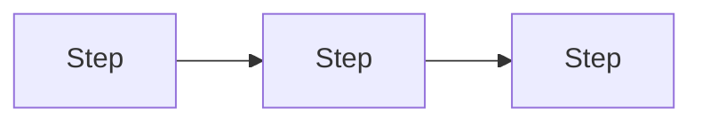

<div align="center">

<picture>
  <source media="(prefers-color-scheme: dark)" srcset="../assets/wordmark-dark.<hash>.svg">
  .svg" alt="aval" width="220">
</picture>

# vX.Y.Z-rc.N

**One line: the promise of this release.**

YYYY-MM-DD &nbsp;·&nbsp; prerelease &nbsp;·&nbsp; **English** &nbsp;·&nbsp; [Español](vX.Y.Z.es.md)

</div>

> [!NOTE]
> This is a release candidate. It ships to npm under the `next` tag and is marked as a prerelease on GitHub. What was not checked by hand, and what feedback is wanted.

> [!WARNING]
> **Breaking change: what stopped working.** What it did before, what it does now, what to run instead, and how a script should change.

## What this release means for you

One paragraph in plain words: what the user can do now that they could not before, and why it matters.

## Highlights

| **Title** | **Title** | **Title** |
| :--- | :--- | :--- |
| One line with a measured number. | One line. | One line. |

| **Title** | **Title** | **Title** |
| :--- | :--- | :--- |
| One line. | One line. | One line. |

## Theme one

<div align="center">
.gif" alt="What the recording shows, step by step" width="100%">
</div>

What it does for the user and why. Then how it works.

| Piece | What it does | Safety net |
| :--- | :--- | :--- |
| **Name** | One sentence. | What protects the user. |

```sh
aval <command>   # a comment that says what happens
```



## Fixes

- **scope:** what was wrong, now in the user's words.

## Upgrade notes

> [!IMPORTANT]
> These are the behaviour changes to know about before you upgrade.

- **Change.** What to do about it.

## Known limits

- **Limit.** Why, and the workaround.

## Verify this release

```sh
gh release download vX.Y.Z-rc.N -R alvaroofernaandez/aval
shasum -a 256 -c SHA256SUMS --ignore-missing
gh attestation verify aval_X.Y.Z-rc.N_<os>_<arch>.tar.gz --repo alvaroofernaandez/aval
npx @alvaroofernaandez/aval@next version
```

<details>
<summary><b>For contributors</b></summary>

- Engineering changes: architecture, tests, ADRs, skills.

</details>
