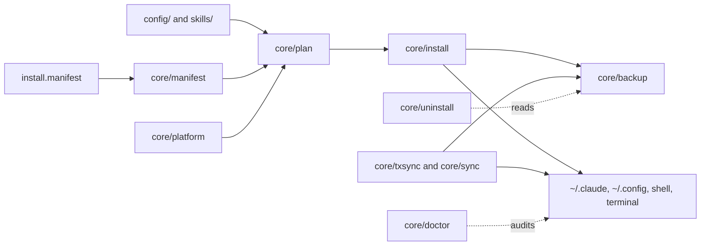

# Architecture

aval is one Go binary, `cmd/aval`, over packages grouped by domain in `internal/`. This page is the map. The rules behind it are [ADR 0002](docs/adr/0002-internal-layering.md) and the generated [architecture model](docs/architecture/model.md); `go test ./tests/ -run Architecture` enforces both, and keeps this page in step with the tree.

## Package map

Layers, from the top: `cmd/aval` may import anything; `ui/cli` sits on `ui`, `ui/caps` and `i18n`; `ui` sits on `core/*`, `devmode`, `i18n`, `release` and `ui/caps`; `core/*` imports only `core/*` and `release`; `design/hook` imports only `design/ack`. Every other package is a leaf: it imports nothing internal outside its tests.

| Package | Layer | What it does |
| :-- | :-- | :-- |
| `cmd/aval` | entry | Parses the command line and wires each command to its package. |
| `internal/core/manifest` | core | Reads `install.manifest`, the single source of what is installed and where. |
| `internal/core/plan` | core | Turns the manifest and a platform into the list of links to make. |
| `internal/core/platform` | core | Detects the OS, the shell and what the machine can do. |
| `internal/core/install` | core | Executes a plan; whatever it displaces goes to a backup first. |
| `internal/core/backup` | core | Records every move under `~/.aval-backup`, so any change can be undone. |
| `internal/core/sync` | core | Keeps live agent settings (`~/.claude/settings.json`) aligned with the repo. |
| `internal/core/txsync` | core | Runs sync as a transaction: back up, apply, verify, undo on failure. |
| `internal/core/doctor` | core | Audits the machine against the repo: links, settings, hooks, tools. |
| `internal/core/deps` | core | The external tool inventory (`deps.manifest`, embedded) and its offline, parallel probes. |
| `internal/core/uninstall` | core | Removes aval's links and puts back what they displaced. |
| `internal/core/update` | core | Refreshes an installation: pull, then re-apply. |
| `internal/core/config` | core | Owns the aval config file (`key = value`). |
| `internal/core/repoloc` | core | Finds the aval repository on disk. |
| `internal/ui` | ui | The hub: themes, screens, the preview, confirm, run, result rhythm. |
| `internal/ui/caps` | leaf | Detects what the terminal can render, from the environment only. |
| `internal/ui/cli` | ui | Status glyphs and words for plain command output. |
| `internal/i18n` | leaf | The message catalog, English and Spanish, with plurals. |
| `internal/release` | leaf | Versions, preflight checks and notes from git history. |
| `internal/relay` | leaf | The context relay core: when to relay and what the new context holds, with no I/O. |
| `internal/devmode` | leaf | The `aval dev` sandbox: a throwaway HOME for trying aval. |
| `internal/deck` | leaf | Renders a JSON slide spec into a PDF deck. |
| `internal/agent/budget` | leaf | Measures always-on context and hook latency per agent. |
| `internal/agent/fmthook` | leaf | Hook that formats the file an agent just edited with its project's formatter. |
| `internal/agent/lessons` | leaf | Hook that injects a short lesson when a tool call matches it. |
| `internal/agent/prepush` | leaf | The git pre-push gate against employer material and secrets. |
| `internal/agent/rateguard` | leaf | Hook that stops bursts of requests to hosts that ban rapid clients. |
| `internal/agent/repoprofile` | leaf | SessionStart hook that tells the agent the project's stack. |
| `internal/agent/review` | leaf | Sizes a code review from git: a risk tier and the lenses to run. |
| `internal/agent/rtkhook` | leaf | Hook that rewrites Bash commands through `rtk`. |
| `internal/agent/rules` | leaf | Mirrors the blocking rules of CLAUDE.md into OpenCode's AGENTS.md. |
| `internal/agent/statusline` | leaf | Renders Claude Code's status line. |
| `internal/design/ack` | leaf | Records that the design pipeline ran for a project. |
| `internal/design/gate` | leaf | Design gates: contrast, tokens, hardcoded values, specs, emoji. |
| `internal/design/hook` | hook | The design hooks: deny UI edits until ack, ask for a render. |
| `internal/devops/dockerclean` | leaf | Reclaims Docker space on Kiri, never touching volumes. |
| `internal/devops/kiri` | leaf | Makes Docker ready on Kiri, idempotently. |
| `internal/devops/reaper` | leaf | Ends orphaned test processes. |
| `internal/docs/pdfreport` | leaf | Scaffolds a print-grade A4 PDF project. |
| `internal/term/macos` | leaf | macOS defaults and the screenshot LaunchAgent. |
| `internal/term/tmux` | leaf | Helpers tmux, Ghostty, yazi and the prompt call. |
| `internal/term/tmux/e2e` | leaf | Real-tmux integration tests for those helpers. |
| `internal/testenv` | leaf | Cross-OS test helpers. |
| `tools/brand` | tool | Generates the README images; not part of the binary. |

## Data flow

The repository declares; the machine follows. Nothing is written without a backup, and the hub only reads.

1. `core/manifest` reads `install.manifest`; `core/plan` combines it with `core/platform` into links.
2. `core/install` makes the links after moving anything in the way into `core/backup`.
3. `core/txsync` keeps the live settings in line, in a transaction that `core/doctor` verifies.
4. `core/uninstall` and `aval restore` read the backup to put the machine back.

## Where a change goes

| I want to… | Where | Reference test |
| :-- | :-- | :-- |
| Add a command | `cmd/aval` (dispatch in `main.go`), logic in its domain package | `tests/cli_smoke_test.go` |
| Add a hook | `internal/agent/<name>`, wired in `cmd/aval/agent_hook.go` and `config/claude/settings.json` | `tests/hooks_e2e_test.go` |
| Change what is installed | `install.manifest`, never a hard-coded path | `tests/manifest_test.go` |
| Change how settings sync | `internal/core/sync`, `internal/core/txsync` | `internal/core/sync` tests |
| Add a design gate | `internal/design/gate` | `tests/design_pipeline_test.go` |
| Add user-facing text | `internal/i18n` catalogs, both languages | `internal/i18n/catalog_test.go` |
| Add a shared skill | `skills/`, fanned out by the manifest | `tests/distributed_skills_test.go` |
| Add a package or an import | The layers above; a new edge needs an ADR | `tests/architecture_test.go` |
| Add a dependency | A row in [docs/dependencies.md](docs/dependencies.md) | `tests/dependencies_test.go` |
| Grow a file or a function | Limits: 500 lines per file, 60 per function, complexity 15; the exceptions in `tests/testdata/quality-allowlist.txt` only shrink | `tests/quality_test.go` |
| Change CI | `.github/workflows/ci.yml` | `tests/workflows_test.go` |
| Cut a release | `aval release`, see [docs/releasing.md](docs/releasing.md) | `internal/release` tests |
