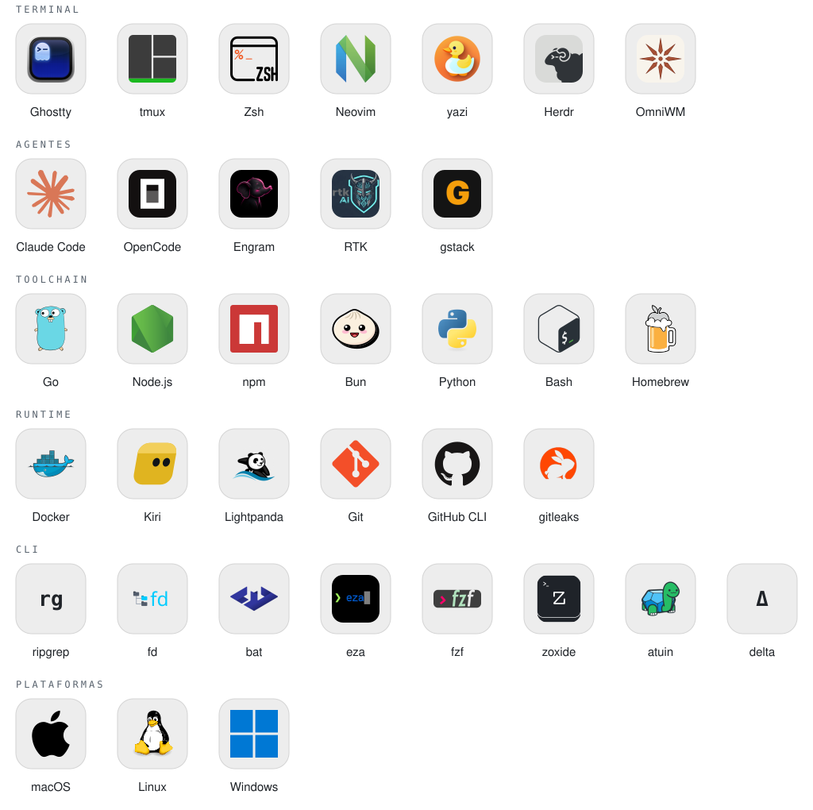

<div align="center">

<picture>
  <source media="(prefers-color-scheme: dark)" srcset="docs/assets/hero-dark.6704cc71.svg">
  
</picture>

<br/>
<br/>


<br/>

[**Qué es**](#qué-es-aval) &nbsp;·&nbsp;
[**Garantías**](#garantías) &nbsp;·&nbsp;
[**Stack**](#stack) &nbsp;·&nbsp;
[**Instalar**](#instalar) &nbsp;·&nbsp;
[**Dentro**](#dentro) &nbsp;·&nbsp;
[**Guía completa →**](docs/guide.md)

</div>

<br/>

## Qué es aval

<picture>
  <source media="(prefers-color-scheme: dark)" srcset="docs/assets/mark-dark.a2bb352f.svg">
  
</picture>

Un **harness** es todo lo que rodea a un agente de IA para que trabaje bien:
instrucciones, memoria, skills, hooks, gates y el entorno donde corre.
aval es el mío, versionado y con tests, instalable en una máquina nueva con
un comando.

El nombre es la tesis. En español, un aval es una **garantía**: alguien
responde por algo. Aquí cada afirmación
tiene detrás un mecanismo que la comprueba. Por eso, en el logo, la **v** es
un check: la garantía está dentro del nombre.

<br/>

## Garantías

| Lo que se promete | Cómo se comprueba |
| :--- | :--- |
| Ningún secreto llega a git | `gitleaks` revisa el árbol **y todo el historial** en cada ejecución de los tests |
| Nada se implementa sin test | TDD estricto: el agente emite un `[tdd-gate]` con el test que falla antes de escribir código |
| Nada visual se aprueba a ojo | Un hook bloquea la edición de UI hasta pasar el pipeline de diseño; los gates **miden** el contraste |
| Una sola fuente de verdad | Los dos instaladores leen `install.manifest`; un test falla si divergen |
| Nada se borra al instalar | Lo que existiera se mueve a `~/.aval-backup/<fecha>/` antes de enlazar |
| El agente no olvida | Memoria persistente con Engram entre sesiones y compactaciones |

<br/>

## Stack

<picture>
  <source media="(prefers-color-scheme: dark)" srcset="docs/assets/stack-dark.00b41a7d.svg">
  
</picture>

<sub>Logos oficiales de cada proyecto (<a href="docs/logos/SOURCES.md">procedencia</a>). ripgrep y delta no publican logo: llevan sus iniciales en vez de uno inventado.</sub>

<br/>

## Instalar

```sh
git clone https://github.com/alvaroofernaandez/aval.git ~/aval
cd ~/aval && ./install.sh --dry-run && ./install.sh
```

Con Go instalado, el arranque de un comando compila la TUI multiplataforma:

```sh
curl -fsSL https://raw.githubusercontent.com/alvaroofernaandez/aval/main/scripts/install.sh | sh
aval update   # git pull + enlaza lo nuevo
```

> [!NOTE]
> `npx @alvaroofernaandez/aval` y los binarios precompilados se publican desde CI y aún no están disponibles con el nombre nuevo.

<br/>

## Dentro

| | Qué | Detalle |
| :--- | :--- | :--- |
| `config/claude` · `config/opencode` | Instrucciones, agentes, hooks, comandos | [Agentes](docs/guide.md#-agentes) |
| `shared/skills` | Skills compartidas por todos los agentes | [Skills](docs/guide.md#-skills-compartidas) |
| `config/ghostty` · `config/tmux` | Terminal, barra de estado de ~32 ms, sidebar de yazi | [Barra](docs/guide.md#-barra-de-estado) · [Sidebar](docs/guide.md#-barra-lateral-de-archivos) |
| `home/` | zsh, p10k, git | [Shell](docs/guide.md#-shell-y-herramientas) |
| `cmd/aval` · `internal/` · `npm/` | Instalador TUI en Go | [Instalación](docs/guide.md#-instalación) |
| `install.manifest` | Qué se instala y dónde: fuente única | [Mapa](docs/guide.md#️-mapa-del-repositorio) |
| `pins/` | Commit exacto de cada skill de terceros | [Agentes](docs/guide.md#-agentes) |
| `tests/` | Shell, Go y npm en una sola orden: `./tests/run-all.sh` | [Tests](docs/guide.md#-tests) |

<br/>

<div align="center">

<picture>
  <source media="(prefers-color-scheme: dark)" srcset="docs/assets/wordmark-dark.3ba4fd49.svg">
  
</picture>

<sub>Imágenes generadas con <code>python3 docs/brand.py</code> · cada logo del stack es marca registrada de su proyecto</sub>

</div>
