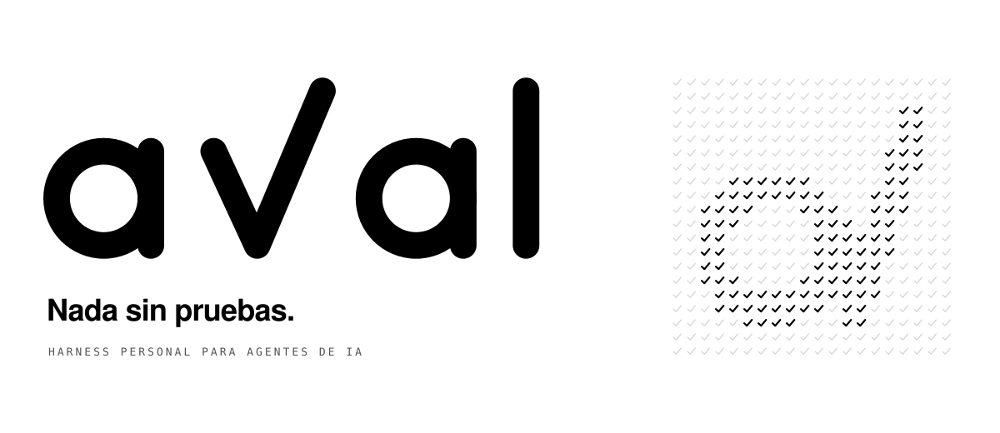
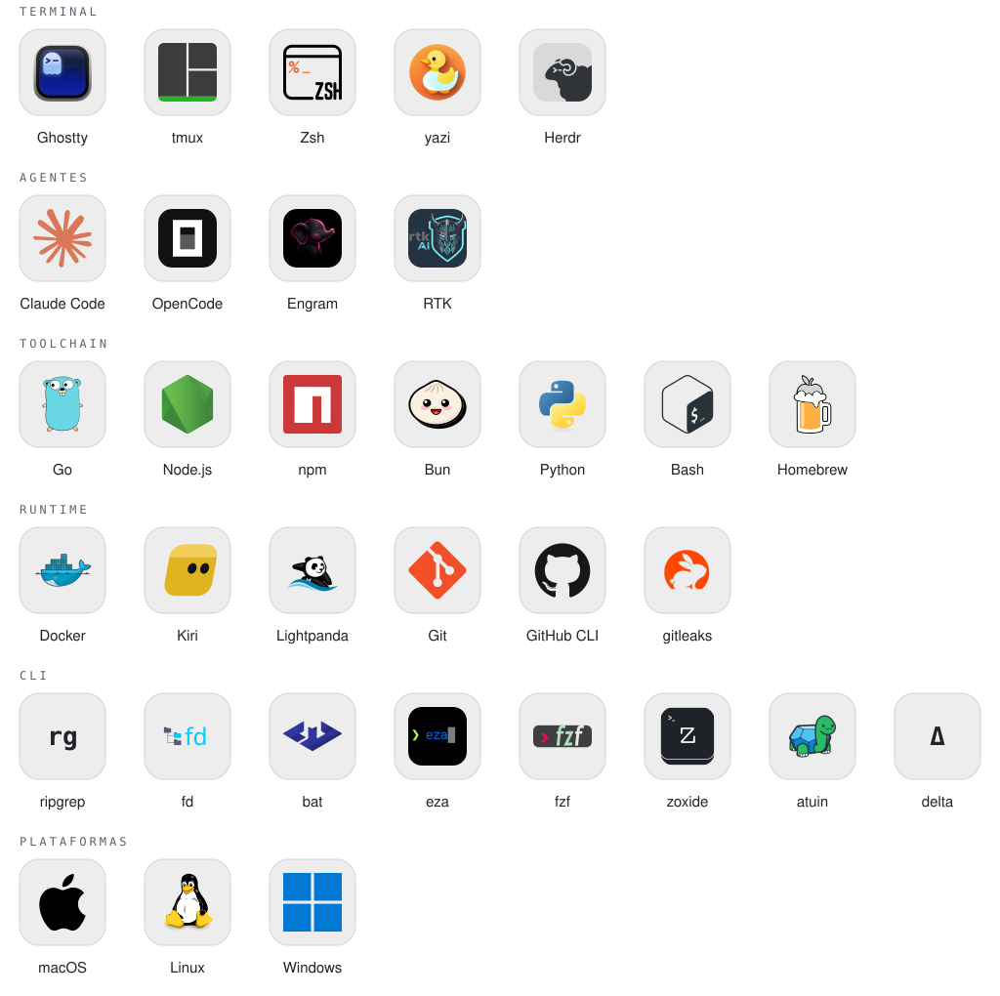

<div align="center">

<picture>
  <source media="(prefers-color-scheme: dark)" srcset="docs/assets/hero-dark.6704cc71.svg">
  
</picture>

<br/>
<br/>


<br/>

[**Qué es**](#qué-es-aval) &nbsp;·&nbsp;
[**Garantías**](#garantías) &nbsp;·&nbsp;
[**Stack**](#stack) &nbsp;·&nbsp;
[**Instalar**](#instalar) &nbsp;·&nbsp;
[**Comandos**](#comandos) &nbsp;·&nbsp;
[**Dentro**](#dentro) &nbsp;·&nbsp;
[**Principios**](#principios) &nbsp;·&nbsp;
[**Guía completa →**](docs/guide.md)

</div>

<br/>

## Qué es aval

<picture>
  <source media="(prefers-color-scheme: dark)" srcset="docs/assets/mark-dark.a2bb352f.svg">
  
</picture>

aval es un **harness de ingeniería para agentes de IA**: las reglas, la
memoria, las skills, los hooks y los controles de calidad con los que Claude
Code y OpenCode trabajan, junto con el entorno de terminal donde se ejecutan.
Es un único binario de Go, versionado, cubierto por tests e instalable en macOS,
Linux y Windows.

Su principio está en el nombre: un aval es una **garantía**. Ninguna regla
depende de la buena voluntad del agente; cada una tiene detrás un mecanismo que
la verifica, ya sea un test, un hook o un control con resultados medidos. Por eso
la **v** del logotipo es un check.

<br/>

## Garantías

| Lo que se promete | Cómo se comprueba |
| :--- | :--- |
| Ningún secreto llega a git | `gitleaks` revisa el árbol **y todo el historial** en cada ejecución de los tests |
| Nada se implementa sin test | TDD estricto: el agente emite un `[tdd-gate]` con el test que falla antes de escribir código |
| Nada visual se aprueba a ojo | Un hook bloquea la edición de UI hasta pasar el pipeline de diseño; los gates **miden** el contraste |
| Una sola fuente de verdad | La TUI, `--yes`, `update`, `doctor` y `uninstall` leen `install.manifest`; nada lleva su propia lista |
| Nada se borra al instalar | Lo que existiera se mueve a `~/.aval-backup/<fecha>/` antes de enlazar |
| El agente no olvida | Memoria persistente con Engram entre sesiones y compactaciones |

<br/>

## Stack

<picture>
  <source media="(prefers-color-scheme: dark)" srcset="docs/assets/stack-dark.ba66d22a.svg">
  
</picture>

<sub>Logos oficiales de cada proyecto (<a href="docs/logos/SOURCES.md">procedencia</a>). ripgrep y delta no publican logo: llevan sus iniciales en vez de uno inventado.</sub>

<br/>

## Instalar

```sh
go install github.com/alvaroofernaandez/aval/cmd/aval@latest   # o el paquete npm, o el binario de Releases
git clone https://github.com/alvaroofernaandez/aval.git ~/aval && cd ~/aval

aval                  # TUI: elige qué instalar
aval --yes --dry-run  # sin TUI: muestra qué haría, no toca nada
aval --yes            # sin TUI: instala todo lo que aplica (--copy copia en vez de enlazar)
```

`aval` busca `install.manifest` en el repo: ejecútalo dentro del clon o pasa `--repo <ruta>`.
Los subcomandos que no dependen del repo (`hook`, `design`, `tmux`, `pdf`…) funcionan solo con el binario.
Lo instalado a propósito con Homebrew está en el `Brewfile` (`brew bundle --file=Brewfile`).

Lo privado (nombres de empresa, skills de cliente) vive fuera del repo, en `~/.config/aval/private`
(o `$AVAL_PRIVATE_DIR`): un `settings.json` que `aval sync` fusiona encima y un `links.manifest` que enlaza.

> [!NOTE]
> `npx @alvaroofernaandez/aval` y los binarios precompilados se publican desde CI y aún no están disponibles con el nombre nuevo.

<br/>

## Comandos

| Orden | Para qué |
| :--- | :--- |
| `aval doctor` | Revisa enlaces, hooks, agentes y settings (`--fix`, `--json`, `--security`) |
| `aval sync` | Vuelca lo que gestiona el repo en `~/.claude/settings.json` y en Codex/Gemini; transaccional (`--dry-run`, `--check`) |
| `aval update` | `git pull` + enlaza lo nuevo (`--dry-run`) |
| `aval restore` · `aval uninstall` | Deshacen una instalación o sync desde `~/.aval-backup` (`--list`, `latest`, `<id>`, `--pin`) · quitan solo los enlaces de este repo |
| `aval budget` | Contexto siempre activo por agente y latencia de cada hook; sale con 1 si se pasa |
| `aval review assess` | Nivel de riesgo del diff, solo con git, y qué revisores lanzar |
| `aval rules sync` | Replica las reglas compartidas de `CLAUDE.md` y las lecciones en el `AGENTS.md` de OpenCode (`--check`) |
| `aval hook <nombre>` | `lessons` · `design-gate` · `design-shot-stop` · `rtk-rewrite` · `repo-profile` · `pre-push` |
| `aval statusline` | Línea de estado de Claude Code |
| `aval design ack <superficie>` · `aval design gate <…>` | Ack del pipeline de diseño · gates medidos: `contrast`, `tokens`, `pairs`, `hardcodes`, `theme-refs`, `component`, `emoji`, `native` |
| `aval tmux <…>` | `sidebar-toggle`, `sidebar-follow`, `sidebar-watch`, `open-file`, `close-file`, `paste-router`, `statusbar`, `launch` |
| `aval macos <…>` | `defaults`, `screenshot-clipboard install` / `copy` |
| `aval kiri up` · `aval docker cleanup` | Deja Docker listo sobre Kiri · prunes seguros (`--dry-run`) |
| `aval pdf init` · `aval pdf assets` | Proyecto de informe PDF · `assets/brand.css` |
| `aval reap-orphan-tests` | Termina procesos de test huérfanos (`--min-age`, `--dry-run`) |

Detalle de cada una en la [guía](docs/guide.md#️-comandos).

<br/>

## Dentro

| | Qué | Detalle |
| :--- | :--- | :--- |
| `config/claude` · `config/opencode` | Instrucciones, agentes, hooks, comandos | [Agentes](docs/guide.md#-agentes) |
| `skills/` | Skills compartidas por todos los agentes | [Skills](docs/guide.md#-skills-compartidas) |
| `config/ghostty` · `config/yazi*` · `config/herdr-*` · `home/tmux.conf` | Terminal, barra de estado, sidebar de yazi, Herdr | [Barra](docs/guide.md#-barra-de-estado) · [Sidebar](docs/guide.md#-barra-lateral-de-archivos) |
| `home/` | zsh, p10k, git | [Shell](docs/guide.md#-shell-y-herramientas) |
| `cmd/aval` · `internal/` · `npm/` | El binario, por dominios, y su empaquetado | [Mapa](docs/guide.md#️-mapa-del-repositorio) |
| `install.manifest` | Qué se instala y dónde: fuente única | [Instalación](docs/guide.md#-instalación) |
| `tests/` | Tests de integración en Go | [Tests](docs/guide.md#-tests) |

<br/>

## Principios

- **Un solo binario de Go.** Toda la lógica propia es Go; sin shell ni Python propios, salvo los dotfiles de zsh (`home/`) y el shim de 3 líneas de `.githooks/pre-push` (git exige un ejecutable).
- **Manifiesto declarativo.** `install.manifest` dice qué se instala y dónde; el código lee datos, no rutas.
- **Sin upstream vendorizado.** Dependencias como módulos, no árboles copiados.
- **Nada se borra.** Todo lo desplazado se guarda en `~/.aval-backup` y `aval restore` lo devuelve.

[Contribuir](CONTRIBUTING.md) · [Licencia MIT](LICENSE) · [Seguridad](SECURITY.md) · [Código de conducta](CODE_OF_CONDUCT.md)

<br/>

<div align="center">

<picture>
  <source media="(prefers-color-scheme: dark)" srcset="docs/assets/wordmark-dark.3ba4fd49.svg">
  
</picture>

<sub>Imágenes generadas con <code>go run ./tools/brand</code> · cada logo del stack es marca registrada de su proyecto</sub>

</div>
