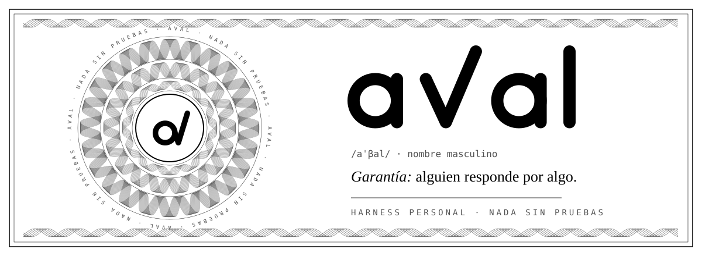
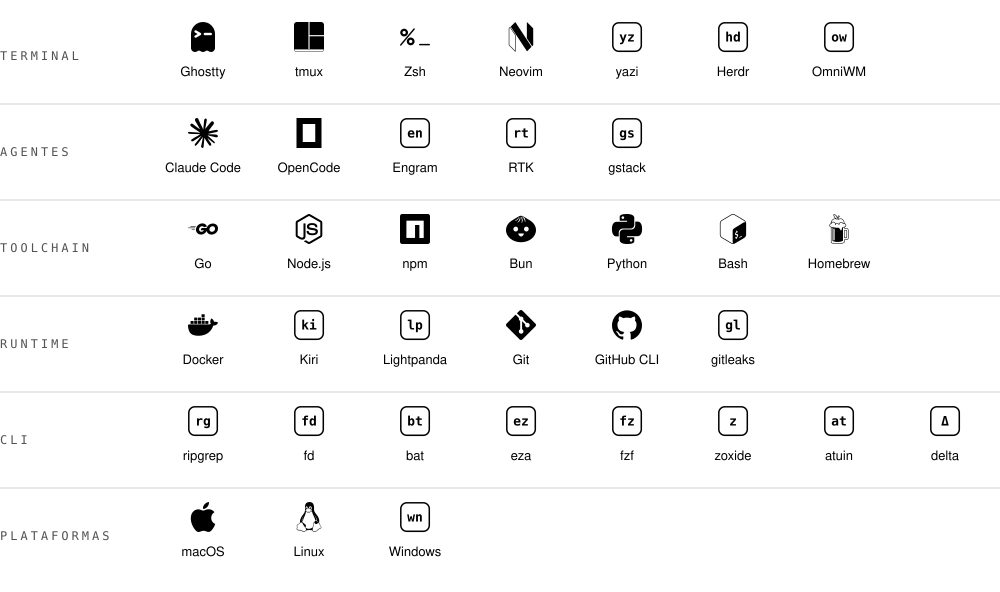

<div align="center">

<picture>
  <source media="(prefers-color-scheme: dark)" srcset="docs/assets/hero-dark.svg">
  
</picture>

<br/>
<br/>

Terminal, agentes de IA y macOS en un solo repositorio.<br/>
Cada pieza documentada. Toda la lógica propia, con tests.

<br/>

```sh
npx @alvaroofernaandez/dotfiles-installer
```

[](https://www.npmjs.com/package/@alvaroofernaandez/dotfiles-installer)


<br/>

[**Stack**](#stack) &nbsp;·&nbsp;
[**Instalar**](#instalar) &nbsp;·&nbsp;
[**Dentro**](#dentro) &nbsp;·&nbsp;
[**Principios**](#principios) &nbsp;·&nbsp;
[**Guía completa →**](docs/guide.md)

</div>

<br/>

## Stack

<picture>
  <source media="(prefers-color-scheme: dark)" srcset="docs/assets/stack-dark.svg">
  
</picture>

<sub>Los cuadros con iniciales son herramientas sin logo publicado: mejor un monograma que un logo inventado.</sub>

<br/>

## Instalar

```sh
# Siempre la última versión, sin instalar nada
npx @alvaroofernaandez/dotfiles-installer

# Sin Node
curl -fsSL https://raw.githubusercontent.com/alvaroofernaandez/dotfiles/main/scripts/install.sh | sh

# A mano
git clone https://github.com/alvaroofernaandez/dotfiles.git ~/dotfiles
cd ~/dotfiles && ./install.sh --dry-run && ./install.sh
```

```sh
dotfiles-installer update   # git pull + enlaza lo nuevo
```

> [!IMPORTANT]
> Nada se borra. Lo que ya existiera en el destino se mueve a `~/.dotfiles-backup/<fecha>/`.

<br/>

## Dentro

| | Qué | Detalle |
| :--- | :--- | :--- |
| `config/ghostty` | Terminal, tema, arranque en tmux | [Arranque](docs/guide.md#-arranque) |
| `config/tmux` | Barra de estado de ~32 ms y sidebar de yazi | [Barra](docs/guide.md#-barra-de-estado) · [Sidebar](docs/guide.md#-barra-lateral-de-archivos) |
| `home/` | zsh, p10k, git | [Shell](docs/guide.md#-shell-y-herramientas) |
| `config/claude` · `config/opencode` | Instrucciones, agentes, hooks, comandos | [Agentes](docs/guide.md#-agentes) |
| `shared/skills` | Skills compartidas por todos los agentes | [Skills](docs/guide.md#-skills-compartidas) |
| `cmd/` · `internal/` · `npm/` | Instalador TUI en Go, publicado en npm | [Instalación](docs/guide.md#-instalación) |
| `install.manifest` | Qué se instala y dónde: fuente única | [Mapa](docs/guide.md#️-mapa-del-repositorio) |
| `tests/` | Shell, Go y npm en una sola orden | [Tests](docs/guide.md#-tests) |

<br/>

## Principios

**Una sola lista.** Los dos instaladores leen `install.manifest`; un test falla si divergen.

**Ningún secreto en git.** Las credenciales viven en `~/.config/zsh/secrets.zsh` (modo `600`, fuera del repo). `gitleaks` revisa el árbol **y todo el historial** en cada ejecución de los tests. [Más →](docs/guide.md#-secretos)

**Medir antes de opinar.** Cada decisión del repo está documentada con el dato que la provocó.

**TDD estricto.** Primero el test que falla, después el código.

```sh
./tests/run-all.sh
```

<br/>

<div align="center">

<sub>Imágenes generadas con <code>python3 docs/brand.py</code> · logos de <a href="https://simpleicons.org">Simple Icons</a> (CC0)</sub>

</div>
