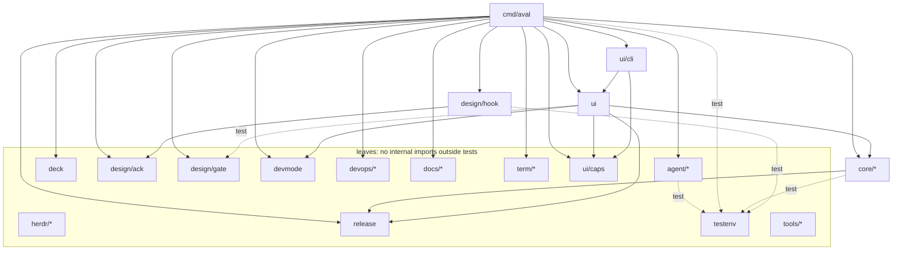

# Architecture model

<!-- Generated by tests/architecture_test.go. Do not edit by hand. -->
<!-- Regenerate: go test ./tests/ -run TestArchitectureModel -update -->

The component graph of the Go packages, read from `go list` for linux, darwin and windows.
Families of packages fold into one node (`core/*`, `agent/*`). A solid arrow is a production
import; a dotted one exists only in tests. `tests/` (the repository checks) is left out.

`TestArchitectureLayeringHolds` enforces the rules below; changing them needs an ADR in `docs/adr/`.

## Rules

| Package | May import | In tests only | Why |
| :--- | :--- | :--- | :--- |
| `cmd/aval` | `internal/*` | - | composition root: wires every package |
| `internal/ui` | `internal/core/*`, `internal/devmode`, `internal/release`, `internal/ui/caps` | `internal/design/gate` | the hub drives core use cases; tests check the design gate |
| `internal/ui/cli` | `internal/ui`, `internal/ui/caps` | - | plain-terminal front end over the ui models |
| `internal/ui/caps` | nothing internal | - | leaf: terminal capabilities |
| `internal/core/*` | `internal/core/*`, `internal/release` | - | domain: install, sync, doctor, update |
| `internal/design/hook` | `internal/design/ack` | - | the PreToolUse gate reads the ack it checks |
| `internal/design/ack` | nothing internal | - | leaf |
| `internal/design/gate` | nothing internal | - | leaf |
| `internal/agent/*` | nothing internal | - | leaf: agent hooks and helpers |
| `internal/devops/*` | nothing internal | - | leaf: docker and runtime helpers |
| `internal/term/*` | nothing internal | - | leaf: terminal integrations |
| `internal/docs/*` | nothing internal | - | leaf: document renderers |
| `internal/herdr/*` | nothing internal | - | leaf: herdr mods |
| `internal/deck` | nothing internal | - | leaf |
| `internal/release` | nothing internal | - | leaf |
| `internal/devmode` | nothing internal | - | leaf |
| `internal/testenv` | nothing internal | - | leaf: test-only helpers |
| `tools/*` | nothing internal | - | leaf: build-time tools |
| `tests` | nothing internal | - | repository checks: drive the binary, import nothing internal |

Everywhere: `internal/testenv` only from test files, and nothing imports `cmd/aval`.

## Exceptions

0 counted exceptions. The list may shrink, never grow.
