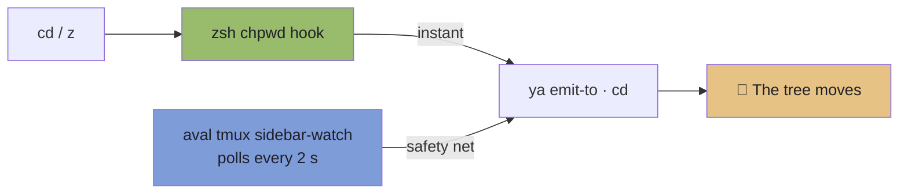

<div align="center">

# aval: the complete guide

<sub><a href="../README.md">← back to the README</a></sub>

The harness from the inside: a single Go binary that installs, syncs and verifies the
configuration of **Claude Code** and **OpenCode** plus a terminal environment (**tmux**, **yazi**, **Ghostty**).<br/>
Every piece is documented and all of the project's own logic is covered by tests.

<br/>

**[⚡ Installation](#-installation)** ·
**[⌨️ Commands](#️-commands)** ·
**[🗺️ Map](#️-repository-map)** ·
**[📊 Status bar](#-status-bar)** ·
**[📂 Sidebar](#-file-sidebar)** ·
**[🤖 Agents](#-agents)** ·
**[🔐 Secrets](#-secrets)** ·
**[🧪 Tests](#-tests)**

</div>

---

## 🎯 At a glance

<div align="center">

</div>

<br/>

On the left, the **yazi** tree; on the right, your shell. At the top, the bar with
CPU · GPU · RAM · time · date, and the **`[FILES]`** button, which is clickable.
**The tree follows your directory**: switch with `cd` or `z` and the pane moves on its own.

| I want to… | Press |
| :--- | :--- |
| 📂 Open or close the tree | `Alt+t` · `prefix`+`e` · click **`[FILES]`** |
| 📄 Open a file | `Enter` on it (opens in a new window) |
| ❌ Close that file | `Ctrl+X` · `Alt+w` · `prefix`+`k` |
| 🪟 Floating scratch pane | `Alt+g` |
| ↔️ Move between splits | `Cmd+Alt+H/J/K/L` · `Cmd+[` · `Cmd+]` |

---

## ⚡ Installation

Three ways to get the binary; everything else is the same.

| Route | Command |
| :--- | :--- |
| Go | `go install github.com/alvaroofernaandez/aval/cmd/aval@latest` |
| npm | `npx @alvaroofernaandez/aval install` (or `npm i -g @alvaroofernaandez/aval`); no clone needed |
| Binary | The Releases page, with `SHA256SUMS` |

> [!NOTE]
> The npm package named `aval` and the prebuilt binaries are published by CI and are not yet
> available under the new name.

On a terminal, a bare `aval` opens the **hub**: the wordmark, a status panel (version from the update cache, repo, doctor, last backup, theme) and a menu. Opening it writes nothing and makes no network calls. Each entry has an icon and, when there is something to know, a badge. A detail pane follows the cursor, and the letters in the footer jump straight to an entry.

```text
                       ▗██              ██  Version  0.3.0 · ! 0.3.1 available
                      ▗██▘              ██  Repo     ~/.aval
     ▄▄▄▄▄▄▄▖  ▗▄▖    ▟█▘    ▗▄▄▄▄▄▄▄   ██  Doctor   ! 1 warn
   ▗██▀▀▀▜██▌  ▝██▖  ▟█▛    ▟█▛▀▀▀███   ██  Backup   today 12:54 · install
   ██▘    ▜█▌   ▝██▖▟█▛    ▐█▛    ▝██   ██  Theme    mono
   ▜█▙▖  ▄██▌    ▝███▛     ▝██▄  ▗▟██   ██
    ▀▜████▜█▌     ▝█▛       ▝▀████▛██   ██
  Nothing passes without evidence.                               macOS (arm64)
  ────────────────────────────────────────────────────────────────────────────

  Set up  › ⇣ Install        │ ⇣ Install                                     i
            ⟳ Update     ↑ 3 │ Link the repo configs into this home.
            ⇄ Sync           │
  Health    ⊞ Doctor     ! 1 │ Repo      ~/.aval
  Undo      ◷ Backups      4 │ Last run  today 12:54
            ⌫ Uninstall      │
  Tools     ⎈ Settings       │ enter  pick what to link
            ⧉ Dev sandbox  2 │
            ◉ About          │

  ────────────────────────────────────────────────────────────────────────────
  1 warning · open Doctor to see it
  ↑↓ move · enter open · i u s d b x , v a jump · ? help · q quit
```

Every write goes through preview, confirm, run and result. A destructive confirm opens on Cancel and names its safety net. Without a terminal, with `aval help` or `--help`, or with `TERM=dumb`, aval prints the usage byte for byte instead.

Views:

- **Install**: links the repo configs into this home. It previews first, and anything in the way moves to `~/.aval-backup`.
- **Update**: pulls the repo (fast-forward only), then re-applies. It fetches a preview first, stops on a dirty tree, and backs up files in the way.
- **Sync**: merges repo-managed settings into the live config. It previews the drift, backs up, verifies with doctor and rolls back on failure.
- **Doctor**: checks this machine against the repo. It is read-only until you press `f`; the fixes it offers are safe ones (dangling links, settings drift), backed up first.
- **Backups**: lists backup runs and restores one. A restore previews first, confirms on Cancel, and moves foreign content aside instead of deleting it.
- **Uninstall**: removes the links aval made and puts back what they displaced. It previews at once, confirms on Cancel, and names `aval restore latest` as the undo.
- **Settings**: theme, glyphs, motion and update checks. Enter saves, esc discards.
- **Dev sandbox**: a throwaway home for trying aval. Your real home is not touched; reset and remove confirm on Cancel.
- **About**: version, paths and links. Read-only.

Or run `aval install` to go straight to the installer. Without a terminal, `aval` on its own prints the usage and changes nothing. The first run goes through four screens:

1. **Welcome.** If aval cannot find its repository (looked up from `--repo <path>`, `$AVAL_REPO`, the location recorded in `~/.config/aval/config`, then the current directory), it offers to clone it to `~/.aval` or to use a folder you already have. Cloning is always an explicit choice. The location is recorded only after an install completes.
2. **Select.** Each group shows what will happen to its files before anything is written: new, linked, or replaces a file. `→` opens the details, `?` shows every key.
3. **Install.** A progress bar and one line per step. A failure appears inline with its reason, and `ctrl+c` stops after the current step; what was already moved to backup is kept and can be undone.
4. **Done.** Counts, the backup path, the undo command and three next steps.

```sh
aval install                   # TUI: welcome, select, install, done
aval install --yes --dry-run   # no TUI: shows what it would do, touches nothing
aval install --yes             # no TUI: actually links everything
aval install --yes --copy      # copy instead of linking
```

Without a terminal and without `--yes`, `aval install` stops with a clear error instead of opening a TUI.

<div align="center">

</div>

<br/>

| | |
| :--- | :--- |
| **Theme** | The `aval` brand theme by default: ink on your own terminal background, colour only on the state glyphs. Ten community themes are opt-in, see [Configuration](#️-configuration) |
| **Tailored to your OS** | On native Windows it offers the AI agents and git; the terminal environment is greyed out with the reason, and installs in full if it detects WSL |
| **Link or copy** | Symlinks wherever possible; on Windows without Developer Mode it **copies**, because it checks instead of assuming |
| **A single list** | The TUI and `--yes` read **the same `install.manifest`** |

> [!IMPORTANT]
> **`aval` never deletes anything.** If you already have configuration at the destination, it moves it to
> `~/.aval-backup/<timestamp>/` before linking. Running it again is safe: links that already point here
> are left untouched.

> [!NOTE]
> The GIF is a real installation recorded with [VHS](https://github.com/charmbracelet/vhs)
> against a throwaway `$HOME`. Regenerate it with `vhs docs/installer-demo.tape`, the screenshot
> above with `vhs docs/environment.tape`, and the hero with `go run ./tools/brand`.

### Updating

```sh
aval update             # git pull + link anything new (idempotent)
aval update --dry-run   # fetch + which paths and manifest entries would change; touches nothing
```

With a dirty tree, `update` (also with `--dry-run`) refuses and says so. Because the configs are
**symlinks into the repo**, `git pull` already updates everything that is linked; re-linking only covers new
manifest entries and newly added skills.

<details>
<summary><b>What if I install it globally with npm? Does it update itself?</b></summary>

<br/>

**No, and no npm tool does.** npm cannot push an update to a machine; the alternative would be remote code
execution on other people's computers. What the binary does do is **tell you**: on startup it checks the
registry (at most once a day, with a 3 s timeout, silently if there is no network) and, if there is a newer
version, it prints which one and the exact command:

```
A newer version is available: 0.1.42 → 0.1.51
Update with: npm update -g @alvaroofernaandez/aval
```

Disable it with `AVAL_NO_UPDATE_CHECK=1`. The way to stay current without thinking about it is `npx`.

</details>

<details>
<summary><b>How the binary is delivered through npm</b></summary>

<br/>

Each platform ships in **its own package**, referenced as `optionalDependencies` with `os` and `cpu`
fields, the esbuild pattern. npm downloads **only** the one that matches the machine.

```
@alvaroofernaandez/aval          ← the one you install
├── …-darwin-arm64 · …-darwin-x64
├── …-linux-arm64  · …-linux-x64
└── …-win32-arm64  · …-win32-x64
```

**There is no `postinstall` script**: nothing runs at install time, so it works with
`npm ci --ignore-scripts`. They are `optionalDependencies` and not `dependencies` on purpose: as hard
dependencies the install would fail on **every** machine, because five of the six can never be satisfied.
Every push to `main` publishes to npm and builds the binaries for all 6 platforms
(`.github/workflows/npm.yml`, only if the whole suite passes).

</details>

<details>
<summary><b>Why do backups go to a separate directory instead of next to the original?</b></summary>

<br/>

Because tools scan their configuration folders **in full**. A `ship.bak.20260811` inside
`~/.claude/skills` would be loaded as a **second, duplicate skill**, and that actually happened: four
phantom skills showed up in the session. Backups live outside any scanned tree, and a test verifies it.

</details>

### 🔗 What gets linked

Defined by `install.manifest`, grouped into `terminal`, `git`, `claude`, `opencode` and `skills`.

| Source in the repo | Destination | Purpose |
| :--- | :--- | :--- |
| `home/{zshrc,zprofile,p10k.zsh,tmux.conf}` | `~/.zshrc`, `~/.zprofile`, `~/.p10k.zsh`, `~/.tmux.conf` | Shell and tmux |
| `home/gitconfig`, `config/git/ignore`, `config/gh/config.yml` | `~/.gitconfig`, `~/.config/git`, `~/.config/gh` | Git and GitHub CLI |
| `config/yazi`, `config/yazi-sidebar` | `~/.config/yazi`, `~/.config/yazi-sidebar` | File manager and the narrow pane variant |
| `config/ghostty`, `config/atuin/config.toml` | `~/.config/...` | Terminal and history |
| `config/herdr-core/templates`, `config/herdr-app/{keys.json,mods/diff-review}` | `~/.config/herdr-*` | Herdr |
| `config/claude/*` | `~/.claude/*` | Claude Code, **path by path** |
| `config/opencode/*` | `~/.config/opencode/*` | OpenCode, **path by path** |
| `skills/<each one>` | `~/.claude/skills`, `~/.config/opencode/skills`, `~/.opencode/skills` | Skills, **one by one** into all three destinations |

> [!WARNING]
> **Agent directories are linked path by path, never as a whole.**
> `~/.claude` also holds `.credentials.json` and **1.6 GB** of session history;
> `~/.config/opencode` holds `node_modules`. Linking the whole directory would displace all of
> that. Tests verify that `~/.claude` remains a real directory and that the
> credentials survive installation. Claude's `settings.json` is not linked either: it is
> managed by `aval sync`.

### 🚀 Startup

Ghostty runs `aval tmux launch`, which resolves tmux **by absolute path** and attaches each
tab to **its own session** (reusing a free one if there is one). If tmux is missing, it falls back to
a login shell: an absent multiplexer must not leave you without a terminal.

<details>
<summary><b>Why absolute paths everywhere?</b> (the lesson that bit the most times)</summary>

<br/>

Ghostty launches its command like this:

```bash
/usr/bin/login -flp <user> /bin/bash --noprofile --norc -c <command>
```

`--noprofile --norc` means **no shell rc file is read**, and an application launched from the Dock
inherits **launchd's** `PATH`: `/usr/bin:/bin:/usr/sbin:/sbin`. `/opt/homebrew/bin` is not in it.
This broke the environment **three times in a row**, each time with a different symptom:

| Where the absolute path was missing | How it showed up |
| :--- | :--- |
| Ghostty's `command` | `exec: tmux: not found` — no terminal |
| `tmux` inside the helpers | `returned 127` — the key did nothing |
| Command passed to `split-window` | The pane flashed and died |

A dead pane closes **silently**, and running the helper from an interactive shell worked because there
the `PATH` is inherited: the check passed while real usage failed. The tests run with launchd's minimal
`PATH`, the real production environment.

</details>

<details>
<summary><b>Why <code>allow-passthrough on</code> in tmux?</b></summary>

<br/>

yazi sends `DA1`/`DSR` probes at startup to detect the terminal's capabilities. Without
passthrough, tmux blocks them and yazi shows **"Terminal response timeout"** for several
seconds before drawing anything.

</details>

### 📦 Dependencies

Everything deliberately installed with Homebrew is in the `Brewfile`: `brew bundle --file=Brewfile`.

---

## ⌨️ Commands

Full reference. `aval help` prints the usage, and so does a bare `aval` without a terminal (on a terminal it opens the hub). Global flags: `--repo`, `--version`.

| Command | What it does | Needs the repo |
| :--- | :--- | :---: |
| `aval install [--yes] [--dry-run] [--copy]` | Installs (with or without the TUI) and records the repo location | yes |
| `aval update [--dry-run]` | `git pull` + link anything new | yes |
| `aval doctor [--fix] [--json] [--security]` | Checks the machine against the repo | yes |
| `aval sync [--dry-run] [--check]` | Pushes managed settings into the live `settings.json` and into Codex/Gemini | yes |
| `aval rules sync [--check]` | Replicates shared `CLAUDE.md` rules and lessons into OpenCode's `AGENTS.md` | yes |
| `aval restore [--list] [latest\|<id>] [--pin <id>]` | Undoes an install or sync | yes |
| `aval uninstall [--dry-run] [--yes]` | Removes this repo's links and returns what was displaced | yes |
| `aval budget [--json] [--skip-hooks] [--runs N]` | Always-on context and hook latency | no |
| `aval usage [--by project\|session\|day\|consumer] [--window 5h\|7d] [--json] [--check] [--rate-limits <file\|->]` | Tokens, cost or plan share from the local agent transcripts; `--check` exits 1 when a budget is over | no |
| `aval deps [--json] [--layer harness\|agent\|env]` | External tool inventory: layer, users, effect if missing, native substitute, and whether each is installed; exits 1 when a blocking tool is missing | no |
| `aval review assess [--base <ref>] [--json]` | Risk level of the diff and reviewers | no |
| `aval hook <name>` | Agent hooks (JSON on stdin): `lessons`, `rate-guard`, `design-gate`, `plan-gate`, `design-shot-stop`, `rtk-rewrite`, `repo-profile`, `pre-push`, `fmt` | no |
| `aval statusline` | Claude Code status line | no |
| `aval design ack <surface>` | Design pipeline ack (required by the `design-gate` hook) | no |
| `aval design gate <gate> …` | `contrast <fg> <bg> [--large]` · `tokens` · `pairs <colors.json> [--aaa]` · `hardcodes [--ext] [--no-tw]` · `theme-refs --theme` · `component [--root]` · `emoji` · `native` | no |
| `aval tmux <name>` | `sidebar-toggle` · `sidebar-follow` · `sidebar-watch` · `open-file` · `close-file` · `paste-router` · `statusbar` · `launch` | no |
| `aval macos <…>` | `defaults` · `screenshot-clipboard install` · `screenshot-clipboard copy` | no |
| `aval kiri up` | Gets Docker ready on Kiri (idempotent, deletes nothing) | no |
| `aval docker cleanup [--dry-run]` | Safe prunes, only against the `kiri` context | no |
| `aval deck build <spec.json> -o <out.pdf> [--plan <plan.md>] [--open]` · `check` · `example` | Plan deck: a JSON spec rendered as a dark aval-brand PDF with the local Chrome, Brave, Edge or Chromium (`AVAL_CHROME` overrides); `--plan` unlocks the `plan-gate` hook | no |
| `aval pdf init <dir>` · `aval pdf assets [dir]` | PDF report project · `assets/brand.css` | no |
| `aval reap-orphan-tests [--min-age s] [--dry-run]` | Terminates orphaned test processes (launched by a LaunchAgent) | no |
| `aval dev [shell\|run\|diff\|project\|ls\|reset\|rm]` | Tries aval in a sandbox without touching your machine ([dev mode](devmode.md)) | yes |

### 🩺 Doctor, sync and the private layer

```sh
aval doctor            # STATUS · CHECK · MESSAGE table; exits 1 if anything fails
aval doctor --json     # the same as a JSON array
aval doctor --fix      # removes broken links and runs sync
aval doctor --security # extra checks, see below
aval sync --dry-run    # shows which keys would change, writes nothing
aval sync              # applies (with a prior copy in ~/.aval-backup/<date>/)
aval sync --check      # read-only: exits 1 and prints what has drifted
```

`doctor` is offline and read-only: manifest links, broken links in the agent directories, hooks in the
live `settings.json` (that they exist, that they are not retired commands, that they match the repo), each
agent's `model:`, each skill's `SKILL.md`, and enabled plugins that are not installed.

The `deps` row checks the external tool inventory, `internal/core/deps/deps.manifest` (embedded in the
binary, 36 tools in three layers: `harness`, `agent`, `env`). Only `git` blocks: without it the row fails
and `doctor` exits 1. Every other tool degrades: the row warns and names what is missing. Tools are looked
up on `PATH`, macOS app bundles by path (skipped on other systems), shell plugins under the Homebrew
`share/` directories; the doctor starts no process to do it. `aval deps` prints the full table, with each
tool's users and the issue planned to absorb it, and adds versions; `--layer` narrows it. Brewfile lines
that only the person uses sit in the manifest's `[personal]` list, so `tests/deps_inventory_test.go` can
fail on a Brewfile tool that is in neither.

`aval doctor --security` (off by default) fails or warns on: an overly broad `permissions.allow`
(`*`, `Bash`, `Bash(*)`), hooks that download and execute remote code (`curl ... | sh`; `npx -y pkg@latest`
warns), hooks that point to scripts outside the repo and `~/.claude/hooks`, and MCP servers with literal
secrets in `env`/`args` (only the server and key are printed, never the value). To silence a check:
`--allow <id>[:<subject>]` or one line per id in `~/.config/aval/private/doctor-allow`.

`sync` keeps `~/.claude/settings.json` as a real file (other tools rewrite it and it holds personal
keys): it **replaces** `hooks`, `attribution`, `worktree`, `spinnerTipsEnabled` and
`subagentPromptCacheTtl`, **merges** `env`, `enabledPlugins`, `skillOverrides` and
`extraKnownMarketplaces` (the repo wins, live-only keys are kept) and touches nothing else. It also
copies the `shared:agent-rules` block from `CLAUDE.md` into `~/.codex/AGENTS.md` and `~/.gemini/GEMINI.md`,
only between their `aval:agent-rules` markers. `aval rules sync` does the same for OpenCode's
`AGENTS.md`; if you change `config/claude/CLAUDE.md`, run it.

`.githooks/pre-push` is a 3-line shim that calls `aval hook pre-push`: it rejects company material and
secrets in outgoing commits and warns (without blocking) about drift via `aval sync --check`.
`AVAL_PREPUSH_STRICT=1` makes it blocking. The installer enables `core.hooksPath`.

**Private layer**: `~/.config/aval/private` (or `$AVAL_PRIVATE_DIR`), outside the repo and optional.
`settings.json` is a fragment that is merged last (it wins over the repo); `links.manifest` holds
lines of `<source relative to the private folder>  <destination relative to $HOME>` and `sync` links them,
first saving whatever was at the destination.

### ↩️ Restore, uninstall and transactional sync

Everything aval moves or overwrites (installer, `sync`, `uninstall`) is recorded in a **backup run**
`~/.aval-backup/<YYYYMMDD-HHMMSS>[-n]/` with a `manifest.json` (absolute path, whether it existed, type,
link target, sha256) and the saved copies. A run identical to the previous one is not created; the 5 most
recent unpinned ones are kept, and one with a `PINNED` marker is never deleted.

```sh
aval restore --list          # id, date, entries, pinned, status
aval restore latest          # or an <id> (a unique prefix is enough); --dry-run to see what it would do
aval restore --pin <id>      # protects a backup from pruning (--unpin releases it)
aval uninstall --dry-run     # what it would remove; without --dry-run it asks for confirmation (--yes skips it)
```

`restore` is atomic per file (temp file + rename) and recreates links. What the run **created** is only
deleted if it is a link that points to the repo or a file whose sha256 is the one aval wrote; content
edited afterwards is set aside in `.displaced/` inside the backup, never lost. `uninstall` removes only
the manifest destinations that are links to this repo, returns what was there before, deletes the
`aval:agent-rules` block from Codex and Gemini (only the block), and any directories the installer created
if they are left empty. `aval restore latest` undoes the uninstall itself.

**`aval sync` is transactional**: `PENDING` marker → backup → apply → check `settings-drift`,
`hooks-resolve`, `hooks-retired`, `hooks-drift` and `overlay`. If any reports FAIL, it restores that backup,
marks it `FAILED` with the reason and exits 1; a single attempt. If an earlier sync died halfway, the next
one warns about it and restores it before continuing.

**Denials**: the repo's `permissions.deny` forbids reading `~/.ssh/**`, `~/.aws/**`, `.credentials.json` and
`.env`/`.env.*` (Claude gives deny priority over allow). The private overlay can only **add**
denials; an overlay `allow` that covers a denial is discarded with a warning.

### 🪶 Fewer tokens, faster: lessons, budget and review

**Lessons** (`aval hook lessons`). Rules that only matter alongside certain files or commands (UI,
Docker/Kiri, headless browser, Herdr, commit attribution) do not travel in `CLAUDE.md` on every turn: they live
in `config/claude/lessons/*.md` (linked to `~/.claude/lessons`) and the PreToolUse hook
(`Edit|Write|NotebookEdit|Bash`) injects them as `additionalContext` when they match.

```markdown
---
triggers:            # path globs, matched against tool_input.file_path
  - "**/Dockerfile*"
commands:            # regex, matched against Bash's tool_input.command
  - '(^|[;&|(] *)docker( |$)'
---
Body of the lesson, at most 600 characters.
```

A lesson fires only once per session, prints nothing when there is no match, never blocks, and takes ~3 ms.
The hook uses `~/.local/bin/aval` or, if absent, the `aval` on `PATH`; without a binary it is a silent no-op.
OpenCode has no such hook: it reads the lessons by hand.

**Rate guard** (`aval hook rate-guard`). Some hosts ban the client IP after a burst of requests: Helice
(`innohelp.es`, `helice.app`) did, after ~45 back-to-back `curl` calls. The PreToolUse hook (`Bash`) denies a
command only when an HTTP client (`curl`, `wget`, `wget2`, httpie `http`/`https`, `xh`, `aria2c`, `lynx`,
`links`, `w3m`) contacts a guarded host **and** the command is a batch: a `for`/`while`/`until` loop, `xargs`,
`parallel`, a `-P` flag, more than 3 guarded URLs, or a URL list fed in (`-i`/`--input-file` for wget,
`-K`/`--config`, `xargs`). One-off requests, loops over other hosts and a host merely mentioned (`echo`, `grep`)
pass. A host matches itself and its subdomains, never lookalikes (`notinnohelp.es` passes).

Guarded hosts are the seed (`innohelp.es`, `helice.app`) plus one host per line (`#` comments) in
`${XDG_CONFIG_HOME:-~/.config}/aval/rate-guard-hosts` (`%APPDATA%\aval\rate-guard-hosts` on Windows) plus the
comma-separated `AVAL_RATE_GUARD_HOSTS`. It never reads the aval config, execs nothing, takes ~5 ms, and fails
open: bad JSON, another tool, an unreadable hosts file or an internal error print nothing. OpenCode runs the
same binary from `config/opencode/plugin/rate-guard.ts` before every `bash` call.

**Format** (`aval hook fmt`). A synchronous PostToolUse hook on `Edit|Write` that formats the one file the
agent just edited with the formatter its project already uses: `gofmt` for `.go`; for `.ts`, `.tsx`, `.js`,
`.jsx`, `.json` and `.css`, Biome when the repository has `biome.json` and `node_modules/.bin/biome`, else
Prettier when it has a `.prettierrc*` or `prettier.config.*` and `node_modules/.bin/prettier`; `ruff format`
for `.py` when `ruff` is on `PATH` and a `pyproject.toml` or `ruff.toml` exists. Binary files and files git
ignores are skipped. An edit with no known extension, no formatter or outside a repository costs only a few
`stat` calls and starts no process; a formatter runs with a 3 s timeout, and a failure or a timeout is one
warning line on stderr and leaves the file as it was. The hook never fails the edit. It is the first hook
that starts a process under the exec exception of [ADR 0007](adr/0007-hooks-may-start-a-resolved-tool.md).

**Budget** (`aval budget`). A table of the always-on context: Claude (`CLAUDE.md`, `@imports`, skills
visible according to `skillOverrides`, agents and commands) and OpenCode (`AGENTS.md` and skills), in characters and
≈tokens (chars/4). It then runs each hook in the live `settings.json` 5 times (2 s timeout) and compares
p50/p95 against the budget: 20 ms for the synchronous PreToolUse/PostToolUse hooks. Exits 1 if any goes
over. It really executes the hooks; `--skip-hooks` measures context only.

**Review** (`aval review assess`). A deterministic risk level, using git only: `high` if it touches hooks,
settings, `install.manifest`, installers, auth, migrations, payments, `.github/workflows` or permissions, or more
than 400 production lines; `medium` if there is code without test changes (or more than 100 lines); `low` if there
are only docs/tests or a small change with tests. It returns the level, the reasons and the reviewers: none,
`review-reliability`, or all four. The `ship` skill uses it to size the self-review.

**Usage** (`aval usage`). Tokens, and cost or plan share, from the transcripts already on disk: Claude Code's
`projects/**/*.jsonl` under `CLAUDE_CONFIG_DIR` (comma separated; else `~/.config/claude` and `~/.claude`, the way
ccusage finds them) and Pi's sessions under `PI_CODING_AGENT_DIR/sessions` (else `~/.pi/agent/sessions`). It
only reads them: no network, no prices downloaded, no API key read. A response written to more than one file
counts once (message id plus request id, as ccusage does), and a line that is not valid JSON is skipped and
counted.

```sh
aval usage                            # per day, all time
aval usage --by project               # or session, day, consumer
aval usage --window 5h                # the open 5 h block and the time until it closes
aval usage --window 7d --json         # the last seven days, stable JSON
aval usage --check                    # exit 1 when a configured budget is over
```

Every response is tagged with a **consumer**. A Claude Code entry is `headless` when its `entrypoint` field starts with
`sdk` (`sdk-cli` is `claude -p`, `sdk-ts` the TypeScript SDK) and `interactive` otherwise; a Pi session is `daemon`
unless its header line says `"consumer": "interactive"` or `"headless"`.

How it is paid is yours to say. `usage.billing` defaults to `subscription`, so by default `aval usage` shows tokens and
the plan share the runtime reported, never dollars.
`aval config set usage.billing api` adds an estimated cost from an embedded price table (Anthropic's list prices,
verified against the official pricing page and dated; see `usage.PricesEffective`; the 1 hour cache write is priced at
the 5 minute rate). A model the table does not list shows `n/a`, never a guess, and a total that leaves such
responses out is marked `+`. `subscription` shows the share of the 5 h and 7 d windows the runtime reported, never
dollars and never an estimate of the plan limit: pass the status line JSON with `--rate-limits <file>` (`-` for stdin)
and the shares come from its `rate_limits.five_hour` and `seven_day`; without it they read `n/a`.

The 5 h block follows ccusage: it opens at the first message, floored to the hour in UTC, and closes five hours
later; a message after that, or after a five hour gap, opens the next one. The 7 d window sums the last seven days.
A budget caps a consumer in a window and has three forms: `aval config set usage.budget.headless.7d 50%` is the
consumer's share of all tokens used in that window (aval never knows your plan limit, so a share is relative to what
the window consumed, not to the plan); `usage.budget.daemon.5h 2000000` is a plain token count; and
`usage.budget.daemon.7d '$20'` is dollars, `api` billing only (skipped otherwise).
`--check` reports and exits 1; stopping the work is up to the consumer. There are no default budgets.

---

## ⚙️ Configuration

Settings live in `${XDG_CONFIG_HOME:-~/.config}/aval/config` (`%APPDATA%\aval\config` on Windows), one `key = value` per line. Writes are atomic and keep comments and unknown lines. `aval config path` prints the file.

| Key | Values | Default | Env | Flag |
| :--- | :--- | :--- | :--- | :--- |
| `repo` | path | none | `AVAL_REPO` | `--repo` |
| `theme` | `aval`, `terminal`, `mono`, or a community theme | `aval` | `AVAL_THEME` | `--theme` |
| `background` | `auto`, `dark`, `light` | `auto` | `AVAL_BACKGROUND` | |
| `glyphs` | `auto`, `unicode`, `ascii` | `auto` | `AVAL_GLYPHS` | |
| `motion` | `auto`, `off` | `auto` | `AVAL_MOTION` | |
| `update_check` | `on`, `off` | `on` | `AVAL_NO_UPDATE_CHECK` | |
| `usage.billing` | `api`, `subscription` | `subscription` | | |
| `usage.budget.<consumer>.<window>` | a token count, a share (`50%`) or dollars (`$4.5`) | none | | |

**Precedence:** flag, then environment variable, then file, then default. `NO_COLOR` is honoured and wins over all of it. `--plain` means `mono`, ASCII glyphs and motion off, in one flag. Hooks, `statusline` and `tmux` never read the UI keys.

**Validation:** a bad UI value warns once on stderr with the file, the line and a suggestion, then falls back to the default. `aval config set` refuses an invalid value with exit 1. A bad `repo` stays a hard error.

### Commands

```sh
aval config                 # settings view on a terminal, list otherwise
aval config list            # every value and where it comes from (default, file, env, flag)
aval config get theme
aval config set theme catppuccin
aval config path
```

The **settings view** (bare `aval config` on a terminal, or `s` in the installer) shows each key with its choices and a live preview of the theme: `↑↓` move, `←→` change, enter saves, `esc` discards. When an environment variable overrides a key in your shell, the view says so.

### Themes

`aval` is the default: ink on your own terminal background, with colour only on the state glyphs (`√` `!` `×`), never on text. The same glyph-only rule holds in every theme. `terminal` uses your terminal's 16 colours, so it inherits your own theme, and `mono` uses none. `background = auto` asks the terminal and falls back to dark.

The community themes are opt-in. A theme name follows `background`, and a variant can be pinned, for example `theme = catppuccin-frappe`.

| Theme | Variants |
| :--- | :--- |
| `catppuccin` | `catppuccin-mocha`, `catppuccin-latte`, `catppuccin-frappe`, `catppuccin-macchiato` |
| `tokyo-night` | `tokyo-night-storm`, `tokyo-night-day` |
| `gruvbox` | `gruvbox-dark`, `gruvbox-light` |
| `dracula` | `dracula-alucard` |
| `nord` | none |
| `kanagawa` | `kanagawa-wave`, `kanagawa-dragon`, `kanagawa-lotus` |
| `rose-pine` | `rose-pine-moon`, `rose-pine-dawn` |
| `solarized` | `solarized-dark`, `solarized-light` |
| `one-dark` | `one-light` |
| `everforest` | `everforest-dark`, `everforest-light` |

Palette values come from each theme's upstream repository. Sources and licences are in [`internal/ui/themes/SOURCES.md`](../internal/ui/themes/SOURCES.md).

---

## 🗺️ Repository map

```
aval/
├── cmd/aval/            Command dispatch (one file per domain) and its tests
├── internal/
│   ├── core/            backup · doctor · install · manifest · plan · platform · sync · txsync · uninstall · update
│   ├── agent/           budget · lessons · prepush · repoprofile · review · rtkhook · rules · statusline
│   ├── design/          ack · gate · hook          (design pipeline and its measured gates)
│   ├── term/            tmux · macos               (sidebar, status bar, startup, defaults)
│   ├── devops/          dockerclean · kiri · reaper
│   ├── docs/            pdfreport
│   ├── herdr/           mods                       (diff-review)
│   └── ui/              themes and the TUI screens
│
├── skills/              Skills shared by all agents
├── config/              claude · opencode · ghostty · yazi · yazi-sidebar · herdr-core · herdr-app · atuin · gh · git
├── home/                zshrc · zprofile · p10k.zsh · tmux.conf · gitconfig
├── tools/brand/         Generator for the README images (go run ./tools/brand)
├── npm/                 cli/ (launcher + resolver) · platform/ · build.mjs
├── docs/                guide.md · assets · logos · VHS tapes
├── tests/               Integration tests (a single Go package)
├── odd/                 Work plans and tasks
├── .githooks/pre-push   3-line shim: exec aval hook pre-push
├── install.manifest     What gets installed and where — single source of truth
└── LICENSE · CONTRIBUTING.md · SECURITY.md · CODE_OF_CONDUCT.md
```

> [!IMPORTANT]
> **`install.manifest` is the single source of truth.** The TUI, `--yes`, `update`, `doctor` and `uninstall` read it; nothing
> else keeps its own list. `tests/manifest_test.go` builds the binary and compares its destinations with those of the
> manifest, so any divergence breaks the build.

---

## 📊 Status bar

Top row, each datum in its own colour block, produced by `aval tmux statusbar`:

```
 [FILES] main 1:zsh        CPU 18%   GPU 6%   RAM 9.1/16.0G   16:22   11 Aug
```

| Segment | Kanagawa colour | Where the data comes from |
| :--- | :--- | :--- |
| 🔵 **CPU** | crystalBlue | load average ÷ cores (`sysctl`; on Linux, `/proc/loadavg`) |
| 🟣 **GPU** | oniViolet | `ioreg -c AGXAccelerator` → `Device Utilization %` (macOS) |
| 🟢 **RAM** | springGreen | `vm_stat`: active + wired + compressed (Linux: `/proc/meminfo`) |
| 🟡 **Time** · 🌸 **Date** | carpYellow · sakuraPink | system clock |

**Measured cost: ~3 ms per refresh** (`hyperfine`, macOS). The `sysctl`, `vm_stat` and `ioreg` reads
are launched in parallel and by absolute path.

<details>
<summary><b>🔥 The story: the bar cost 5.3 seconds per refresh</b></summary>

<br/>

When consumption was measured, this is what happened **every 5 seconds**:

| Script | Cost |
| :--- | ---: |
| `cpu_info.sh` (kanagawa theme) | **5064 ms** |
| custom metrics script | 226 ms |
| `ram_info.sh` (kanagawa theme) | 39 ms |
| **Total** | **~5329 ms** |

The kanagawa CPU script contains a `sleep` to sample a delta: it took **longer than the refresh
interval itself**, so the bar never finished before the next cycle. Roughly **one
core pinned at 100 %** to draw one line of text, and duplicated: kanagawa and the custom
script computed the same thing.

**Decisions that fixed it:**

- ❌ Dropped the theme's `cpu-usage` and `ram-usage` plugins (`home/tmux.conf` leaves a note about it).
- ❌ Dropped `top -l 1` (208 ms: it walks the whole process table).
- ✅ CPU comes from the **load average**, not sampled utilisation: sampling requires two reads separated
  by a `sleep`, which is exactly what cost seconds.
- ✅ GPU via `ioreg`, because `powermetrics` **requires superuser**.
- ✅ Afterwards, the computation moved to Go: no interpreter or shell to start on every refresh.

</details>

<details>
<summary><b>🎨 Bar design rules</b></summary>

<br/>

- **Colour identifies the metric; it is never the only carrier of information.** Every block carries its
  label and its value: it works in monochrome, in screenshots and for colour-blind users.
- **Contrast verified numerically**, not by eye (`aval design gate contrast`).
- **Red threshold for values only.** A value above 85 % switches to `autumnRed`; the alert colour
  is reserved for what is genuinely an alert.
- **No Nerd Font glyphs.** ASCII only, so the row does not break without a patched typeface.
- **No background of its own.** `status-style bg=default` inherits the terminal's, so Ghostty's
  transparency is preserved.

The full rules live in `.agents/DESIGN.md`, which is kept local.

</details>

---

## 📂 File sidebar

A **yazi** pane at 30 % on the left, which inherits the window's directory. Shortcuts are in the table
above; the three ways in exist for a reason (see below).

### 🪟 Each tab, its own project

Each Ghostty tab opens **its own tmux session**: two projects in parallel without interfering with each
other, each with its own sidebar, directory and history.

> [!NOTE]
> If at startup there is a session **with no attached client**, it is reused: that is why closing a tab
> does not lose its work. A new session is only created when all of them are in use.

<details>
<summary><b>The bug that led to this: two tabs were the same tab</b></summary>

<br/>

Startup ran `tmux new-session -A -s main`, and that `-A` means "attach if it already exists". Each
tab was a different **client**, but both attached to the same session and **drew the same
window**: a `z japan-2027` in one moved the tree in the other. They were not two environments, they were one rendered
twice. The clue was in the bar itself: `main 1:zsh*` identical in both.

</details>

### 🔄 The tree follows your directory

Two mechanisms, on purpose:



| Mechanism | Latency | Covers |
| :--- | :--- | :--- |
| zsh `chpwd` hook (`aval tmux sidebar-follow`) | Instant | Shells opened **after** installing it |
| `aval tmux sidebar-watch` | ≤ 2 s | **Everything else** |

> [!NOTE]
> The watcher exists because zsh hooks are **registered when the shell starts**: a shell opened before
> the hook was installed does not have it and would silently stop syncing. It only lives as long as the sidebar:
> it dies as soon as the pane, the marker or the tmux server disappears.

### 📄 Opening files

On `Enter`, `aval tmux open-file` opens the file in a **new tmux window** with **nano**.

<details>
<summary><b>Why a new window and not the work pane?</b></summary>

<br/>

Because whatever you have running where you were — a build, a REPL, an editor with unsaved changes — is **left
alone**: it receives no keystrokes and does not lose focus. When you close the editor, the window disappears and you are back
exactly where you were. The earlier design typed into the work pane with `send-keys` and had to
choose between three branches; all that complexity existed **only** because it wrote into a pane you might be
using.

</details>

<details>
<summary><b>Why nano and not <code>$EDITOR</code>?</b></summary>

<br/>

Because the requirement was to **close with `Ctrl+X`**, which is literally nano's exit key. And if the
file has unsaved changes, nano asks *"Save modified buffer?"*: the protection comes built in.
You can change it with `FILE_EDITOR`.

> ⚠️ **macOS detail:** `/usr/bin/nano` is Apple's **PICO** build, and tmux reports the process as
> `pico`, not `nano`. `aval tmux close-file` accepts both names; if it only handled `nano`, `Alt+w`
> would kill the editor without asking about changes.

</details>

<details>
<summary><b>How a file is closed without losing work</b></summary>

<br/>

1. **It only closes what the sidebar opened.** `open-file` marks its window with `@file_window`; `close-file`
   refuses any other. Deducing it from the window name or from what runs inside would have ended up
   closing real work.
2. **It asks the editor to quit, it does not kill it.** With nano it sends `Ctrl+X`; with vim, `:q`. If there are unsaved
   changes, the editor refuses and warns. Discarding unsaved work is never the shortcut's decision.

</details>

<details>
<summary><b>Why does the tree show no preview?</b></summary>

<br/>

The pane's configuration uses `ratio = [0, 1, 0]`: no parent column and no preview. At 60 columns, yazi's
default three-column layout truncates **every** name. `YAZI_CONFIG_HOME` **replaces**
`~/.config/yazi`, it does not merge with it, so the `opener` is duplicated on purpose — and a test fails if
the two copies diverge.

</details>

### ⚙️ Settings

| Variable | Default | Purpose |
| :--- | :--- | :--- |
| `SIDEBAR_CMD` | `yazi` | Program that runs in the pane |
| `SIDEBAR_WIDTH` | `30%` | Pane width |
| `SIDEBAR_CONFIG_HOME` | `~/.config/yazi-sidebar` | The pane's own yazi config |
| `FILE_EDITOR` | `nano` | Editor used when opening a file |
| `WATCH_INTERVAL` | `2` | Seconds between watcher checks |

### ⌨️ Why these shortcuts and not others

> [!CAUTION]
> **On a "Spanish - ISO" layout, `Option+E` is the dead key for the acute accent.** macOS consumes it
> to compose `á`/`é` and it **never reaches tmux**.

The original shortcut was `Alt+e` and it seemed to do nothing: the binding was registered and worked, but the
keypress never arrived. Project rule: **never bind `Option` + `e` / `i` / `u` / `n`.** That is why there are three
ways in: `Alt+t` (no collision), `prefix`+`e` (does not go through `Option`) and the **`[FILES]`** button (does not depend on the
keyboard).

---

## ⌨️ Moving between splits

The panes in a Ghostty window are **its own splits**, each with its own tmux session. Moving
between them is Ghostty's job: tmux never sees those keys.

| Shortcut | Action |
| :--- | :--- |
| `Cmd+Alt+H` `J` `K` `L` (or arrows) | Directional jump, without leaving the home row |
| `Cmd+[` · `Cmd+]` | Cycle through the splits in order |

> [!NOTE]
> **Ghostty has no "go to split N"**: `goto_split` only accepts directions and `previous`/`next`
> (`goto_split:1` returns `error.InvalidFormat`).

<details>
<summary><b>Why these keys and not others</b></summary>

<br/>

- **`Ctrl+H/J/K/L` is left free on purpose.** Ghostty receives keys **before** tmux, so binding them
  there would break `vim-tmux-navigator` inside every session.
- **`Cmd+H`, `Cmd+M` and `Cmd+Q` are left alone.** macOS uses them to hide, minimise and quit.

</details>

---

## 🗂️ Plan decks

aval's rule is that **nobody runs a plan they have not seen**. After an agent writes
`odd/tasks/<feature>.md` and before it executes it, the `plan-deck` skill turns the plan
into a short PDF deck and the `plan-gate` hook keeps code edits closed until it exists.

| Step | What happens |
| :--- | :--- |
| 1 | The agent asks where to save the deck (`<project>/docs/decks/`, `~/Documents/aval/decks/<project>/` or a path you give) |
| 2 | It writes only content: a JSON spec of slides with a closed set of layouts (`aval deck example` prints one using all of them) |
| 3 | `aval deck build <spec> -o <pdf> --plan odd/tasks/<feature>.md --open` validates the spec, checks that no slide overflows, prints the PDF with the local Chromium-based browser and opens it |
| 4 | `--plan` records the deck for the plan's current sections; the gate opens |

**Layouts:** `cover`, `statement`, `cards`, `steps`, `timeline`, `checklist`, `compare`,
`groups`, `section`, `flow`, `tree`, `table`, `closing`. Tones carry meaning: `good` (new,
kept), `warn` (threshold, problem), `muted` (the old way, an alternative).

**The gate.** The active plan is the newest `odd/tasks/*.md` with an open `- [ ]` item,
changed in the last 72 hours. Its identity is its headings, so ticking boxes keeps the deck
valid and a new or renamed section asks for a new deck. Edits under `odd/` and to
`*.deck.json` are always allowed; the gate fails open on anything it cannot read. Bypass
deliberately with `AVAL_PLAN_DECK_OFF=1`. Claude Code runs it as a PreToolUse hook; OpenCode
runs it through `config/opencode/plugin/plan-gate.ts`, which hands the same payload to the same
`aval hook plan-gate` binary before every edit, write and patch, so both agents share one rule
and one deck marker. Without the binary the plugin fails open.

**Browser.** `AVAL_CHROME` overrides the lookup (Chrome, Chromium, Brave, Edge). The brand
fonts are embedded; a deck needs no network. They are Space Grotesk and IBM Plex Sans, unmodified
from `google/fonts` under the SIL Open Font License 1.1; sources, versions and licences are in
[`internal/deck/assets/fonts/SOURCES.md`](../internal/deck/assets/fonts/SOURCES.md), and the
licences ship in every release archive.

## 🤖 Agents

### 🧩 Shared skills

`skills/` is linked **one by one** into `~/.claude/skills`, `~/.config/opencode/skills` and `~/.opencode/skills`,
so each skill exists exactly once. Skills from marketplaces and third-party packs are **not versioned**:
each tool reinstalls them on its own. Those that ship with a licence carry their attribution in
`skills/PROVENANCE.md` (a test fails if one is missing).

| Family | Skills |
| :--- | :--- |
| Discipline | `plan-deck` · `strict-tdd` · `architecture-evidence` · `cognitive-doc-design` · `skill-creator` |
| Design and UI | `design-pipeline` · `design-refactor` · `laws-of-ux` · `accessibility` · `react-19` · `tailwind-4` · `typescript` · `zod-4` · `ai-sdk-5` |
| Git and delivery | `ship` · `branch-pr` · `chained-pr` · `prs-pro` · `work-unit-commits` · `issue-creation-pro` · `repo-prep` |
| Documents | `pdf-report` · `readme-portal` · `readme-guardian` |
| Environment | `kiri-docker` · `kiri-health` · `docker-build-optimized` · `docker-space-optimizer` · `mac-disk-cleanup` · `lightpanda-browser` · `herdr` |

<details>
<summary><b>The duplication had already diverged</b></summary>

<br/>

When skills were duplicated between Claude and OpenCode, two copies of the same skill measured the
PR budget with different rules (`PRs over 400 changed lines` versus `400 production lines` +
`Test files never count`). The concept was refined on one side and the other fell behind: exactly the failure a
single source eliminates.

</details>

<details>
<summary><b>What is NOT shared, and why</b></summary>

<br/>

`commands/` and `agents/` are specific to each tool: `agent:` and `subtask:` are OpenCode's own syntax and the
paths point to different places. They are the **adaptation layer** between each tool and the
shared skills.

</details>

### 📋 Per-tool configuration

| Path | Contents |
| :--- | :--- |
| `claude/CLAUDE.md`, `RTK.md`, `MCP-PER-PROJECT.md` | Global instructions: persona, strict TDD, design pipeline |
| `claude/settings.json` | Permissions, hooks (`aval hook …`), plugins and marketplaces; not linked, applied by `aval sync` |
| `claude/agents/`, `commands/`, `lessons/` | Subagents, commands and on-demand lessons |
| `claude/themes/` | Custom colour themes, referenced as `custom:<file>` |
| `opencode/opencode.json`, `AGENTS.md`, `package.json` | Global configuration and instructions |
| `opencode/agents/`, `commands/`, `plugin(s)/`, `profiles/` | Adapters and extensions |
| `claude/plugins/aval-relay/` | The context relay mod (experimental, off by default), linked to `~/.claude/aval-relay` |

### 🔁 Context relay (experimental)

When a Claude Code session compacts, the relay answers the compaction itself: an aval
capsule (objective, branch, recent requests, edited files) and the latest messages verbatim
replace the context, with no summariser call. It is **off by default** and only for Claude
Code on macOS and Linux.

```bash
aval relay enable    # AVAL_RELAY=1, the compaction window and the mod in your live settings
aval relay pause     # this repository answers passthrough until `aval relay resume`
aval relay disable   # removes exactly the keys enable added
aval relay status    # on or off, tier, reading source and error bound, pause, last relay
aval relay log       # every applied relay, tokens before and after (`--json` on both)
```

- `enable` sets `CLAUDE_CODE_AUTO_COMPACT_WINDOW` to the hard threshold (200,000 tokens by
  default, `AVAL_RELAY_HARD_TOKENS`) plus the 33,000-token buffer Claude Code keeps before its
  window (measured at a 100,000 window in spike #63). The repo settings never carry these keys.
- When the relay cannot answer, it falls down a ladder instead of failing:

  | Level | When | What happens |
  | --- | --- | --- |
  | 0 | the default | the mod replaces the context with the capsule and the latest messages |
  | 1 | aval missing, slower than 2 s or failing; a tail that would keep every message | Claude Code compacts natively, its summary steered by the capsule or a fixed text |
  | 2 | the mod does not load | `aval hook relay-precompact` steers the summary and `aval hook relay-sessionstart` adds the capsule after it |
  | 3 | the chain already holds 5 relays (`AVAL_RELAY_MAX_CHAIN`) | Claude Code compacts natively, then at the end of the turn the mod clears and opens a new session with the capsule |
  | 4 | everything above failed | native compaction at the window `enable` set |

  A pause, `AVAL_RELAY=0` or another brake lets Claude Code compact as it would without aval.
  Known limit of level 3: Claude Code runs the clear only after any prompt you have already
  queued. Such a prompt runs in the old session first; the capsule carries it only when it
  compacts again before the clear, so send nothing while a level 3 relay is pending.
  The level 2 hooks are in the settings `aval sync` installs and do nothing unless `AVAL_RELAY=1`.
- Each applied relay is one line of `~/.local/state/aval/relay/metrics.jsonl` (mode 0600),
  written when the mod first measures the new context; `status` and `log` read it.
- After that first measure the mod starts `aval relay notify`, without waiting for it: a
  notification such as `Relayed 201k → 38k` through osascript on macOS, notify-send on
  Linux (an OSC 9 terminal sequence without it), or a PowerShell toast on Windows and WSL.
  The text is always an argument or an environment value, never part of a script; a
  notifier that fails or hangs (3 s) never touches the relay. `AVAL_RELAY_NOTIFY=0` turns it off.
- `aval statusline` shows `relay N`: the relays of the repository in the last 12 hours. It
  counts per repository, not per session (the mods API gives no session id the status line
  also sees), and adds nothing when there is no relay state.
- What is not proven yet: the trigger at a turn boundary and on a cold cache, subagents,
  Windows, and any saving in cost. The plan and the open probes are in `odd/tasks/relay.md`.

---

## 🐚 Shell and tools

> [!TIP]
> **`bat`, `zoxide`, `fzf` and `eza` have no configuration file of their own.** All of their tuning lives in
> `~/.zshrc`, which is why that file is versioned. `atuin`, `gh` and `git` do have files and are kept separately.

| Tool | Where its configuration lives |
| :--- | :--- |
| `zoxide` | `~/.zshrc` → `eval "$(zoxide init zsh)"` |
| `fzf` | `~/.zshrc` → `eval "$(fzf --zsh)"` + `FZF_DEFAULT_COMMAND` |
| `bat` · `eza` | `~/.zshrc` → aliases and `LS_COLORS` |
| `atuin` | `config/atuin/config.toml` |
| `delta` | `home/gitconfig` → pager and `diffFilter` |
| `git` | `home/gitconfig` + `config/git/ignore` |

<details>
<summary><b>Shell hygiene: what was cleaned up and why</b></summary>

<br/>

| Problem | Effect | Fix |
| :--- | :--- | :--- |
| One tool's `export PATH` **6 times** | Re-evaluated on every startup | Reduced to one |
| `$HOME/.cargo/bin` twice on the same line | Noise in `PATH` | Deduplicated |
| Variable pointing to another person's `$HOME` | Inherited from a copied config; nobody read it | Removed |
| `delta` installed but not configured | git was not using it | Wired up as the pager |
| Nested shells stacking `PATH` | Ghostty → tmux → zsh, each level prepends | `typeset -U path` |

`typeset -U path` is the key piece: declaring each entry once in the file is not enough, because each
`export` prepends to the inherited `PATH`, which already contained it. One test checks at **runtime** that an
interactive shell has no repeated entries, and another that startup fits in 80 ms.

</details>

---

## 🔐 Secrets

> [!IMPORTANT]
> **No credential lives in this repository.** They are loaded from `~/.config/zsh/secrets.zsh` (mode `600`,
> outside git), through a guarded `source` that does not break the shell if the file does not exist.

```zsh
# ~/.zshrc
[ -r "$HOME/.config/zsh/secrets.zsh" ] && source "$HOME/.config/zsh/secrets.zsh"
```

### 🛡️ Automatic guard

`tests/secrets_test.go` runs **gitleaks** on every run and verifies:

- ✅ The working tree and the **entire history** are clean.
- ✅ A planted credential **is detected**: a detector nobody has ever seen detect anything is decoration.

<details>
<summary><b>Why this guard exists: a token reached GitHub</b></summary>

<br/>

`ENGRAM_CLOUD_TOKEN` was committed verbatim in `opencode.json` and published. The sweep that had
declared the file clean searched for `token` **as a standalone word** before `:` or `=`; the key was called
`ENGRAM_CLOUD_TOKEN`, so the pattern never touched it.

**Remediation, in this order:**

1. 🔄 Token **rotated** first (GitHub keeps orphaned objects for a while; rotating matters more than rewriting).
2. 💾 Backup with `git bundle`.
3. 🔧 Value replaced with `{env:ENGRAM_CLOUD_TOKEN}`, opencode's native syntax.
4. 🧹 `git filter-repo --replace-text` over the whole history + `push --force`.
5. ✅ `gitleaks`: 18 commits scanned, 0 findings.

**Lessons that stayed in the tests:**

- `gitleaks` detected **only 2 of the 4** secret-bearing lines in `.zshrc`. The suite combines it with explicit
  patterns instead of trusting a single detector.
- The canary is generated **at runtime** with `crypto/rand`. Written literally in the file, the guard itself
  would detect it and mark the repo as dirty forever.

</details>

### 🚫 Deliberately outside the repository

| Path | Reason |
| :--- | :--- |
| `~/.config/zsh/secrets.zsh` · `~/.claude/.credentials.json` · `~/.local/share/opencode/auth.json`, `mcp-auth.json` | 🔑 Credentials |
| `~/.config/gh/hosts.yml` | 👤 Identifies the account; gh uses the keyring |
| `~/.claude/projects`, `history.jsonl`, `file-history` · `~/.local/share/opencode/opencode.db` | 💾 History (GBs) |
| `~/.claude/settings.local.json` | 💻 Permissions for one specific machine |
| `.agents/` | 📓 Design notes, local only |
| `node_modules`, `*.bak` | ♻️ Regenerable |

---

## 🧪 Tests

```sh
go test ./...                      # everything; tests that need a missing tool are skipped
go test -short ./...               # fast subset (skips the slow end-to-end tests)
node --test npm/cli/lib/*.test.js  # npm packaging
AVAL_LIVE_CHECKS=1 go test ./tests # plus checks against this machine
```

Measured on macOS with the `Brewfile` tools installed (counts tests and subtests):

| Command | Result | Time |
| :--- | :--- | ---: |
| `go test ./...` | 33 packages ok · 730 pass · 0 fail · 4 skipped | ~17 s |
| `go test -short ./...` | 33 packages ok · 679 pass · 0 fail · 39 skipped | ~12 s |
| `node --test npm/cli/lib/*.test.js` | 13 pass · 0 fail | 0.15 s |

**What each layer covers.** Unit tests live next to their code in `cmd/` and `internal/`
(`internal/term/tmux/e2e` spins up an isolated tmux server). `tests/` is a single integration package:
secrets and company material in tree and history, manifest versus the compiled binary, installer,
startup under launchd's minimal `PATH`, Ghostty keys, zsh hygiene and startup, end-to-end agent hooks,
design pipeline, context budget, and the README itself (content-addressed images, links, leaks).

**Tools that enable tests.** Without `tmux`, `zsh`, `gitleaks`, `git`, `node`, `bun`, `atuin`, `zoxide`,
`fzf`, `delta`, `hyperfine` or `go`, the tests that use them are **skipped** instead of failing; install them
(`brew bundle --file=Brewfile`) so they run. `AVAL_LIVE_CHECKS=1` enables the few that read the real
`$HOME` (live settings and the secrets file); they are skipped by default because they depend on the machine. The `shot.mjs` renders are skipped if Playwright is missing; `npm i -g playwright-core` is enough, since an installed Chrome, Brave or Edge does the rendering.

> [!NOTE]
> The install tests use `t.TempDir()` for both the repo and `$HOME`, and the tmux ones use an isolated server
> (`tmux -L`): none of them touches your session or your real configuration.

<details>
<summary><b>🎓 Lessons learned: tests that lied</b></summary>

<br/>

Several tests exist because an earlier check **passed green while the failure was still there**:

| Pattern | What happened | Fix |
| :--- | :--- | :--- |
| Searching for `leaks found` | `gitleaks` prints **`no leaks found`** on success: it contains the searched string | Judge by **exit code** |
| `rg "Ctrl+X"` | `+` is a regex metacharacter: it searched for `Ctrl`, `Ctrll`… | Literal search (`-F`) |
| `sleep 600` as a yazi stand-in | `/bin/sleep` resolves under **any** `PATH`, erasing the property it claimed to test | Use the real binary |
| `EDITOR=cat` when verifying | `cat` exits instantly: the window was created and closed itself | Use an editor that blocks |
| Reading the source code | It checked what the code **says**, not what it **does** | Behavioural assertions |
| Comparing two runs with live data | `23%` vs `9%` gave `NN%` vs `N%` | Collapse variable-length values |
| Counting processes by name | `pgrep -f` also counted the **test process itself**, which carries that name | Exclude itself |
| Fixed `sleep` after `kill-server` | `kill-server` only **starts** the shutdown: under load, the next `new-session` landed on a dying server that deleted the socket and took the new session with it | A **dedicated socket** per block |

The rule that sums it all up: **a test that asserts absence passes by default.** If you do not mutate it to watch it fail, you
do not know whether it is any good. Several of these were verified by deliberately reintroducing the bug.

</details>

---

## 🧭 Principles

- **A single Go binary.** The project's own logic is Go. No shell or Python of its own, except the zsh dotfiles
  (`home/`) and the 3-line `.githooks/pre-push` shim, because git requires an executable.
- **Declarative manifest.** `install.manifest` says what is installed and where; the code reads data.
- **No vendored upstream.** Dependencies are Go modules, not copied trees.
- **Small surface.** Deleting code is preferred over adding flags.

To contribute: [CONTRIBUTING.md](../CONTRIBUTING.md) (issue first, strict TDD, conventional commits).
[MIT](../LICENSE) licence. Vulnerabilities: [SECURITY.md](../SECURITY.md).

---

<div align="center">

**Built by measuring before opining.**

<sub>Every decision in this repository is documented with the data that prompted it.</sub>

</div>
