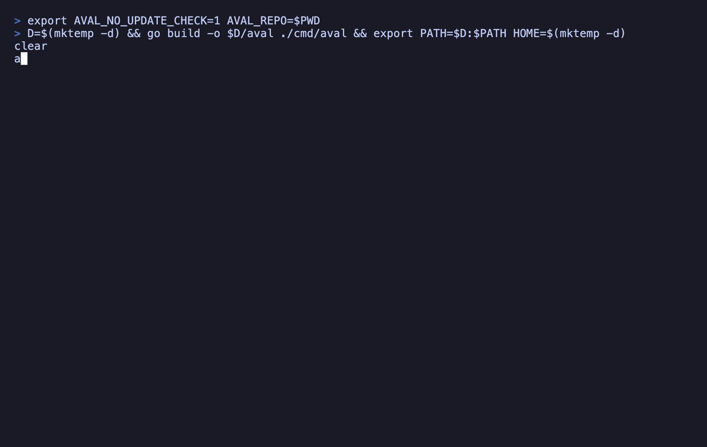
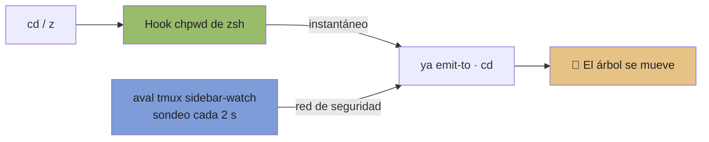

<div align="center">

# Guía completa de aval

<sub><a href="../README.md">← volver al README</a></sub>

El harness por dentro: un único binario de Go que instala, sincroniza y verifica la
configuración de **Claude Code** y **OpenCode** y un entorno de terminal (**tmux**, **yazi**, **Ghostty**).<br/>
Cada pieza está documentada y toda la lógica propia está cubierta por tests.

<br/>

**[⚡ Instalación](#-instalación)** ·
**[⌨️ Comandos](#️-comandos)** ·
**[🗺️ Mapa](#️-mapa-del-repositorio)** ·
**[📊 Barra de estado](#-barra-de-estado)** ·
**[📂 Barra lateral](#-barra-lateral-de-archivos)** ·
**[🤖 Agentes](#-agentes)** ·
**[🔐 Secretos](#-secretos)** ·
**[🧪 Tests](#-tests)**

</div>

---

## 🎯 En una pantalla

<div align="center">

</div>

<br/>

A la izquierda, el árbol de **yazi**; a la derecha, tu shell. Arriba, la barra con
CPU · GPU · RAM · hora · fecha, y el botón **`[FILES]`**, que es clicable.
**El árbol sigue tu directorio**: cambias con `cd` o `z` y el panel se mueve solo.

| Quiero… | Pulso |
| :--- | :--- |
| 📂 Abrir o cerrar el árbol | `Alt+t` · `prefix`+`e` · clic en **`[FILES]`** |
| 📄 Abrir un archivo | `Enter` sobre él (se abre en una ventana nueva) |
| ❌ Cerrar ese archivo | `Ctrl+X` · `Alt+w` · `prefix`+`k` |
| 🪟 Panel scratch flotante | `Alt+g` |
| ↔️ Moverme entre splits | `Cmd+Alt+H/J/K/L` · `Cmd+[` · `Cmd+]` |

---

## ⚡ Instalación

Tres formas de obtener el binario; el resto es igual.

| Vía | Comando |
| :--- | :--- |
| Go | `go install github.com/alvaroofernaandez/aval/cmd/aval@latest` |
| npm | `npx @alvaroofernaandez/aval` (o `npm i -g @alvaroofernaandez/aval`) |
| Binario | La página de Releases, con `SHA256SUMS` |

> [!NOTE]
> El paquete npm con el nombre `aval` y los binarios precompilados los publica CI y aún no
> están disponibles con el nombre nuevo.

Después, desde un clon del repo (`aval` busca `install.manifest` en el directorio actual, junto al
binario o en `--repo <ruta>`):

```sh
git clone https://github.com/alvaroofernaandez/aval.git ~/aval && cd ~/aval

aval                   # TUI: detecta el sistema y deja elegir qué instalar
aval --yes --dry-run   # sin TUI: muestra qué haría, no toca nada
aval --yes             # sin TUI: enlaza de verdad
aval --yes --copy      # copia en vez de enlazar
```

<div align="center">

</div>

<br/>

| | |
| :--- | :--- |
| **Tema** | Tokyo Night, la misma paleta que el resto del entorno |
| **Personalizado por SO** | En Windows nativo se ofrecen los agentes IA y git; el entorno de terminal aparece en gris con el motivo, y se instala completo si detecta WSL |
| **Enlaza o copia** | Symlink donde se puede; en Windows sin Developer Mode **copia**, porque lo comprueba en vez de suponerlo |
| **Una sola lista** | TUI y `--yes` leen **el mismo `install.manifest`** |

> [!IMPORTANT]
> **`aval` nunca borra nada.** Si ya tienes configuración en el destino, la mueve a
> `~/.aval-backup/<timestamp>/` antes de enlazar. Volver a ejecutarlo es seguro: los
> enlaces que ya apuntan aquí se dejan intactos.

> [!NOTE]
> El GIF es una instalación real grabada con [VHS](https://github.com/charmbracelet/vhs)
> contra un `$HOME` desechable. Se regenera con `vhs docs/installer-demo.tape`, la captura de
> arriba con `vhs docs/environment.tape` y el hero con `go run ./tools/brand`.

### Actualizar

```sh
aval update             # git pull + enlaza lo nuevo (idempotente)
aval update --dry-run   # fetch + qué rutas y entradas del manifiesto cambiarían; no toca nada
```

Con un árbol sucio, `update` (también con `--dry-run`) se niega y lo dice. Como los configs son
**symlinks al repo**, el `git pull` ya actualiza todo lo enlazado; el re-enlazado solo cubre entradas
nuevas del manifiesto y skills recién añadidas.

<details>
<summary><b>¿Y si lo instalo global con npm? ¿Se actualiza solo?</b></summary>

<br/>

**No, y ninguna herramienta de npm lo hace.** npm no puede empujar una actualización a una
máquina; lo contrario sería ejecución remota de código en equipos ajenos. Lo que sí hace el
binario es **avisar**: al arrancar comprueba el registry (como mucho una vez al día, en 3 s, en
silencio si no hay red) y, si hay versión nueva, dice cuál es y el comando exacto:

```
A newer version is available: 0.1.42 → 0.1.51
Update with: npm update -g @alvaroofernaandez/aval
```

Se desactiva con `AVAL_NO_UPDATE_CHECK=1`. La forma de estar al día sin pensar es `npx`.

</details>

<details>
<summary><b>Cómo se entrega el binario por npm</b></summary>

<br/>

Cada plataforma va en **su propio paquete**, referenciado como `optionalDependencies` con
campos `os` y `cpu` — el patrón de esbuild. npm descarga **solo** el que corresponde a la máquina.

```
@alvaroofernaandez/aval          ← el que instalas
├── …-darwin-arm64 · …-darwin-x64
├── …-linux-arm64  · …-linux-x64
└── …-win32-arm64  · …-win32-x64
```

**No hay script de `postinstall`**: nada se ejecuta al instalar, así que funciona con
`npm ci --ignore-scripts`. Son `optionalDependencies` y no `dependencies` a propósito: como
dependencias duras la instalación fallaría en **todas** las máquinas, porque cinco de las seis
nunca se pueden satisfacer. Cada push a `main` publica en npm y compila los binarios de las 6
plataformas (`.github/workflows/npm.yml`, solo si pasa toda la suite).

</details>

<details>
<summary><b>¿Por qué los backups van a un directorio aparte y no junto al original?</b></summary>

<br/>

Porque las herramientas escanean sus carpetas de configuración **enteras**. Un
`ship.bak.20260811` dentro de `~/.claude/skills` se cargaría como una **segunda skill
duplicada**, y de hecho pasó: aparecieron cuatro skills fantasma en la sesión. Los backups viven
fuera de cualquier árbol escaneado, y hay un test que lo verifica.

</details>

### 🔗 Qué enlaza

Lo define `install.manifest`, agrupado en `terminal`, `git`, `claude`, `opencode` y `skills`.

| Origen en el repo | Destino | Función |
| :--- | :--- | :--- |
| `home/{zshrc,zprofile,p10k.zsh,tmux.conf}` | `~/.zshrc`, `~/.zprofile`, `~/.p10k.zsh`, `~/.tmux.conf` | Shell y tmux |
| `home/gitconfig`, `config/git/ignore`, `config/gh/config.yml` | `~/.gitconfig`, `~/.config/git`, `~/.config/gh` | Git y GitHub CLI |
| `config/yazi`, `config/yazi-sidebar` | `~/.config/yazi`, `~/.config/yazi-sidebar` | Gestor de archivos y variante estrecha del panel |
| `config/ghostty`, `config/atuin/config.toml` | `~/.config/...` | Terminal e historial |
| `config/herdr-core/templates`, `config/herdr-app/{keys.json,mods/diff-review}` | `~/.config/herdr-*` | Herdr |
| `config/claude/*` | `~/.claude/*` | Claude Code, **ruta por ruta** |
| `config/opencode/*` | `~/.config/opencode/*` | OpenCode, **ruta por ruta** |
| `skills/<cada una>` | `~/.claude/skills`, `~/.config/opencode/skills`, `~/.opencode/skills` | Skills, **una a una** en los tres destinos |

> [!WARNING]
> **Los directorios de agentes se enlazan ruta por ruta, nunca completos.**
> `~/.claude` contiene además `.credentials.json` y **1,6 GB** de historial de sesiones;
> `~/.config/opencode` contiene `node_modules`. Enlazar el directorio entero desplazaría todo
> eso. Hay tests que verifican que `~/.claude` sigue siendo un directorio real y que las
> credenciales sobreviven a la instalación. `settings.json` de Claude tampoco se enlaza: lo
> gestiona `aval sync`.

### 🚀 Arranque

Ghostty ejecuta `aval tmux launch`, que resuelve tmux **por ruta absoluta** y adjunta cada
pestaña a **una sesión propia** (reutilizando una libre si la hay). Si tmux no estuviera, cae a
una shell de login: un multiplexor ausente no puede dejarte sin terminal.

<details>
<summary><b>¿Por qué rutas absolutas en todas partes?</b> (la lección que más veces mordió)</summary>

<br/>

Ghostty lanza su comando así:

```bash
/usr/bin/login -flp <usuario> /bin/bash --noprofile --norc -c <comando>
```

`--noprofile --norc` significa que **no se lee ningún rc de shell**, y una aplicación lanzada
desde el Dock hereda el `PATH` de **launchd**: `/usr/bin:/bin:/usr/sbin:/sbin`. Ahí no está
`/opt/homebrew/bin`. Esto rompió el entorno **tres veces seguidas**, cada vez con un síntoma
distinto:

| Dónde faltaba la ruta absoluta | Cómo se manifestó |
| :--- | :--- |
| `command` de Ghostty | `exec: tmux: not found` — sin terminal |
| `tmux` dentro de los helpers | `returned 127` — la tecla no hacía nada |
| Comando pasado a `split-window` | El panel parpadeaba y moría |

Un panel muerto se cierra **en silencio**, y ejecutar el helper desde una shell interactiva
funcionaba porque ahí el `PATH` viene heredado: la comprobación pasaba mientras el uso real
fallaba. Los tests ejecutan con el `PATH` mínimo de launchd, el entorno real de producción.

</details>

<details>
<summary><b>¿Por qué <code>allow-passthrough on</code> en tmux?</b></summary>

<br/>

yazi envía sondas `DA1`/`DSR` al arrancar para detectar las capacidades del terminal. Sin
passthrough, tmux las bloquea y yazi muestra **«Terminal response timeout»** durante varios
segundos antes de dibujar nada.

</details>

### 📦 Dependencias

Todo lo instalado a propósito con Homebrew está en el `Brewfile`: `brew bundle --file=Brewfile`.

---

## ⌨️ Comandos

Referencia completa. `aval --help` lista las banderas globales (`--dry-run`, `--yes`, `--repo`, `--copy`, `--version`).

| Orden | Qué hace | Necesita el repo |
| :--- | :--- | :---: |
| `aval` · `--yes` · `--dry-run` · `--copy` | Instala (TUI o sin ella) | sí |
| `aval update [--dry-run]` | `git pull` + enlaza lo nuevo | sí |
| `aval doctor [--fix] [--json] [--security]` | Revisa la máquina frente al repo | sí |
| `aval sync [--dry-run] [--check]` | Vuelca ajustes gestionados en el `settings.json` vivo y en Codex/Gemini | sí |
| `aval rules sync [--check]` | Replica reglas compartidas de `CLAUDE.md` y lecciones en el `AGENTS.md` de OpenCode | sí |
| `aval restore [--list] [latest\|<id>] [--pin <id>]` | Deshace una instalación o sync | sí |
| `aval uninstall [--dry-run] [--yes]` | Quita los enlaces de este repo y devuelve lo desplazado | sí |
| `aval budget [--json] [--skip-hooks] [--runs N]` | Contexto siempre activo y latencia de hooks | no |
| `aval review assess [--base <ref>] [--json]` | Nivel de riesgo del diff y revisores | no |
| `aval hook <nombre>` | Hooks de agente (JSON por stdin): `lessons`, `design-gate`, `design-shot-stop`, `rtk-rewrite`, `repo-profile`, `pre-push` | no |
| `aval statusline` | Línea de estado de Claude Code | no |
| `aval design ack <superficie>` | Ack del pipeline de diseño (lo exige el hook `design-gate`) | no |
| `aval design gate <gate> …` | `contrast <fg> <bg> [--large]` · `tokens` · `pairs <colors.json> [--aaa]` · `hardcodes [--ext] [--no-tw]` · `theme-refs --theme` · `component [--root]` · `emoji` · `native` | no |
| `aval tmux <nombre>` | `sidebar-toggle` · `sidebar-follow` · `sidebar-watch` · `open-file` · `close-file` · `paste-router` · `statusbar` · `launch` | no |
| `aval macos <…>` | `defaults` · `screenshot-clipboard install` · `screenshot-clipboard copy` | no |
| `aval kiri up` | Deja Docker listo sobre Kiri (idempotente, no borra nada) | no |
| `aval docker cleanup [--dry-run]` | Prunes seguros, solo sobre el contexto `kiri` | no |
| `aval pdf init <dir>` · `aval pdf assets [dir]` | Proyecto de informe PDF · `assets/brand.css` | no |
| `aval reap-orphan-tests [--min-age s] [--dry-run]` | Termina procesos de test huérfanos (lo lanza un LaunchAgent) | no |
| `aval dev [shell\|run\|diff\|project\|ls\|reset\|rm]` | Prueba aval en un sandbox sin tocar tu máquina ([modo dev](devmode.md)) | sí |

### 🩺 Doctor, sync y la capa privada

```sh
aval doctor            # tabla STATUS · CHECK · MESSAGE; sale con 1 si algo falla
aval doctor --json     # lo mismo como array JSON
aval doctor --fix      # borra enlaces rotos y ejecuta sync
aval doctor --security # chequeos extra, ver abajo
aval sync --dry-run    # muestra qué claves cambiarían, no escribe nada
aval sync              # aplica (copia previa en ~/.aval-backup/<fecha>/)
aval sync --check      # solo lectura: sale con 1 e imprime qué ha derivado
```

`doctor` es offline y de solo lectura: enlaces del manifiesto, enlaces rotos en los directorios de
agentes, hooks del `settings.json` vivo (que existan, que no sean comandos retirados, que coincidan con
el repo), `model:` de cada agente, `SKILL.md` de cada skill y plugins activos sin instalar.

`aval doctor --security` (apagado por defecto) falla o avisa con: `permissions.allow` demasiado amplio
(`*`, `Bash`, `Bash(*)`), hooks que descargan y ejecutan código remoto (`curl ... | sh`; `npx -y pkg@latest`
avisa), hooks que apuntan a scripts fuera del repo y de `~/.claude/hooks`, y servidores MCP con secretos
literales en `env`/`args` (solo se imprime servidor y clave, nunca el valor). Para silenciar un chequeo:
`--allow <id>[:<sujeto>]` o una línea por id en `~/.config/aval/private/doctor-allow`.

`sync` mantiene `~/.claude/settings.json` como archivo real (lo reescriben otras herramientas y guarda
claves personales): **reemplaza** `hooks`, `attribution`, `worktree`, `spinnerTipsEnabled` y
`subagentPromptCacheTtl`, **fusiona** `env`, `enabledPlugins`, `skillOverrides` y
`extraKnownMarketplaces` (gana el repo, se conservan las claves solo-vivas) y no toca nada más. Además
copia el bloque `shared:agent-rules` de `CLAUDE.md` a `~/.codex/AGENTS.md` y `~/.gemini/GEMINI.md`,
solo entre sus marcadores `aval:agent-rules`. `aval rules sync` hace lo propio con el `AGENTS.md` de
OpenCode; si cambias `config/claude/CLAUDE.md`, ejecútalo.

`.githooks/pre-push` es un shim de 3 líneas que llama a `aval hook pre-push`: rechaza material de empresa y
secretos en los commits salientes y avisa (no bloquea) de drift con `aval sync --check`.
`AVAL_PREPUSH_STRICT=1` lo vuelve bloqueante. El instalador activa `core.hooksPath`.

**Capa privada**: `~/.config/aval/private` (o `$AVAL_PRIVATE_DIR`), fuera del repo y opcional.
`settings.json` es un fragmento que se fusiona al final (gana sobre el repo); `links.manifest` tiene
líneas `<origen relativo a la carpeta privada>  <destino relativo a $HOME>` y `sync` las enlaza,
guardando antes lo que hubiera en el destino.

### ↩️ Restaurar, desinstalar y sync transaccional

Todo lo que aval mueve o sobrescribe (instalador, `sync`, `uninstall`) se anota en una **ejecución de
copia** `~/.aval-backup/<AAAAMMDD-HHMMSS>[-n]/` con un `manifest.json` (ruta absoluta, si existía, tipo,
destino del enlace, sha256) y las copias guardadas. Una ejecución idéntica a la anterior no se crea; se
conservan las 5 últimas sin fijar, y una con marcador `PINNED` no se borra nunca.

```sh
aval restore --list          # id, fecha, entradas, fijada, estado
aval restore latest          # o un <id> (basta un prefijo único); --dry-run para ver qué haría
aval restore --pin <id>      # protege una copia de la poda (--unpin la suelta)
aval uninstall --dry-run     # qué quitaría; sin --dry-run pide confirmación (--yes la salta)
```

`restore` es atómico por archivo (temporal + rename) y recrea enlaces. Lo que la ejecución **creó** solo se
borra si es un enlace que apunta al repo o un archivo cuyo sha256 es el que aval escribió; el contenido
editado después se aparta a `.displaced/` dentro de la copia, nunca se pierde. `uninstall` quita únicamente
los destinos del manifiesto que son enlaces hacia este repo, devuelve lo que había antes, borra el bloque
`aval:agent-rules` de Codex y Gemini (solo el bloque) y los directorios que creó el instalador si quedan
vacíos. `aval restore latest` deshace el propio uninstall.

**`aval sync` es transaccional**: marcador `PENDING` → copia → aplica → comprueba `settings-drift`,
`hooks-resolve`, `hooks-retired`, `hooks-drift` y `overlay`. Si alguna da FAIL, restaura esa copia, la marca
`FAILED` con el motivo y sale con 1; un solo intento. Si un sync anterior murió a medias, el siguiente lo
avisa y lo restaura antes de seguir.

**Denegaciones**: `permissions.deny` del repo prohíbe leer `~/.ssh/**`, `~/.aws/**`, `.credentials.json` y
`.env`/`.env.*` (Claude da prioridad a deny sobre allow). El overlay privado solo puede **añadir**
denegaciones; un `allow` del overlay que cubra una denegación se descarta con un aviso.

### 🪶 Menos tokens, más rápido: lessons, budget y review

**Lessons** (`aval hook lessons`). Las reglas que solo importan junto a ciertos archivos o comandos (UI,
Docker/Kiri, navegador headless, Herdr, atribución de commits) no viajan en `CLAUDE.md` en cada turno: viven
en `config/claude/lessons/*.md` (enlazado a `~/.claude/lessons`) y el hook PreToolUse
(`Edit|Write|NotebookEdit|Bash`) las inyecta como `additionalContext` cuando coinciden.

```markdown
---
triggers:            # globs de ruta, contra tool_input.file_path
  - "**/Dockerfile*"
commands:            # regex, contra tool_input.command de Bash
  - '(^|[;&|(] *)docker( |$)'
---
Cuerpo de la lección, como mucho 600 caracteres.
```

Una lección sale una sola vez por sesión, sin coincidencia no imprime nada, nunca bloquea y tarda ~3 ms. El
hook usa `~/.local/bin/aval` o, si no está, el `aval` del `PATH`; sin binario es un no-op silencioso.
OpenCode no tiene este hook: lee las lecciones a mano.

**Budget** (`aval budget`). Tabla del contexto siempre activo: Claude (`CLAUDE.md`, `@imports`, skills
visibles según `skillOverrides`, agentes y comandos) y OpenCode (`AGENTS.md` y skills), en caracteres y
≈tokens (chars/4). Después ejecuta cada hook del `settings.json` vivo 5 veces (timeout 2 s) y compara
p50/p95 con el presupuesto: 20 ms para los hooks síncronos PreToolUse/PostToolUse. Sale con 1 si alguno se
pasa. Ejecuta los hooks de verdad; `--skip-hooks` mide solo contexto.

**Review** (`aval review assess`). Nivel de riesgo determinista, solo con git: `high` si toca hooks,
settings, `install.manifest`, instaladores, auth, migraciones, pagos, `.github/workflows` o permisos, o más
de 400 líneas de producción; `medium` si hay código sin cambios de tests (o más de 100 líneas); `low` si solo
hay docs/tests o un cambio pequeño con tests. Devuelve nivel, motivos y revisores: ninguno,
`review-reliability`, o los cuatro. La skill `ship` lo usa para dimensionar la auto-revisión.

---

## 🗺️ Mapa del repositorio

```
aval/
├── cmd/aval/            Dispatch de comandos (un fichero por dominio) y sus tests
├── internal/
│   ├── core/            backup · doctor · install · manifest · plan · platform · sync · txsync · uninstall · update
│   ├── agent/           budget · lessons · prepush · repoprofile · review · rtkhook · rules · statusline
│   ├── design/          ack · gate · hook          (pipeline de diseño y sus gates medidos)
│   ├── term/            tmux · macos               (sidebar, barra de estado, arranque, defaults)
│   ├── devops/          dockerclean · kiri · reaper
│   ├── docs/            pdfreport
│   ├── herdr/           mods                       (diff-review)
│   └── ui/              Tema Tokyo Night y las pantallas de la TUI
│
├── skills/              Skills compartidas por todos los agentes
├── config/              claude · opencode · ghostty · yazi · yazi-sidebar · herdr-core · herdr-app · atuin · gh · git
├── home/                zshrc · zprofile · p10k.zsh · tmux.conf · gitconfig
├── tools/brand/         Generador de las imágenes del README (go run ./tools/brand)
├── npm/                 cli/ (launcher + resolutor) · platform/ · build.mjs
├── docs/                guide.md · assets · logos · cintas VHS
├── tests/               Tests de integración (un paquete de Go)
├── odd/                 Planes y tareas de trabajo
├── .githooks/pre-push   Shim de 3 líneas: exec aval hook pre-push
├── install.manifest     Qué se instala y dónde — fuente única
└── LICENSE · CONTRIBUTING.md · SECURITY.md · CODE_OF_CONDUCT.md
```

> [!IMPORTANT]
> **`install.manifest` es la fuente única.** La TUI, `--yes`, `update`, `doctor` y `uninstall` lo leen; nada
> más lleva su propia lista. `tests/manifest_test.go` compila el binario y compara sus destinos con los del
> manifiesto, así que una divergencia rompe el build.

---

## 📊 Barra de estado

Fila superior, cada dato en su propio bloque de color, producido por `aval tmux statusbar`:

```
 [FILES] main 1:zsh        CPU 18%   GPU 6%   RAM 9.1/16.0G   16:22   11 Aug
```

| Segmento | Color Kanagawa | De dónde sale el dato |
| :--- | :--- | :--- |
| 🔵 **CPU** | crystalBlue | load average ÷ núcleos (`sysctl`; en Linux, `/proc/loadavg`) |
| 🟣 **GPU** | oniViolet | `ioreg -c AGXAccelerator` → `Device Utilization %` (macOS) |
| 🟢 **RAM** | springGreen | `vm_stat`: active + wired + compressed (Linux: `/proc/meminfo`) |
| 🟡 **Hora** · 🌸 **Fecha** | carpYellow · sakuraPink | reloj del sistema |

**Coste medido: ~3 ms por refresco** (`hyperfine`, macOS). Las lecturas de `sysctl`, `vm_stat` e `ioreg`
se lanzan en paralelo y por ruta absoluta.

<details>
<summary><b>🔥 La historia: la barra costaba 5,3 segundos por refresco</b></summary>

<br/>

Al medir el consumo, esto es lo que pasaba **cada 5 segundos**:

| Script | Coste |
| :--- | ---: |
| `cpu_info.sh` (tema kanagawa) | **5064 ms** |
| script propio de métricas | 226 ms |
| `ram_info.sh` (tema kanagawa) | 39 ms |
| **Total** | **~5329 ms** |

El script de CPU de kanagawa contiene un `sleep` para muestrear un delta: tardaba **más que el propio
intervalo de refresco**, así que la barra nunca terminaba antes del siguiente ciclo. Aproximadamente **un
core al 100 % de forma permanente** para dibujar una línea de texto, y duplicado: kanagawa y el script
propio calculaban lo mismo.

**Decisiones que lo arreglaron:**

- ❌ Fuera los plugins `cpu-usage` y `ram-usage` del tema (`home/tmux.conf` lo deja anotado).
- ❌ Fuera `top -l 1` (208 ms: recorre toda la tabla de procesos).
- ✅ La CPU sale del **load average**, no de utilización muestreada: muestrear exige dos lecturas separadas
  por un `sleep`, que es exactamente lo que costaba segundos.
- ✅ GPU por `ioreg`, porque `powermetrics` **exige superusuario**.
- ✅ Después, el cálculo pasó a Go: sin intérprete ni shell que arrancar por refresco.

</details>

<details>
<summary><b>🎨 Reglas de diseño de la barra</b></summary>

<br/>

- **El color identifica la métrica, nunca es el único portador de información.** Cada bloque lleva su
  etiqueta y su valor: funciona en monocromo, en capturas y con daltonismo.
- **Contraste verificado numéricamente**, no a ojo (`aval design gate contrast`).
- **Umbral en rojo solo para valores.** Un dato por encima del 85 % pasa a `autumnRed`; el color de alerta
  se reserva para lo que de verdad es una alerta.
- **Sin glifos de Nerd Font.** Solo ASCII, así que la fila no se rompe sin tipografía parcheada.
- **Sin fondo propio.** `status-style bg=default` hereda el del terminal, así que la transparencia de
  Ghostty se mantiene.

Las reglas completas están en `.agents/DESIGN.md`, que se mantiene en local.

</details>

---

## 📂 Barra lateral de archivos

Un panel de **yazi** al 30 % a la izquierda, que hereda el directorio de la ventana. Atajos en la tabla
de arriba; los tres accesos existen por una razón (ver más abajo).

### 🪟 Cada pestaña, su propio proyecto

Cada pestaña de Ghostty abre **su propia sesión de tmux**: dos proyectos en paralelo sin que se
interfieran, cada uno con su sidebar, su directorio y su historial.

> [!NOTE]
> Si al arrancar hay una sesión **sin ningún cliente adjunto**, se reutiliza: por eso cerrar una pestaña
> no pierde su trabajo. Solo se crea una sesión nueva cuando todas están en uso.

<details>
<summary><b>El bug que llevó a esto: dos pestañas eran la misma</b></summary>

<br/>

El arranque hacía `tmux new-session -A -s main`, y ese `-A` significa «adjúntate si ya existe». Cada
pestaña era un **cliente** distinto, pero las dos se adjuntaban a la misma sesión y **dibujaban la misma
ventana**: un `z japan-2027` en una movía el árbol de la otra. No eran dos entornos, era uno renderizado
dos veces. La pista estaba en la propia barra: `main 1:zsh*` idéntico en ambas.

</details>

### 🔄 El árbol sigue tu directorio

Dos mecanismos, a propósito:



| Mecanismo | Latencia | Cubre |
| :--- | :--- | :--- |
| Hook `chpwd` de zsh (`aval tmux sidebar-follow`) | Instantánea | Shells abiertos **después** de instalarlo |
| `aval tmux sidebar-watch` | ≤ 2 s | **Todo lo demás** |

> [!NOTE]
> El vigilante existe porque los hooks de zsh **se registran al arrancar el shell**: un shell abierto antes
> de instalar el hook no lo tiene y dejaría de sincronizar en silencio. Solo vive mientras vive el sidebar:
> muere en cuanto el panel, la marca o el servidor de tmux desaparecen.

### 📄 Abrir archivos

Al pulsar `Enter`, `aval tmux open-file` abre el archivo en una **ventana nueva de tmux** con **nano**.

<details>
<summary><b>¿Por qué una ventana nueva y no el panel de trabajo?</b></summary>

<br/>

Porque lo que tengas corriendo donde estabas —un build, un REPL, un editor con cambios sin guardar— **no se
toca**: no recibe pulsaciones ni pierde el foco. Al cerrar el editor, la ventana desaparece y vuelves
exactamente donde estabas. El diseño anterior escribía en el panel de trabajo con `send-keys` y necesitaba
decidir entre tres ramas; toda esa complejidad existía **solo** porque escribía en un panel que podías estar
usando.

</details>

<details>
<summary><b>¿Por qué nano y no <code>$EDITOR</code>?</b></summary>

<br/>

Porque el requisito era **cerrar con `Ctrl+X`**, que es literalmente la tecla de salida de nano. Y si el
archivo tiene cambios sin guardar, nano pregunta *«Save modified buffer?»*: la protección viene incluida.
Se puede cambiar con `FILE_EDITOR`.

> ⚠️ **Detalle de macOS:** `/usr/bin/nano` es la build **PICO** de Apple, y tmux reporta el proceso como
> `pico`, no `nano`. `aval tmux close-file` acepta ambos nombres; si solo contemplara `nano`, `Alt+w`
> mataría el editor sin preguntar por los cambios.

</details>

<details>
<summary><b>Cómo se cierra un archivo sin perder trabajo</b></summary>

<br/>

1. **Solo cierra lo que abrió el sidebar.** `open-file` marca su ventana con `@file_window`; `close-file` se
   niega con cualquier otra. Deducirlo por el nombre de la ventana o por lo que corre dentro habría acabado
   cerrando trabajo real.
2. **Al editor le pide salir, no lo mata.** Con nano envía `Ctrl+X`; con vim/nvim, `:q`. Si hay cambios sin
   guardar, el editor se niega y avisa. Descartar trabajo no guardado nunca es decisión del atajo.

</details>

<details>
<summary><b>¿Por qué el árbol no muestra previsualización?</b></summary>

<br/>

La configuración del panel usa `ratio = [0, 1, 0]`: sin columna padre y sin preview. A 60 columnas, el diseño
de tres columnas por defecto de yazi trunca **todos** los nombres. `YAZI_CONFIG_HOME` **reemplaza** a
`~/.config/yazi`, no se fusiona con ella, así que el `opener` está duplicado a propósito — y un test falla si
las dos copias divergen.

</details>

### ⚙️ Ajustes

| Variable | Por defecto | Para qué |
| :--- | :--- | :--- |
| `SIDEBAR_CMD` | `yazi` | Programa que corre en el panel |
| `SIDEBAR_WIDTH` | `30%` | Ancho del panel |
| `SIDEBAR_CONFIG_HOME` | `~/.config/yazi-sidebar` | Config de yazi propia del panel |
| `FILE_EDITOR` | `nano` | Editor al abrir un archivo |
| `WATCH_INTERVAL` | `2` | Segundos entre comprobaciones del vigilante |

### ⌨️ Por qué estos atajos y no otros

> [!CAUTION]
> **En una distribución «Spanish - ISO», `Option+E` es la tecla muerta del acento agudo.** macOS la consume
> para componer `á`/`é` y **nunca llega a tmux**.

El atajo original era `Alt+e` y parecía no hacer nada: el binding estaba registrado y funcionaba, pero la
pulsación no llegaba. Regla del proyecto: **nunca atar `Option` + `e` / `i` / `u` / `n`.** Por eso hay tres
accesos: `Alt+t` (sin colisión), `prefix`+`e` (no pasa por `Option`) y el botón **`[FILES]`** (no depende del
teclado).

---

## ⌨️ Moverse entre splits

Los paneles de una ventana de Ghostty son **splits suyos**, cada uno con su propia sesión de tmux. Moverse
entre ellos es cosa de Ghostty: tmux nunca ve esas teclas.

| Atajo | Acción |
| :--- | :--- |
| `Cmd+Alt+H` `J` `K` `L` (o flechas) | Salto direccional, sin soltar la fila home |
| `Cmd+[` · `Cmd+]` | Recorrer los splits en orden |

> [!NOTE]
> **Ghostty no permite «ir al split N»**: `goto_split` solo acepta direcciones y `previous`/`next`
> (`goto_split:1` devuelve `error.InvalidFormat`).

<details>
<summary><b>Por qué estas teclas y no otras</b></summary>

<br/>

- **`Ctrl+H/J/K/L` queda libre a propósito.** Ghostty recibe las teclas **antes** que tmux, así que atarlas
  ahí dejaría inservible `vim-tmux-navigator` dentro de cada sesión.
- **`Cmd+H`, `Cmd+M` y `Cmd+Q` no se tocan.** macOS los usa para ocultar, minimizar y salir.

</details>

---

## 🤖 Agentes

### 🧩 Skills compartidas

`skills/` se enlaza **una a una** a `~/.claude/skills`, `~/.config/opencode/skills` y `~/.opencode/skills`,
así que cada skill existe una sola vez. Las skills de marketplaces y packs de terceros **no se versionan**:
cada herramienta las reinstala por su cuenta. Las que traen licencia llevan su atribución en
`skills/PROVENANCE.md` (un test falla si falta una).

| Familia | Skills |
| :--- | :--- |
| Disciplina | `strict-tdd` · `cognitive-doc-design` · `skill-creator` |
| Diseño y UI | `design-pipeline` · `design-refactor` · `laws-of-ux` · `accessibility` · `react-19` · `tailwind-4` · `typescript` · `zod-4` · `ai-sdk-5` |
| Git y entrega | `ship` · `branch-pr` · `chained-pr` · `prs-pro` · `work-unit-commits` · `issue-creation-pro` · `repo-prep` |
| Documentos | `pdf-report` · `readme-portal` · `readme-guardian` |
| Entorno | `kiri-docker` · `kiri-health` · `docker-build-optimized` · `docker-space-optimizer` · `mac-disk-cleanup` · `lightpanda-browser` · `herdr` |

<details>
<summary><b>La duplicación ya había divergido</b></summary>

<br/>

Cuando las skills estaban duplicadas entre Claude y OpenCode, dos copias de la misma skill medían el
presupuesto de PR con reglas distintas (`PRs over 400 changed lines` frente a `400 production lines` +
`Test files never count`). El concepto se refinó en un lado y el otro se quedó atrás: justo el fallo que una
fuente única elimina.

</details>

<details>
<summary><b>Lo que NO se comparte, y por qué</b></summary>

<br/>

Los `commands/` y `agents/` son específicos de cada herramienta: `agent:` y `subtask:` son sintaxis propia de
OpenCode y las rutas apuntan a sitios distintos. Son la **capa de adaptación** entre cada herramienta y las
skills compartidas.

</details>

### 📋 Configuración por herramienta

| Ruta | Contenido |
| :--- | :--- |
| `claude/CLAUDE.md`, `RTK.md`, `MCP-PER-PROJECT.md` | Instrucciones globales: persona, TDD estricto, pipeline de diseño |
| `claude/settings.json` | Permisos, hooks (`aval hook …`), plugins y marketplaces; no se enlaza, lo aplica `aval sync` |
| `claude/agents/`, `commands/`, `lessons/` | Subagentes, comandos y lecciones bajo demanda |
| `claude/themes/` | Temas de color propios, referenciados como `custom:<fichero>` |
| `opencode/opencode.json`, `AGENTS.md`, `package.json` | Configuración e instrucciones globales |
| `opencode/agents/`, `commands/`, `plugin(s)/`, `profiles/` | Adaptadores y extensiones |

---

## 🐚 Shell y herramientas

> [!TIP]
> **`bat`, `zoxide`, `fzf` y `eza` no tienen fichero de configuración propio.** Todo su ajuste vive en
> `~/.zshrc`, y por eso ese fichero se versiona. `atuin`, `gh` y `git` sí tienen fichero y van aparte.

| Herramienta | Dónde está su configuración |
| :--- | :--- |
| `zoxide` | `~/.zshrc` → `eval "$(zoxide init zsh)"` |
| `fzf` | `~/.zshrc` → `eval "$(fzf --zsh)"` + `FZF_DEFAULT_COMMAND` |
| `bat` · `eza` | `~/.zshrc` → aliases y `LS_COLORS` |
| `atuin` | `config/atuin/config.toml` |
| `delta` | `home/gitconfig` → pager y `diffFilter` |
| `git` | `home/gitconfig` + `config/git/ignore` |

<details>
<summary><b>Higiene del shell: qué se limpió y por qué</b></summary>

<br/>

| Problema | Efecto | Solución |
| :--- | :--- | :--- |
| `export PATH` de una herramienta **6 veces** | Reevaluado en cada arranque | Reducido a uno |
| `$HOME/.cargo/bin` dos veces en la misma línea | Ruido en el `PATH` | Deduplicado |
| Variable apuntando al `$HOME` de otra persona | Heredada de una config copiada; nadie la leía | Eliminada |
| `delta` instalado pero sin configurar | git no lo usaba | Conectado como pager |
| Shells anidados apilando el `PATH` | Ghostty → tmux → zsh, cada nivel antepone | `typeset -U path` |

`typeset -U path` es la pieza clave: declarar cada entrada una vez en el fichero no basta, porque cada
`export` antepone al `PATH` heredado que ya la contenía. Un test comprueba en **tiempo de ejecución** que un
shell interactivo no tiene entradas repetidas, y otro que el arranque cabe en 80 ms.

</details>

---

## 🔐 Secretos

> [!IMPORTANT]
> **Ninguna credencial vive en este repositorio.** Se cargan desde `~/.config/zsh/secrets.zsh` (modo `600`,
> fuera de git), mediante un `source` protegido que no rompe el shell si el fichero no existe.

```zsh
# ~/.zshrc
[ -r "$HOME/.config/zsh/secrets.zsh" ] && source "$HOME/.config/zsh/secrets.zsh"
```

### 🛡️ Guarda automática

`tests/secrets_test.go` corre **gitleaks** en cada ejecución y verifica:

- ✅ El árbol de trabajo y **todo el historial** están limpios.
- ✅ Una credencial plantada **es detectada**: un detector al que nadie ha visto detectar nada es decoración.

<details>
<summary><b>Por qué existe esta guarda: un token llegó a GitHub</b></summary>

<br/>

`ENGRAM_CLOUD_TOKEN` se commiteó literal en `opencode.json` y se publicó. El barrido que había dado el
fichero por limpio buscaba `token` **como palabra suelta** antes de `:` o `=`; la clave se llamaba
`ENGRAM_CLOUD_TOKEN`, así que el patrón nunca la tocó.

**Remediación, en este orden:**

1. 🔄 Token **rotado** primero (GitHub conserva objetos huérfanos un tiempo; rotar importa más que reescribir).
2. 💾 Copia de seguridad con `git bundle`.
3. 🔧 Valor sustituido por `{env:ENGRAM_CLOUD_TOKEN}`, sintaxis nativa de opencode.
4. 🧹 `git filter-repo --replace-text` sobre todo el historial + `push --force`.
5. ✅ `gitleaks`: 18 commits escaneados, 0 hallazgos.

**Lecciones que quedaron en los tests:**

- `gitleaks` detectó **solo 2 de las 4** líneas con secretos del `.zshrc`. La suite lo combina con patrones
  explícitos en vez de fiarse de un detector.
- El canario se genera **en tiempo de ejecución** con `crypto/rand`. Escrito literal en el fichero, el propio
  guardián lo detectaba y marcaba el repo como sucio para siempre.

</details>

### 🚫 Fuera del repositorio a propósito

| Ruta | Motivo |
| :--- | :--- |
| `~/.config/zsh/secrets.zsh` · `~/.claude/.credentials.json` · `~/.local/share/opencode/auth.json`, `mcp-auth.json` | 🔑 Credenciales |
| `~/.config/gh/hosts.yml` | 👤 Identifica la cuenta; gh usa el keyring |
| `~/.claude/projects`, `history.jsonl`, `file-history` · `~/.local/share/opencode/opencode.db` | 💾 Historial (GB) |
| `~/.claude/settings.local.json` | 💻 Permisos de una máquina concreta |
| `.agents/` | 📓 Notas de diseño, solo locales |
| `node_modules`, `*.bak` | ♻️ Regenerables |

---

## 🧪 Tests

```sh
go test ./...                      # todo; los que necesitan una herramienta ausente se saltan
go test -short ./...               # subconjunto rápido (salta los extremo a extremo lentos)
node --test npm/cli/lib/*.test.js  # empaquetado npm
AVAL_LIVE_CHECKS=1 go test ./tests # además, comprobaciones contra esta máquina
```

Medido en macOS con las herramientas del `Brewfile` instaladas (cuenta tests y subtests):

| Orden | Resultado | Tiempo |
| :--- | :--- | ---: |
| `go test ./...` | 33 paquetes ok · 730 pasan · 0 fallan · 4 saltados | ~17 s |
| `go test -short ./...` | 33 paquetes ok · 679 pasan · 0 fallan · 39 saltados | ~12 s |
| `node --test npm/cli/lib/*.test.js` | 13 pasan · 0 fallan | 0,15 s |

**Qué cubre cada capa.** Los tests unitarios viven junto a su código en `cmd/` e `internal/`
(`internal/term/tmux/e2e` levanta un servidor de tmux aislado). `tests/` es un único paquete de integración:
secretos y material de empresa en árbol e historial, manifiesto frente al binario compilado, instalador,
arranque bajo el `PATH` mínimo de launchd, teclas de Ghostty, higiene y arranque de zsh, hooks de agente de
extremo a extremo, pipeline de diseño, presupuesto de contexto, y el propio README (imágenes
content-addressed, enlaces, fugas).

**Herramientas que activan tests.** Sin `tmux`, `zsh`, `gitleaks`, `git`, `node`, `bun`, `atuin`, `zoxide`,
`fzf`, `delta`, `hyperfine` o `go`, los tests que las usan se **saltan** en vez de fallar; instálalas
(`brew bundle --file=Brewfile`) para que corran. `AVAL_LIVE_CHECKS=1` activa los pocos que leen el `$HOME`
real (settings vivos y fichero de secretos); se saltan por defecto porque dependen de la máquina. Los render de `shot.mjs` se saltan si no hay Chromium de Playwright.

> [!NOTE]
> Los tests de instalación usan `t.TempDir()` para el repo y para `$HOME`, y los de tmux, un servidor aislado
> (`tmux -L`): ninguno toca tu sesión ni tu configuración real.

<details>
<summary><b>🎓 Lecciones aprendidas: tests que mentían</b></summary>

<br/>

Varios tests existen porque una comprobación anterior **pasaba en verde mientras el fallo seguía ahí**:

| Patrón | Qué pasó | Corrección |
| :--- | :--- | :--- |
| Buscar `leaks found` | `gitleaks` imprime **`no leaks found`** al tener éxito: contiene la cadena buscada | Juzgar por **código de salida** |
| `rg "Ctrl+X"` | `+` es un metacarácter regex: buscaba `Ctrl`, `Ctrll`… | Búsqueda literal (`-F`) |
| `sleep 600` como doble de yazi | `/bin/sleep` resuelve bajo **cualquier** `PATH`, borrando la propiedad que decía probar | Usar el binario real |
| `EDITOR=cat` al verificar | `cat` termina al instante: la ventana se creaba y se cerraba sola | Usar un editor que bloquee |
| Leer el código fuente | Comprobaba lo que el código **dice**, no lo que **hace** | Aserciones de comportamiento |
| Comparar dos ejecuciones con datos vivos | `23%` vs `9%` daban `NN%` vs `N%` | Colapsar valores de longitud variable |
| Contar procesos por nombre | `pgrep -f` también contaba el **propio proceso de test**, que lleva ese nombre | Excluirse a sí mismo |
| `sleep` fijo tras `kill-server` | `kill-server` solo **inicia** el apagado: bajo carga, el `new-session` siguiente aterrizaba en un servidor moribundo que borraba el socket y se llevaba la sesión nueva | Un **socket propio** por bloque |

Regla que resume todo: **un test que afirma ausencia pasa por defecto.** Si no lo mutas para verlo fallar, no
sabes si sirve. Varios de estos se verificaron reintroduciendo el bug a propósito.

</details>

---

## 🧭 Principios

- **Un solo binario de Go.** La lógica propia es Go. Sin shell ni Python propios, salvo los dotfiles de zsh
  (`home/`) y el shim de 3 líneas de `.githooks/pre-push`, porque git exige un ejecutable.
- **Manifiesto declarativo.** `install.manifest` dice qué se instala y dónde; el código lee datos.
- **Sin upstream vendorizado.** Dependencias como módulos de Go, no árboles copiados.
- **Superficie pequeña.** Se prefiere borrar código a añadir banderas.

Para contribuir: [CONTRIBUTING.md](../CONTRIBUTING.md) (issue primero, TDD estricto, commits convencionales).
Licencia [MIT](../LICENSE). Vulnerabilidades: [SECURITY.md](../SECURITY.md).

---

<div align="center">

**Hecho a base de medir antes de opinar.**

<sub>Cada decisión de este repositorio está documentada con el dato que la provocó.</sub>

</div>
