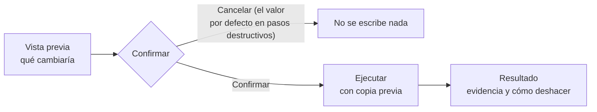
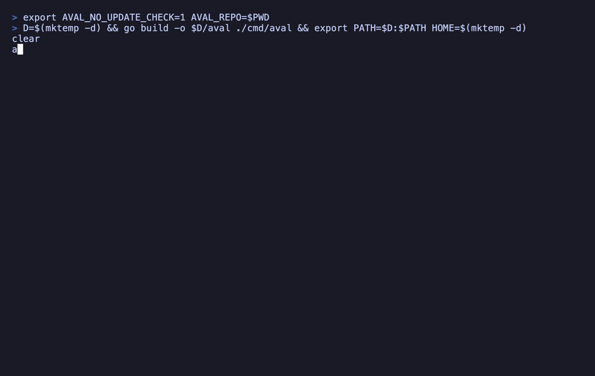
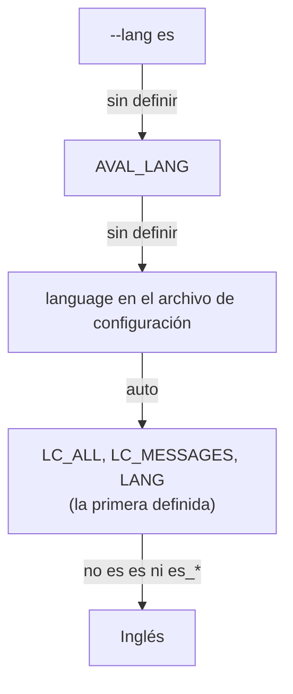
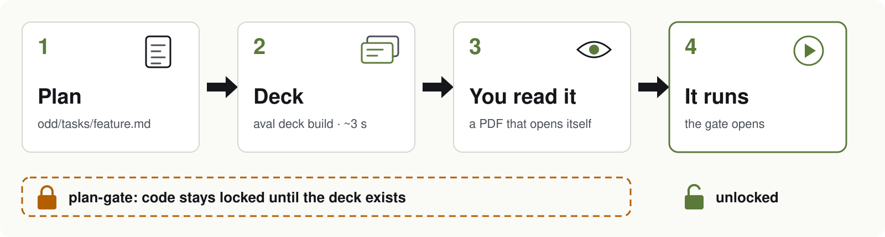
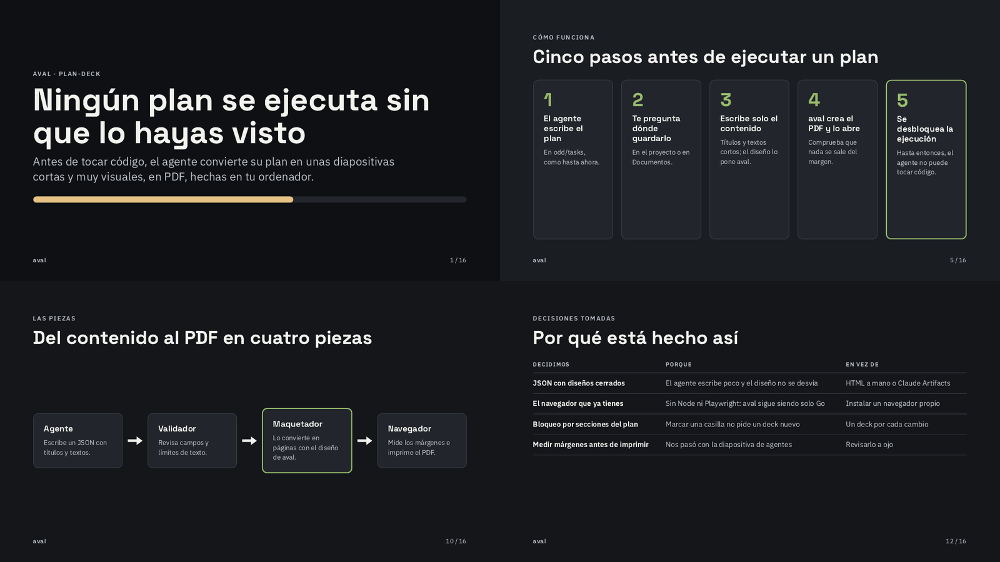

<div align="center">

<picture>
  <source media="(prefers-color-scheme: dark)" srcset="../assets/wordmark-dark.3ba4fd49.svg">
  
</picture>

# v0.2.0

**El hub, una experiencia de terminal nueva y el español.**

2026-11-23 &nbsp;·&nbsp; estable &nbsp;·&nbsp; [English](v0.2.0.md) &nbsp;·&nbsp; **Español**

</div>

> [!NOTE]
> Esta es la versión estable. Se publica en npm con la etiqueta `latest`. Se publicó primero como `v0.2.0-rc.1`, y la interfaz, también en español, se comprobó a mano antes de promocionarla; el código es el mismo.

> [!WARNING]
> **Cambio incompatible: `aval` sin comando ya no instala.** En v0.1.0, `aval` a secas ejecutaba el instalador. Ahora instalar es siempre explícito: `aval install` (con `--dry-run`, `--yes`, `--copy`). La forma antigua con solo opciones (`aval --yes`) sigue instalando, con un aviso de obsolescencia en stderr, y los comandos desconocidos ahora fallan en lugar de acabar en una instalación. Si algún script suyo ejecuta `aval` a secas para instalar, cámbielo por `aval install --yes`.

## Qué significa esta release para usted

En v0.1.0, ejecutar `aval` sin comando instalaba. A partir de esta release, en una terminal, abre un **hub**: una pantalla que muestra el estado de su equipo (versión, repo, doctor, última copia de seguridad, tema) y da acceso a todo lo que hace aval, desde instalar hasta desinstalar, con el mismo ritmo seguro cada vez: **vista previa, confirmar, ejecutar, resultado**. No se escribe nada hasta que usted confirma, y abrir el hub no escribe nada ni toca la red. Todo funciona en inglés y en español, se ve como usted elija y cada paso destructivo indica cómo deshacerlo.

## Novedades principales

| **El hub** | **Un ritmo seguro** | **Un instalador renovado** |
| :--- | :--- | :--- |
| `aval` en una terminal abre un hub con un panel de estado y 9 vistas. | Toda escritura pasa por vista previa, confirmar, ejecutar y resultado. Las confirmaciones destructivas empiezan en Cancelar. | Bienvenida, selección con vista previa por archivo, fallos en línea y una pantalla final con deshacer. |

| **Temas y ajustes** | **Inglés y español** | **Un limitador para agentes** |
| :--- | :--- | :--- |
| 40 valores de tema aceptados en 13 familias, con vista previa en vivo. | 538 mensajes por idioma, elegidos por opción, variable, configuración o locale. | `aval hook rate-guard` evita que un agente sature hosts que bloquean la IP. |

| **Decks de planes** | **El repo desde cualquier sitio** | **Instalación explícita** |
| :--- | :--- | :--- |
| `aval deck` convierte un plan en un PDF que usted lee antes de que el agente lo ejecute. | `--repo`, `AVAL_REPO` o la ubicación registrada: sirve cualquier directorio. | `aval install` instala; `aval` a secas abre el hub. |

## El hub

<div align="center">

</div>

Ejecute `aval` en una terminal. Verá el wordmark, un panel de estado y un menú en cuatro grupos. Un panel de detalle junto al menú explica qué hará la entrada resaltada antes de abrirla, y una letra salta directamente a una entrada (`i u s d b x , v a`; `?` las lista todas).

```sh
aval            # abre el hub en una terminal
aval help       # el uso, byte a byte, con o sin terminal
```

Sin terminal, con `aval help` o `--help`, o con `TERM=dumb`, aval imprime el uso, de modo que los scripts y las tuberías se comportan como antes.

> [!IMPORTANT]
> Abrir el hub no escribe nada y no hace ninguna llamada de red. La insignia de actualización lee referencias que su repo ya había descargado. Es una regla, registrada en el [ADR 0004](../adr/0004-hub-writes-nothing-offline.md) y fijada por pruebas. El ADR está en inglés.

### Las vistas

| Vista | Qué hace | Red de seguridad |
| :--- | :--- | :--- |
| **Instalar** | Enlaza las configuraciones del repo en este HOME. | Muestra una vista previa; lo que estorba se mueve a `~/.aval-backup`. |
| **Actualizar** | Actualiza el repo (solo avance rápido) y vuelve a aplicar. | Descarga una vista previa, se detiene si el árbol está sucio y hace copia de lo que estorba. |
| **Sincronizar** | Fusiona los ajustes que gestiona el repo en la configuración activa. | Muestra la deriva, hace copia de seguridad, verifica con doctor y revierte si falla. |
| **Doctor** | Comprueba este equipo frente al repo. | Solo lectura hasta que pulsa `f`; ofrece únicamente arreglos seguros, con copia previa. |
| **Copias** | Lista las copias de seguridad y restaura una. | Una restauración muestra una vista previa, confirma sobre Cancelar y aparta el contenido ajeno en lugar de borrarlo. |
| **Desinstalar** | Quita los enlaces que creó aval y devuelve lo que habían desplazado. | Muestra la vista previa al instante, confirma sobre Cancelar y nombra `aval restore latest` como forma de deshacer. |
| **Ajustes** | Tema, glifos, animación, comprobación de actualizaciones e idioma. | Enter guarda, `esc` descarta. |
| **Sandbox dev** | Un HOME desechable para probar aval. | Su HOME real no se toca; reiniciar y eliminar confirman sobre Cancelar. |
| **Acerca de** | Versión, rutas y enlaces. | Solo lectura. |

### Un mismo ritmo para cada escritura

Toda vista que cambia algo sigue los mismos cuatro pasos, así que nunca hay que aprender un flujo nuevo:



La idea es la confianza. La vista previa se calcula antes de escribir nada y las vistas que escriben la muestran primero. Una confirmación destructiva se abre con el cursor en Cancelar, de modo que una pulsación accidental de Enter no hace nada, y nombra su red de seguridad (por ejemplo, una restauración desde `~/.aval-backup`).

## Un instalador renovado

<div align="center">

</div>

<sub>La grabación del instalador está en inglés.</sub>

`aval install` es ahora un flujo de cuatro pasos:

1. **Bienvenida.** Si aval no encuentra su repositorio, ofrece clonarlo en `~/.aval` o usar una carpeta que usted ya tenga. Clonar es siempre decisión suya.
2. **Selección.** Cada grupo muestra qué ocurrirá con sus archivos antes de escribir nada: nuevo, enlazado o reemplaza un archivo.
3. **Instalación.** Los fallos aparecen en línea y `ctrl+c` se detiene con orden tras el paso en curso.
4. **Final.** Recuentos, la ruta de la copia de seguridad, el comando para deshacer (`aval restore latest`) y los siguientes pasos.

```sh
aval install                  # TUI: bienvenida, selección, instalación, final
aval install --yes --dry-run  # sin TUI: muestra lo que haría, no toca nada
aval install --yes            # sin TUI: instala todo lo que corresponda
```

Salir del instalador no escribe nada. Sin terminal y sin `--yes`, se detiene con un error claro en lugar de abrir una TUI que no puede funcionar. La superposición de ayuda (`?`) se genera a partir del mapa de teclas, así que no puede desviarse de las teclas que realmente funcionan.

## Temas y ajustes

aval dibuja con una sola regla en todos los temas: **el color vive solo en el glifo de estado** (`√` correcto, `!` aviso, `×` fallo), nunca en las palabras. Así la interfaz se lee bien sobre cualquier fondo y con cualquier paleta.

| Opción | Qué obtiene |
| :--- | :--- |
| `aval` (por defecto) | Tinta sobre el fondo de su propia terminal. |
| `terminal` | Los 16 colores de su terminal. |
| `mono` | Sin color. |
| 10 familias de la comunidad | `catppuccin`, `tokyo-night`, `gruvbox`, `dracula`, `nord`, `kanagawa`, `rose-pine`, `solarized`, `one-dark`, `everforest`. Se puede fijar una variante, por ejemplo `theme = catppuccin-frappe`. |

En total, la clave `theme` acepta 40 valores. Las paletas se leyeron del repositorio original de cada tema, y los colores de texto y de estado se comprueban contra umbrales de contraste (4,5:1 para texto, 3:1 para glifos de estado); las fuentes y licencias están en [`internal/ui/themes/SOURCES.md`](../../internal/ui/themes/SOURCES.md).

La vista **Ajustes** muestra el tema en vivo mientras usted se mueve por la lista y no aplica nada hasta que pulsa enter. Hay siete claves, y cada una tiene variable de entorno u opción cuando tiene sentido:

| Clave | Valores | Variable | Opción |
| :--- | :--- | :--- | :--- |
| `repo` | ruta | `AVAL_REPO` | `--repo` |
| `theme` | `aval`, `terminal`, `mono` o un tema de la comunidad | `AVAL_THEME` | `--theme` |
| `background` | `auto`, `dark`, `light` | `AVAL_BACKGROUND` | |
| `glyphs` | `auto`, `unicode`, `ascii` | `AVAL_GLYPHS` | |
| `motion` | `auto`, `off` | `AVAL_MOTION` | |
| `update_check` | `on`, `off` | `AVAL_NO_UPDATE_CHECK` | |
| `language` | `auto`, `en`, `es` | `AVAL_LANG` | `--lang` |

Los mismos ajustes están disponibles desde la línea de comandos, y el orden es siempre: opción, variable de entorno, archivo y valor por defecto:

```sh
aval config list              # cada valor y de dónde procede
aval config get theme
aval config set theme catppuccin
aval config path
aval --plain doctor           # mono, glifos ASCII y sin animación, en una sola opción
```

`NO_COLOR` se respeta y prevalece sobre todo lo anterior. Un valor no válido en el archivo avisa una vez por stderr y vuelve al valor por defecto; `aval config set` lo rechaza con código de salida 1.

## Wordmark en la terminal

El hub se abre con el wordmark de aval dibujado en la terminal. Se genera a partir de la misma geometría que los SVG de la marca, así que no puede desviarse del logotipo, y tiene un nivel Unicode y un nivel ASCII para terminales que no pueden dibujar los caracteres de bloque.

## Inglés y español

El hub, el instalador y la salida para personas de la CLI (uso, doctor, sync, restore, uninstall, update, install y config) están disponibles en inglés y en español.

El idioma se resuelve en este orden; gana la primera coincidencia:



```sh
aval --lang es doctor            # una sola vez
AVAL_LANG=es aval                # durante la sesión
aval config set language es      # se mantiene
```

Con `language = auto`, aval elige español cuando la primera de `LC_ALL`, `LC_MESSAGES` y `LANG` que esté definida empieza por `es`, e inglés en caso contrario.

Lo que sigue en inglés, a propósito: la salida `--json`, la salida de hooks y de la statusline, los registros y los archivos generados. Los scripts y los agentes leen eso, y no debe cambiar con el locale. Los hooks y la statusline son rutas críticas que ni siquiera resuelven un idioma.

Las pruebas mantienen honesta la traducción: ambos idiomas deben cubrir los mismos 538 mensajes con los mismos marcadores, los mensajes con plural necesitan las dos formas, no puede existir un mensaje que el código nunca consulta, y una guarda de redacción impone un único término en español por concepto. Las pantallas también están fijadas por archivos golden: 160 de los 328 son en español. La decisión está registrada en el [ADR 0006](../adr/0006-i18n-human-output.md).

## Decks de planes

**Usted ve el plan antes de que el agente lo ejecute.** Cuando un agente trabaja a partir de un plan en `odd/tasks/`, aval lo convierte en un deck PDF breve que alguien sin perfil técnico puede seguir en cinco minutos, y el código queda bloqueado hasta que ese deck existe.

<picture>
  <source media="(prefers-color-scheme: dark)" srcset="../assets/plan-deck-flow-dark.fa10f771.svg">
  
</picture>



| Pieza | Qué hace |
| :--- | :--- |
| `aval deck build` | Convierte una especificación JSON en diapositivas oscuras con la marca de aval e imprime el PDF con el navegador basado en Chromium del propio equipo, tras comprobar que nada desborda. Sin nube y sin Node. |
| `aval deck check` y `aval deck example` | Validan una especificación (layouts, campos obligatorios, límites de texto) e imprimen un ejemplo completo que usa todos los layouts. |
| La puerta del plan | Un hook que deniega ediciones fuera de `odd/` mientras el plan activo no tiene deck. `--plan` en `build` registra el deck y desbloquea el trabajo. |
| La skill `plan-deck` | Enseña a cualquier agente a escribir el deck: lenguaje llano primero, decisiones con lo que se descartó y honestidad sobre lo que no está verificado. |

```sh
aval deck example > plan.deck.json
aval deck build plan.deck.json -o docs/decks/plan.pdf --plan odd/tasks/plan.md --open
```

Esta misma release se planificó así: su deck es [`docs/decks/release-v0.2.0.pdf`](../decks/release-v0.2.0.pdf).

## aval encuentra su repositorio desde cualquier sitio

Un binario instalado desde npm o desde una release de GitHub no vive dentro del checkout, así que aval ahora resuelve el repositorio en un orden fijo, y gana la primera coincidencia: `--repo`, después `AVAL_REPO`, después el `repo` registrado en el archivo de configuración, después el directorio de trabajo y por último la ubicación del ejecutable. `aval install` registra el repositorio desde el que se ejecutó, de modo que cualquier comando posterior funciona desde cualquier directorio. Las tres fuentes explícitas fallan de forma clara si apuntan a algo que no es un checkout, en lugar de adivinar.

## Limitador de ritmo para agentes

`aval hook rate-guard` es un hook nuevo para las llamadas Bash de Claude Code y OpenCode. Algunos sitios bloquean su IP tras una ráfaga de peticiones rápidas. El limitador deniega un lote de Bash que envía peticiones HTTP a uno de esos hosts: un bucle, `xargs` o `parallel`, una opción `-P`, más de 3 URL, o una lista de URL entregada al cliente. Una sola petición, o un bucle sobre otros hosts, pasa. La lista incorporada se puede ampliar con un archivo `rate-guard-hosts` en la carpeta de configuración de aval (junto al archivo que imprime `aval config path`) o con `AVAL_RATE_GUARD_HOSTS`. El hook solo lee ese archivo y su entorno: sin exec y sin red.

## Correcciones

- **install:** salir de `aval install` no escribe nada, y sin terminal se detiene con un error claro.
- **cli:** el rollback de sync informa del id de su copia de seguridad.
- **hub:** volver a aplicar confirma su ejecución de copia al cerrarse.
- **hub:** los indicadores de progreso respetan el ajuste `motion`.
- **hub:** el margen deja un espacio antes del cursor, y Instalar y Ajustes están registrados como vistas del hub.
- **ui:** las líneas de seguridad se ajustan en lugar de truncarse, y la vista previa de desinstalación desplaza las listas largas.
- **ui:** el titular final va en tinta negrita, y el color de estado se queda en el glifo en los temas de la comunidad.
- **cli:** sin rayas largas en la salida de los comandos.
- **doctor:** los arreglos de enlaces rotos nombran a doctor como origen de la copia de seguridad.
- **ui:** las rutas dentro de su carpeta personal se muestran como `~/...` con barra normal en todos los sistemas, también en Windows.
- **deck:** las rutas del navegador y las URL de archivo usan el separador del sistema de destino, así que los decks también se construyen en Windows.
- **design:** la auditoría de desbordamiento encuentra `playwright-core` cuando está instalado de forma global.

## Notas de actualización

> [!IMPORTANT]
> Estos son los cambios de comportamiento que conviene conocer antes de actualizar.

- **Instalar es explícito.** `aval` a secas ya no instala; use `aval install`. La forma con solo opciones sigue funcionando con un aviso de obsolescencia, y los comandos desconocidos fallan. Vea el aviso del principio.
- **Un `--lang` incorrecto es un error.** `aval --lang xx ...` termina con código 1 en `sync`, `restore`, `uninstall`, `update`, `install`, `doctor` y `config`. Un `AVAL_LANG` incorrecto se ignora, y un `language` incorrecto en el archivo avisa y vuelve al locale. `version`, `help` y los hooks ignoran el idioma.
- **`aval` a secas en una terminal abre el hub.** Sin terminal sigue imprimiendo el uso.
- **Las copias de seguridad registran su origen.** Cada ejecución indica qué comando la creó (por ejemplo install o doctor).
- **Un locale en español cambia la interfaz.** Si su `LANG` empieza por `es`, aval ahora habla español. `aval config set language en` o `AVAL_LANG=en` mantienen el inglés.
- **La salida para máquinas no cambia.** `--json`, hooks, statusline, registros y archivos generados siguen en inglés.

## Limitaciones conocidas

- **Parte del texto sigue en inglés en una sesión en español.** El texto que procede de los paquetes del núcleo (mensajes de las comprobaciones de doctor, etiquetas y motivos de los grupos del plan, avisos de sync y los motivos dentro de los errores de install), `unknown command` y el aviso de actualización disponible.
- **Las terminales varían.** El nivel Unicode necesita una terminal que pueda dibujar los caracteres de bloque y los glifos; si no, use `--plain` o `glyphs = ascii`.

## Verificar esta release

```sh
gh release download v0.2.0 -R alvaroofernaandez/aval
shasum -a 256 -c SHA256SUMS --ignore-missing      # Linux: sha256sum -c
gh attestation verify aval_0.2.0_<os>_<arch>.tar.gz --repo alvaroofernaandez/aval
tar -xzf aval_0.2.0_<os>_<arch>.tar.gz && ./aval version
npx @alvaroofernaandez/aval@latest version
```

Sustituya `<os>` y `<arch>` por su plataforma, por ejemplo `darwin_arm64`.

<details>
<summary><strong>Para quien contribuye</strong></summary>

<br/>

La release también refuerza cómo se construye aval, para que las próximas salgan más baratas de cambiar. Los documentos enlazados están en inglés.

- **Una guarda de arquitectura.** `tests/architecture_test.go` comprueba cada importación entre paquetes de `internal/` contra una lista permitida declarada, y `docs/architecture/model.md` se genera a partir de ella. Véase el [ADR 0002](../adr/0002-internal-layering.md).
- **Errores como valores.** Los errores de comandos y del núcleo son centinelas y errores tipados, verificados con `errors.Is` y `errors.As`, nunca por su texto. El texto que ve la persona usuaria se fija en un solo lugar, `tests/messages_test.go`.
- **Un `run` comprobable.** `run(args, stdin, stdout, stderr, env)` es toda la línea de comandos, de modo que los subcomandos se prueban en proceso, con unas pocas pruebas de humo sobre el binario real.
- **ADR 0001 a 0006.** Solo Go, capas internas, el pre-push analiza las pruebas de CI, el hub no escribe y funciona sin red, un relé de contexto consciente del coste e i18n para la salida humana. Véase [el índice](../adr/README.md).
- **Skills del proyecto.** Cuatro skills en `.claude/skills/` (`aval-architecture`, `aval-testing`, `aval-docs`, `aval-release`) llevan las reglas de la casa para los agentes. Los estándares genéricos `architecture-evidence` y `strict-tdd` se distribuyen en `skills/`.
- **Pruebas de higiene.** Guardas contra esperas fijas, directorios temporales improvisados y comparaciones del texto de los errores en las pruebas.
- **Notas de release.** Cada release tiene ahora notas escritas a mano en inglés y en español en `docs/releases/`, enlazadas desde el CHANGELOG. Véase [docs/releasing.md](../releasing.md).

</details>

---

El historial completo de cambios es la lista de commits que sigue en la página de la release en GitHub. El resumen está en el [CHANGELOG](../../CHANGELOG.md) (en inglés).
