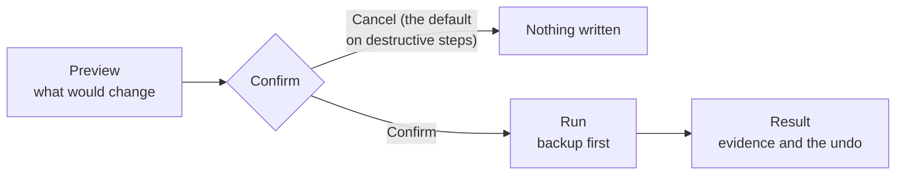
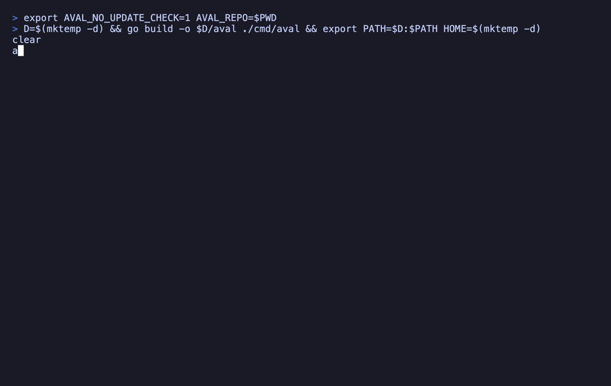
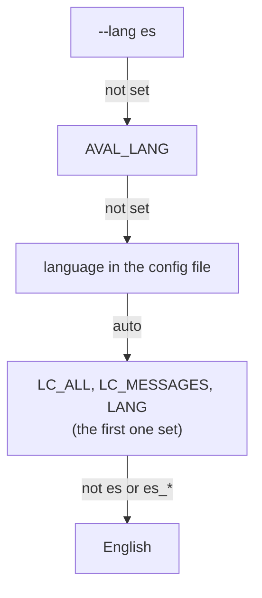
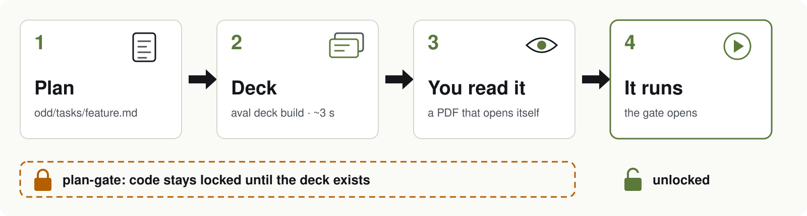
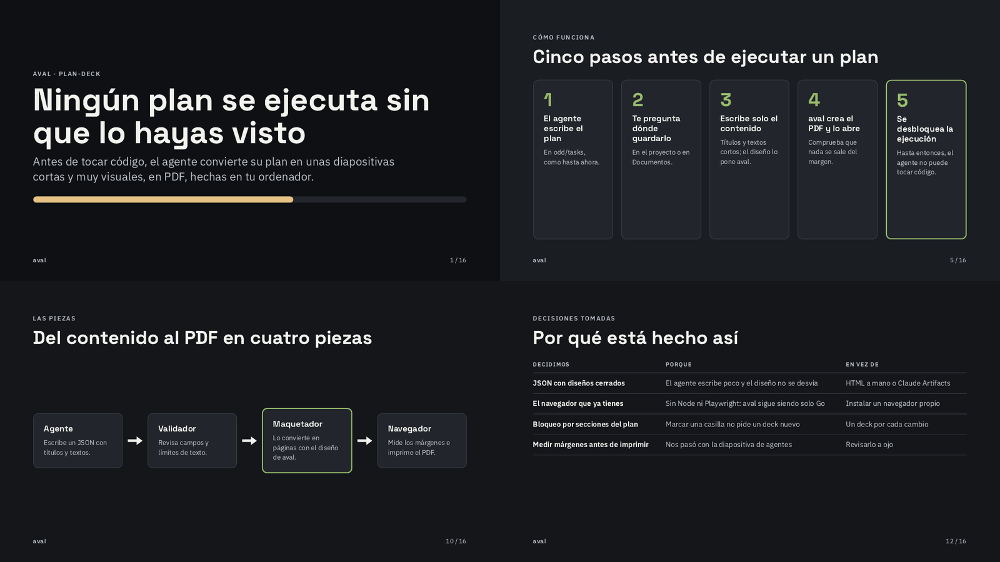

<div align="center">

<picture>
  <source media="(prefers-color-scheme: dark)" srcset="../assets/wordmark-dark.3ba4fd49.svg">
  
</picture>

# v0.2.0-rc.1

**The hub, a new terminal experience, and Spanish.**

2026-11-23 &nbsp;·&nbsp; prerelease &nbsp;·&nbsp; **English** &nbsp;·&nbsp; [Español](v0.2.0.es.md)

</div>

> [!NOTE]
> This is a release candidate. It ships to npm under the `next` tag and is marked as a prerelease on GitHub. The Spanish interface is covered by tests, but nobody has used it by hand for long yet. If something reads wrong, that is exactly the feedback this candidate is for.

> [!WARNING]
> **Breaking change: `aval` with no command no longer installs.** In v0.1.0, bare `aval` ran the installer. Now installing is always explicit: `aval install` (with `--dry-run`, `--yes`, `--copy`). The old flag-only form (`aval --yes`) still installs, with a deprecation notice on stderr, and unknown commands now fail instead of falling through to an install. If a script of yours runs bare `aval` to install, change it to `aval install --yes`.

## What this release means for you

In v0.1.0, running `aval` without a command installed. From this release, on a terminal, it opens a **hub**: one screen that shows the state of your machine (version, repo, doctor, last backup, theme) and lets you reach everything aval does, from install to uninstall, with the same safe rhythm every time: **preview, confirm, run, result**. Nothing is written until you confirm, and opening the hub writes nothing and never touches the network. The whole thing speaks English and Spanish, looks the way you choose, and every destructive step tells you how to undo it.

## Highlights

| **The hub** | **A safe rhythm** | **A rebuilt installer** |
| :--- | :--- | :--- |
| Bare `aval` on a terminal opens a hub with a status panel and 9 views. | Every write is preview, confirm, run, result. Destructive confirms open on Cancel. | Welcome, select with per-file previews, inline failures, a done screen with undo. |

| **Themes and settings** | **English and Spanish** | **A rate guard for agents** |
| :--- | :--- | :--- |
| 40 accepted theme values over 13 families, with live preview. | 538 messages per language, chosen by flag, variable, config or locale. | `aval hook rate-guard` stops agents from hammering hosts that ban the IP. |

| **Plan decks** | **The repo from anywhere** | **Explicit install** |
| :--- | :--- | :--- |
| `aval deck` turns a plan into a PDF you read before the agent runs it. | `--repo`, `AVAL_REPO` or the recorded location: any directory works. | `aval install` installs; bare `aval` opens the hub. |

## The hub

<div align="center">

</div>

Run `aval` on a terminal. You get the wordmark, a status panel and a menu in four groups. A detail pane beside the menu says what the highlighted entry will do before you open it, and a letter jumps straight to an entry (`i u s d b x , v a`; `?` lists them all).

```sh
aval            # opens the hub on a terminal
aval help       # the usage, byte for byte, with or without a terminal
```

Without a terminal, with `aval help` or `--help`, or with `TERM=dumb`, aval prints the usage instead, so scripts and pipes behave as before.

> [!IMPORTANT]
> Opening the hub writes nothing and makes no network call. The update badge reads refs your repo has already fetched. This is a rule, recorded in [ADR 0004](../adr/0004-hub-writes-nothing-offline.md) and pinned by tests.

### The views

| View | What it does | Safety net |
| :--- | :--- | :--- |
| **Install** | Links the repo configs into this home. | Previews first; anything in the way moves to `~/.aval-backup`. |
| **Update** | Pulls the repo (fast-forward only), then re-applies. | Fetches a preview, stops on a dirty tree, backs up files in the way. |
| **Sync** | Merges repo-managed settings into the live config. | Previews the drift, backs up, verifies with doctor, rolls back on failure. |
| **Doctor** | Checks this machine against the repo. | Read-only until you press `f`; offers only safe fixes, backed up first. |
| **Backups** | Lists backup runs and restores one. | A restore previews first, confirms on Cancel, moves foreign content aside instead of deleting it. |
| **Uninstall** | Removes the links aval made and puts back what they displaced. | Previews at once, confirms on Cancel, names `aval restore latest` as the undo. |
| **Settings** | Theme, glyphs, motion, update checks and language. | Enter saves, `esc` discards. |
| **Dev sandbox** | A throwaway home for trying aval. | Your real home is not touched; reset and remove confirm on Cancel. |
| **About** | Version, paths and links. | Read-only. |

### One rhythm for every write

Every view that changes something follows the same four steps, so you never have to learn a new flow:



The point is trust. A preview is computed before anything is written, and the views that write show it first. A destructive confirm opens with the cursor on Cancel, so a stray Enter does nothing, and it names its safety net (for example, a restore from `~/.aval-backup`).

## A rebuilt installer

<div align="center">

</div>

`aval install` is now a four-step flow:

1. **Welcome.** If aval cannot find its repository, it offers to clone it to `~/.aval` or to use a folder you already have. Cloning is always your choice.
2. **Select.** Each group shows what will happen to its files before anything is written: new, linked, or replaces a file.
3. **Install.** Failures appear inline, and `ctrl+c` stops gracefully after the current step.
4. **Done.** Counts, the backup path, the undo command (`aval restore latest`) and the next steps.

```sh
aval install                  # TUI: welcome, select, install, done
aval install --yes --dry-run  # no TUI: shows what it would do, touches nothing
aval install --yes            # no TUI: installs everything that applies
```

Quitting the installer writes nothing. Without a terminal and without `--yes`, it stops with a clear error instead of opening a TUI that cannot work. A help overlay (`?`) is generated from the key map, so it cannot drift from the keys that really work.

## Themes and settings

aval draws with one rule in every theme: **colour lives on the state glyph only** (`√` ok, `!` warning, `×` failure), never on the words. That keeps the interface readable on any background and in any palette.

| Choice | What you get |
| :--- | :--- |
| `aval` (default) | Ink on your own terminal background. |
| `terminal` | The 16 colours of your terminal. |
| `mono` | No colour at all. |
| 10 community families | `catppuccin`, `tokyo-night`, `gruvbox`, `dracula`, `nord`, `kanagawa`, `rose-pine`, `solarized`, `one-dark`, `everforest`. A variant can be pinned, for example `theme = catppuccin-frappe`. |

In total the `theme` key accepts 40 values. Palettes were read from each theme's upstream repository, and text and state colours are checked against contrast thresholds (4.5:1 for text, 3:1 for state glyphs); sources and licences are in [`internal/ui/themes/SOURCES.md`](../../internal/ui/themes/SOURCES.md).

The **Settings** view previews a theme live while you move through it, and applies nothing until you press enter. There are seven keys, and each has an environment variable or flag where it makes sense:

| Key | Values | Env | Flag |
| :--- | :--- | :--- | :--- |
| `repo` | path | `AVAL_REPO` | `--repo` |
| `theme` | `aval`, `terminal`, `mono`, or a community theme | `AVAL_THEME` | `--theme` |
| `background` | `auto`, `dark`, `light` | `AVAL_BACKGROUND` | |
| `glyphs` | `auto`, `unicode`, `ascii` | `AVAL_GLYPHS` | |
| `motion` | `auto`, `off` | `AVAL_MOTION` | |
| `update_check` | `on`, `off` | `AVAL_NO_UPDATE_CHECK` | |
| `language` | `auto`, `en`, `es` | `AVAL_LANG` | `--lang` |

The same settings are reachable from the command line, and the order is always flag, then environment, then file, then default:

```sh
aval config list              # every value and where it comes from
aval config get theme
aval config set theme catppuccin
aval config path
aval --plain doctor           # mono, ASCII glyphs, motion off, in one flag
```

`NO_COLOR` is honoured and wins over all of it. An invalid value in the file warns once on stderr and falls back to the default; `aval config set` refuses it with exit 1.

## Terminal wordmark

The hub opens with the aval wordmark drawn in the terminal. It is generated from the same geometry as the brand SVGs, so it cannot drift from the logo, and it has a Unicode tier and an ASCII tier for terminals that cannot draw the block characters.

## English and Spanish

The hub, the installer and the human output of the CLI (usage, doctor, sync, restore, uninstall, update, install and config) are available in English and Spanish.

<div align="center">

</div>

The language is resolved in this order, first match wins:



```sh
aval --lang es doctor            # one-off
AVAL_LANG=es aval                # for the session
aval config set language es      # sticks
```

With `language = auto`, aval picks Spanish when the first of `LC_ALL`, `LC_MESSAGES` and `LANG` that is set starts with `es`, and English otherwise.

What stays English, on purpose: `--json` output, hook and statusline output, logs and generated files. Scripts and agents read those, and they must not change with the locale. Hooks and the statusline are hot paths that never even resolve a language.

The translation is kept honest by tests: both languages must cover the same 538 messages with the same placeholders, plural messages need both forms, no message may exist that the code never looks up, and a copy guard enforces one Spanish term per concept. The screens are also pinned by golden files: 160 of the 328 are Spanish. The decision is recorded in [ADR 0006](../adr/0006-i18n-human-output.md).

## Plan decks

**You see the plan before the agent runs it.** When an agent works from a plan in `odd/tasks/`, aval turns it into a short PDF deck that a non-technical reader can follow in five minutes, and code stays locked until that deck exists.

<picture>
  <source media="(prefers-color-scheme: dark)" srcset="../assets/plan-deck-flow-dark.fa10f771.svg">
  
</picture>



| Piece | What it does |
| :--- | :--- |
| `aval deck build` | Renders a JSON spec as dark, brand-consistent slides and prints the PDF with the machine's own Chromium-based browser, after an overflow check. No cloud and no Node. |
| `aval deck check` and `aval deck example` | Validate a spec (layouts, required fields, text limits) and print a complete example that uses every layout. |
| The plan gate | A hook that denies edits outside `odd/` while the active plan has no deck. `--plan` on `build` records the deck and unlocks the work. |
| The `plan-deck` skill | Teaches any agent to write the deck: plain language first, decisions with what was rejected, honest about what is unverified. |

```sh
aval deck example > plan.deck.json
aval deck build plan.deck.json -o docs/decks/plan.pdf --plan odd/tasks/plan.md --open
```

This release was itself planned that way: its deck is [`docs/decks/release-v0.2.0.pdf`](../decks/release-v0.2.0.pdf).

## aval finds its repository from anywhere

A binary installed from npm or a GitHub release does not live inside the checkout, so aval now resolves the repository in a fixed order, first match wins: `--repo`, then `AVAL_REPO`, then the `repo` recorded in the config file, then the working directory, then the executable's location. `aval install` records the repository it ran from, so every later command works from any directory. The three explicit sources fail loudly if they point at something that is not a checkout, instead of guessing.

## Rate guard for agents

`aval hook rate-guard` is a new hook for Claude Code and OpenCode Bash calls. Some sites ban your IP after a burst of rapid requests. The guard denies a Bash batch that sends HTTP requests to such a host: a loop, `xargs` or `parallel`, a `-P` flag, more than 3 URLs, or a URL list fed to the client. A single request, or a loop over other hosts, passes. The built-in list can be extended with a `rate-guard-hosts` file in the aval config folder (next to the file `aval config path` prints) or with `AVAL_RATE_GUARD_HOSTS`. The hook reads only that file and its environment: no exec and no network.

## Fixes

- **install:** quitting `aval install` writes nothing, and without a terminal it stops with a clear error.
- **cli:** a sync rollback reports its backup id.
- **hub:** re-apply commits its backup run when it closes.
- **hub:** spinners honour the `motion` setting.
- **hub:** the gutter keeps a space before the cursor, and Install and Settings are registered as hub views.
- **ui:** safety lines wrap instead of truncating, and the uninstall preview scrolls long lists.
- **ui:** the done headline is bold ink, and state colour stays on the glyph in community themes.
- **cli:** no em dashes in command output.
- **doctor:** fixes for broken links name doctor as the backup origin.
- **ui:** paths under your home show as `~/...` with a forward slash on every system, Windows included.
- **deck:** browser paths and file URLs are built with the target system's separator, so decks also build on Windows.
- **design:** the overflow audit finds `playwright-core` when it is installed globally.

## Upgrade notes

> [!IMPORTANT]
> These are the behaviour changes to know about before you upgrade.

- **Installing is explicit.** Bare `aval` no longer installs; use `aval install`. The flag-only form still works with a deprecation notice, and unknown commands fail. See the warning at the top.
- **A bad `--lang` is an error.** `aval --lang xx ...` exits 1 on `sync`, `restore`, `uninstall`, `update`, `install`, `doctor` and `config`. A bad `AVAL_LANG` is skipped, and a bad `language` in the file warns and falls back to the locale. `version`, `help` and hooks ignore the language.
- **Bare `aval` on a terminal opens the hub.** Without a terminal it still prints the usage.
- **Backups record their origin.** Backup runs now say which command made them (for example install or doctor).
- **Spanish locales switch the interface.** If your `LANG` starts with `es`, aval now speaks Spanish. `aval config set language en` or `AVAL_LANG=en` keeps English.
- **Machine output is unchanged.** `--json`, hooks, the statusline, logs and generated files stay English.

## Known limits

- **Some text is still English in a Spanish session.** Text that comes from the core packages (doctor check messages, plan group labels and reasons, sync warnings and the reasons inside install errors), `unknown command`, and the update-available notice.
- **The Spanish interface has been checked by tests, not by hand for long.** That is why this is a candidate.
- **Terminals vary.** The Unicode tier needs a terminal that can draw block characters and the glyphs; otherwise use `--plain` or `glyphs = ascii`.

## Verify this release

```sh
gh release download v0.2.0-rc.1 -R alvaroofernaandez/aval
shasum -a 256 -c SHA256SUMS --ignore-missing      # Linux: sha256sum -c
gh attestation verify aval_0.2.0-rc.1_<os>_<arch>.tar.gz --repo alvaroofernaandez/aval
tar -xzf aval_0.2.0-rc.1_<os>_<arch>.tar.gz && ./aval version
npx @alvaroofernaandez/aval@next version
```

Replace `<os>` and `<arch>` with your platform, for example `darwin_arm64`.

<details>
<summary><strong>For contributors</strong></summary>

<br/>

The release also hardens how aval is built, so the next releases are cheaper to change.

- **An architecture guard.** `tests/architecture_test.go` checks every import between `internal/` packages against a declared allowlist, and `docs/architecture/model.md` is generated from it. See [ADR 0002](../adr/0002-internal-layering.md).
- **Errors as values.** Command and core errors are sentinels and typed errors, asserted with `errors.Is` and `errors.As`, never by their text. User-facing text is pinned in one place, `tests/messages_test.go`.
- **A testable `run`.** `run(args, stdin, stdout, stderr, env)` is the whole command line, so subcommands are tested in process, with a handful of real-binary smoke tests.
- **ADRs 0001 to 0006.** Go only, internal layering, pre-push scans CI tests, the hub writes nothing and stays offline, a cost-aware context relay, and i18n for human output. See [the index](../adr/README.md).
- **Project skills.** Four skills in `.claude/skills/` (`aval-architecture`, `aval-testing`, `aval-docs`, `aval-release`) carry the house rules for agents. Generic `architecture-evidence` and `strict-tdd` standards ship in `skills/`.
- **Hygiene tests.** Guards against fixed sleeps, ad hoc temp dirs and comparisons of error text in tests.
- **Release notes.** Each release now has hand-written notes in English and Spanish under `docs/releases/`, linked from the CHANGELOG. See [docs/releasing.md](../releasing.md).

</details>

---

The full history of changes is the commit list that follows on the GitHub release page. The summary is in the [CHANGELOG](../../CHANGELOG.md).
