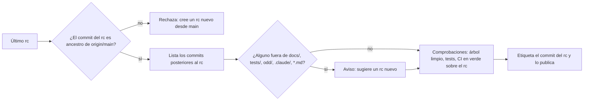

<div align="center">

<picture>
  <source media="(prefers-color-scheme: dark)" srcset="../assets/wordmark-dark.3ba4fd49.svg">
  
</picture>

# v0.2.1

**Promote funciona aunque main haya avanzado.**

2026-11-23 &nbsp;·&nbsp; estable &nbsp;·&nbsp; [English](v0.2.1.md) &nbsp;·&nbsp; **Español**

</div>

## Qué significa esta versión para usted

`aval release promote` convierte una release candidate ya probada en la versión estable, sobre el mismo commit. Hasta ahora se negaba en cuanto `main` tenía cualquier commit posterior al rc, aunque solo fuera de documentación, y su error sugería hacer checkout del commit del rc, algo que la comprobación siguiente rechazaba. Solo se podía promocionar si no se había fusionado nada desde el rc, lo que rara vez ocurre. Desde esta versión, promote comprueba el rc y no su checkout, e indica qué no incluirá la versión estable.

## Lo más destacado

| **Promote tras fusionar** | **Comprueba el rc, no HEAD** | **Claro sobre lo que queda fuera** |
| :-- | :-- | :-- |
| La documentación, los tests o los planes fusionados tras el rc ya no bloquean un promote. | El commit del rc debe estar en `origin/main`; la CI se comprueba sobre ese commit. | Se listan los commits posteriores al rc y se avisa cuando alguno cambia código que se distribuye. |

## Cómo decide promote ahora



| Comprobación | Antes | Ahora |
| :-- | :-- | :-- |
| HEAD es el commit del rc | obligatoria | no obligatoria |
| En `main`, al día con `origin/main` | obligatoria | se omite en promote |
| El commit del rc está en `origin/main` | no se comprobaba | obligatoria |
| CI en verde | sobre el rc | sobre el rc |
| Commits posteriores al rc | rechazo | se listan, con aviso si cambian código distribuido |

```sh
aval release promote --dry-run   # muestra la versión, los commits que quedan fuera y las comprobaciones
```

## Correcciones

- **release:** `aval release promote` etiqueta el commit del rc aunque `main` haya avanzado, rechaza un rc que no está en `origin/main` y ya no sugiere un checkout que sus propias comprobaciones rechazan ([#79](https://github.com/alvaroofernaandez/aval/issues/79))

> [!IMPORTANT]
> Las notas y la sección de `CHANGELOG.md` escritas después de un rc no están dentro de la etiqueta promocionada. El cuerpo de la release en GitHub sale de `main`, así que tras un promote sus enlaces a esos archivos apuntan a `main`. `docs/releasing.md` y las skills de release describen la regla.

## Verificar esta versión

```sh
gh release download v0.2.1 -R alvaroofernaandez/aval
shasum -a 256 -c SHA256SUMS --ignore-missing
gh attestation verify aval_0.2.1_<os>_<arch>.tar.gz --repo alvaroofernaandez/aval
npx @alvaroofernaandez/aval@latest version
```
