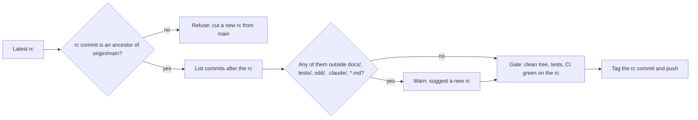

<div align="center">

<picture>
  <source media="(prefers-color-scheme: dark)" srcset="../assets/wordmark-dark.3ba4fd49.svg">
  
</picture>

# v0.2.1

**Promote works after main moves on.**

2026-11-23 &nbsp;·&nbsp; stable &nbsp;·&nbsp; **English** &nbsp;·&nbsp; [Español](v0.2.1.es.md)

</div>

## What this release means for you

`aval release promote` turns a tested release candidate into the stable release, on the same commit. Until now it refused as soon as `main` had any commit after the rc, even a docs-only one, and its error suggested checking out the rc commit, which the next check then rejected. A stable could only be promoted if nothing had merged since the rc, which is rarely the case. From this release, promote checks the rc, not your checkout, and tells you what the stable will not contain.

## Highlights

| **Promote after merges** | **Checks the rc, not HEAD** | **Honest about what is left out** |
| :-- | :-- | :-- |
| Docs, tests or plans merged after the rc no longer block a promote. | The rc commit must be on `origin/main`; CI is checked on that commit. | Commits after the rc are listed; a warning appears when one changes shipped code. |

## How promote decides now



| Check | Before | Now |
| :-- | :-- | :-- |
| HEAD is the rc commit | required | not required |
| On `main`, up to date with `origin/main` | required | skipped for promote |
| rc commit is on `origin/main` | not checked | required |
| CI green | on the rc | on the rc |
| Commits after the rc | refusal | listed, with a warning for shipped code |

```sh
aval release promote --dry-run   # shows the version, the commits left out and the checks
```

## Fixes

- **release:** `aval release promote` tags the rc commit after `main` has moved on, refuses an rc that is not on `origin/main`, and no longer suggests a checkout its own checks reject ([#79](https://github.com/alvaroofernaandez/aval/issues/79))

> [!IMPORTANT]
> The notes and `CHANGELOG.md` section written after an rc are not inside the promoted tag. The GitHub release body comes from `main`, so after a promote its links to those files point at `main`. `docs/releasing.md` and the release skills describe the rule.

## Verify this release

```sh
gh release download v0.2.1 -R alvaroofernaandez/aval
shasum -a 256 -c SHA256SUMS --ignore-missing
gh attestation verify aval_0.2.1_<os>_<arch>.tar.gz --repo alvaroofernaandez/aval
npx @alvaroofernaandez/aval@latest version
```
