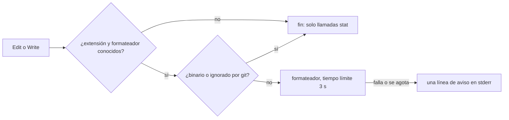
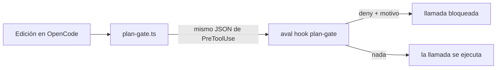

<div align="center">

<picture>
  <source media="(prefers-color-scheme: dark)" srcset="../assets/wordmark-dark.3ba4fd49.svg">
  
</picture>

# v0.3.0-rc.4

**Las ediciones vuelven formateadas, cada herramienta externa está en una tabla, la puerta del plan cubre OpenCode y los decks se generan sin conexión.**

2026-11-23 &nbsp;·&nbsp; prerelease &nbsp;·&nbsp; [English](v0.3.0.md) &nbsp;·&nbsp; **Español**

</div>

> [!NOTE]
> Esta es una versión candidata de v0.3.0, el núcleo nativo del harness. Se publica en npm con la etiqueta `next` y aparece como prerelease en GitHub. El plugin de OpenCode está probado con su propia sonda, todavía no dentro de una sesión larga de OpenCode, y las fuentes embebidas del deck se compararon a ojo en una sola máquina; esa es la opinión que se busca con esta candidata.

## Qué significa esta versión para usted

Cuando un agente edita un archivo, aval formatea ahora ese único archivo con el formateador que ya usa el proyecto (gofmt, Biome, Prettier o Ruff), justo después de la edición y antes de que el agente vuelva a leerlo. No hay nada que configurar, y una edición que nadie formatea cuesta unos microsegundos.

aval se apoya en herramientas que no distribuye: git, gh, rtk, code-review-graph, Engram, un navegador, tmux y otras. Hasta ahora nada decía cuáles necesitaba, qué se rompía sin cada una ni qué versión de aval planea sustituirla. `aval deps` imprime ahora ese inventario y `aval doctor` lo comprueba: si falta `git`, el doctor falla; cualquier otra herramienta ausente es un aviso que nombra la función que se desactiva.

La regla de aval es que nadie ejecuta un plan que no ha visto: mientras el plan activo de `odd/tasks/` no tiene deck, las ediciones de código se deniegan. Hasta ahora solo Claude Code la aplicaba. OpenCode aplica ahora la misma regla, con el mismo binario, de modo que un plan escrito en un agente y ejecutado en el otro pasa por la misma puerta, y un solo `aval deck build --plan` abre ambos. Los decks ya no necesitan la red: las fuentes de la marca viajan dentro del binario, de modo que un deck generado en un avión se ve igual que uno generado en la oficina.

## Lo más destacado

| **Una regla, dos agentes** | **Sin lógica duplicada** | **Falla en abierto** |
| :-- | :-- | :-- |
| Las ediciones, escrituras y parches de OpenCode pasan por la puerta del plan. | El plugin entrega el payload a `aval hook plan-gate`; la decisión y su motivo salen de Go. | Sin binario, con un tiempo agotado o una salida extraña, la edición sigue adelante. |
| **Formateado tras cada edición** | **Solo el formateador del proyecto** | **Nunca estorba** |
| `aval hook fmt` se ejecuta tras Edit y Write sobre el único archivo que cambió. | gofmt, o Biome o Prettier desde `node_modules/.bin`, o Ruff con un archivo de proyecto. | Un fallo o un tiempo agotado de 3 s es una línea de aviso; la edición siempre se mantiene. |
| **Un inventario** | **El doctor lo conoce** | **Una hoja de ruta por herramienta** |
| `aval deps`: 36 herramientas por capa, quién usa cada una y qué ocurre sin ella. | Una fila `deps` en `aval doctor` y en el hub; solo `git` bloquea. | Cada herramienta nombra la issue que planea absorberla, o `none`. |
| **Decks sin conexión** | **Fuentes sin modificar** | **Generación más rápida** |
| El HTML generado no contiene ninguna URL `http://` ni `https://`. | Space Grotesk e IBM Plex Sans, byte a byte desde `google/fonts`, con sus licencias en cada archivo publicado. | Un deck de 16 diapositivas se genera en unos 2,8 s en lugar de 3,7 s: no se descargan fuentes. |

## Formateo tras cada edición

| Archivo editado | Formateador | Cuándo |
| :-- | :-- | :-- |
| `.go` | `gofmt -w` | `gofmt` en el `PATH` |
| `.ts`, `.tsx`, `.js`, `.jsx`, `.json`, `.css` | `biome format --write` | `biome.json` y `node_modules/.bin/biome` |
| los mismos | `prettier --write` | sin Biome; un `.prettierrc*` o `prettier.config.*` y `node_modules/.bin/prettier` |
| `.py` | `ruff format` | `ruff` en el `PATH` y un `pyproject.toml` o `ruff.toml` |
| cualquier otro, un archivo binario, uno que git ignora o uno fuera de un repositorio | ninguno | no inicia ningún proceso |



Medido con benchmarks de Go en un Mac con Apple Silicon bajo carga: unos 4 µs para una edición que nadie formatea (objetivo inferior a 5 ms) y unos 15 ms para una ejecución de gofmt (objetivo p95 inferior a 150 ms). Prettier arranca Node y puede tardar más; no se ha medido. Claude Code detecta la reescritura: en una comprobación sin interfaz, la siguiente edición del agente sobre el mismo archivo se aplicó sin volver a leerlo.

El hook es el primero que inicia un proceso bajo una regla nueva, el [ADR 0007](../adr/0007-hooks-may-start-a-resolved-tool.md): un hook puede iniciar una herramienta que ya ha localizado, con un tiempo límite, nunca en su camino sin trabajo. Leer configuración y usar la red siguen prohibidos para todos los hooks.

## La puerta del plan en OpenCode

| Llamada de OpenCode mientras el plan no tiene deck | Resultado |
| :-- | :-- |
| `edit`, `write` o `patch` de un archivo fuente | denegada, con el mismo motivo que muestra Claude Code |
| una edición bajo `odd/` o de un `*.deck.json` | permitida |
| `bash`, `read` y cualquier otra herramienta | sin puerta |
| `AVAL_PLAN_DECK_OFF=1` | permitida, de forma deliberada |
| sin binario `aval`, tiempo agotado de 2 s o salida no válida | permitida |



El plugin se instala con el resto de `config/opencode/plugin` mediante `aval install`; no hay nada que configurar. Medido en un Mac con Apple Silicon, una llamada con puerta añade entre 10 y 13 ms aproximadamente con el binario ya en caliente.

## El inventario de dependencias

```sh
aval deps                       # la tabla: estado, herramienta, capa, si falta, sustituto, usada por
aval deps --layer harness       # harness, agent o env
aval deps --json                # para scripts; sale con 1 si falta una herramienta que bloquea
```

| Capa | Qué cubre | Ejemplos |
| :-- | :-- | :-- |
| `harness` | aval, sus comandos y sus hooks | git, go, gh, gitleaks, rtk, code-review-graph, un navegador Chromium |
| `agent` | los entornos de los agentes y lo que llaman sus skills | claude, opencode, engram, node, docker |
| `env` | el entorno de shell y terminal que enlaza `aval install` | zsh y sus plugins, tmux, yazi, Ghostty, fzf, ripgrep |

El inventario es `internal/core/deps/deps.manifest`, embebido en el binario: `aval deps` no necesita el repositorio ni la red. Solo ejecuta un comando corto de versión para git, go, gh, node, docker, tmux y zsh, cada uno limitado a 200 ms; el doctor y el hub solo buscan las herramientas y no inician ningún proceso. Las aplicaciones de macOS se comprueban por ruta en macOS y figuran como omitidas en otros sistemas. Las líneas del Brewfile que solo usa la persona (aplicaciones personales) están en una lista explícita `[personal]`, y un test falla cuando una línea del Brewfile no es ni una entrada ni personal. Medido en frío en esta máquina: 0,53 s la primera ejecución, unos 0,1 s después.

## Los decks no necesitan la red

| | Antes | Ahora |
| :-- | :-- | :-- |
| Origen de las fuentes | un `<link>` a fonts.googleapis.com | dos reglas `@font-face` incrustadas desde el binario |
| Sin conexión | fuentes del sistema (Avenir Next, Segoe UI, Helvetica) | las fuentes de la marca |
| Tamaño del binario (`-trimpath -s -w`, darwin/arm64) | 12.929.378 bytes | 13.623.298 bytes (+694 KB) |
| `aval deck build` de 16 diapositivas | unos 3,7 s | unos 2,8 s |

Las fuentes son los archivos variables que publica hoy `google/fonts` (Space Grotesk 2.000, IBM Plex Sans 3.201), embebidos sin modificar: sin subconjuntos ni conversiones, porque IBM Plex reserva su nombre para los archivos sin modificar. Su origen, versiones y sumas SHA-256 están en `internal/deck/assets/fonts/SOURCES.md`, y los dos textos de la SIL Open Font License se incluyen en cada archivo publicado. Medido en un Mac con Apple Silicon bajo carga.

## Notas de actualización

> [!IMPORTANT]
> Tras `aval sync`, Claude Code ejecuta `aval hook fmt` después de cada Edit y Write, y los hooks de gentle-ai (un hook de revisión en SessionStart y Stop, telemetría en Stop y SubagentStop) desaparecen de `~/.claude/settings.json`, sin ningún hook en su lugar: la revisión de código es el comando `aval review assess`. El Brewfile ya no instala gentle-ai; el tap se mantiene.
>
> `aval doctor` tiene una nueva fila `deps` y sale con 1 cuando falta `git`; cualquier otra herramienta ausente es un aviso.
>
> Tras `aval install` o `aval sync`, OpenCode deniega las ediciones mientras el plan activo no tiene deck, como ya hacía Claude Code. Genere el deck (`aval deck build <spec> -o <pdf> --plan <plan>`) o defina `AVAL_PLAN_DECK_OFF=1` para saltarse la puerta de forma deliberada.

## Límites conocidos

- El `native_substitute` de cada herramienta es una propuesta que el responsable revisa en esta candidata; ninguna herramienta se marca como «desactualizada».

- Las fuentes del deck se compararon a ojo con la versión anterior generada con conexión, en dos diapositivas; la CI no puede cortar la red, así que un test que comprueba que el HTML no contiene URL externas ocupa su lugar.

- Una llamada `patch` que solo lleva el texto del parche y ninguna ruta de archivo no pasa por la puerta, igual que en la puerta de diseño.
- Los casos de tiempo agotado y salida no válida fallan en abierto por diseño; se revisan en el código, no con tests.

## Para quienes contribuyen

- Los marcadores de gentle-ai desaparecen de los archivos de instrucciones, que conservan su texto; se eliminan `skills/_shared/review-ledger-contract*.md`; `tests/no_gentle_ai_test.go` mantiene el nombre fuera de `config/`, `internal/`, `cmd/`, `skills/_shared/`, el Brewfile, el README y `.agents/DESIGN.md`, y un test solo permite que los hooks ejecuten `aval`, `code-review-graph` y `rm` (#4).
- `AGENTS.md` incluye una enmienda fechada a la regla de los hooks, que remite al ADR 0007 (#25).

## Verificar esta versión

```sh
gh release download v0.3.0-rc.4 -R alvaroofernaandez/aval
shasum -a 256 -c SHA256SUMS --ignore-missing
gh attestation verify aval_0.3.0-rc.4_<os>_<arch>.tar.gz --repo alvaroofernaandez/aval
npx @alvaroofernaandez/aval@next version
```
