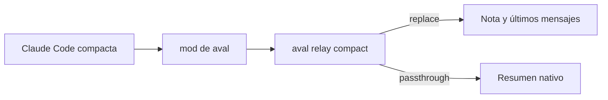
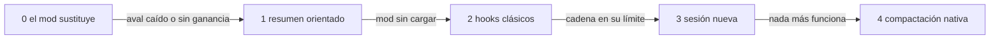
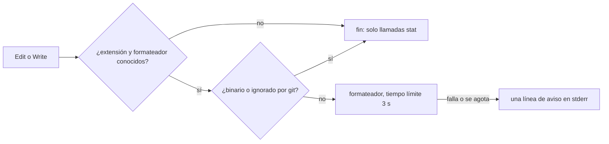
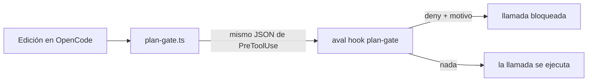

<div align="center">

<picture>
  <source media="(prefers-color-scheme: dark)" srcset="../assets/wordmark-dark.3ba4fd49.svg">
  
</picture>

# v0.3.0-rc.8

**Un relay de contexto experimental para Claude Code con una escalera de respaldo y un estado que se puede consultar, las ediciones vuelven formateadas, cada herramienta externa está en una tabla, la puerta del plan cubre OpenCode y los decks se generan sin conexión.**

2026-11-24 &nbsp;·&nbsp; prerelease &nbsp;·&nbsp; [English](v0.3.0.md) &nbsp;·&nbsp; **Español**

</div>

> [!NOTE]
> Esta es una versión candidata de v0.3.0, el núcleo nativo del harness. Se publica en npm con la etiqueta `next` y aparece como prerelease en GitHub. El plugin de OpenCode está probado con su propia sonda, todavía no dentro de una sesión larga de OpenCode, y las fuentes embebidas del deck se compararon a ojo en una sola máquina; esa es la opinión que se busca con esta candidata. El relay de contexto es nuevo en la rc.6 y está desactivado por defecto; la rc.7 añade su escalera de respaldo y la rc.8, `aval relay status` y `log`. Ambos se comprobaron en sesiones de Claude Code sin interfaz, todavía no en la pantalla interactiva.

## Qué significa esta versión para usted

Las sesiones largas de Claude Code se compactan: cuando el contexto se llena, Claude Code pide a un modelo que resuma la conversación, espera la respuesta y continúa a partir del resumen. El relay, nuevo en esta candidata y desactivado salvo que usted lo active, responde él mismo a esa compactación. aval escribe una nota breve (la primera petición, la rama, las peticiones recientes y los archivos editados) y conserva los últimos mensajes palabra por palabra, de modo que no hay llamada al resumidor y el agente no pierde el hilo. `aval relay enable` lo activa para Claude Code; `aval relay disable` lo retira.

Cuando el relay no puede responder, la rc.7 lo hace bajar por una escalera en lugar de rendirse. Si aval falta o tarda, Claude Code compacta igualmente, pero se le indica a su resumen qué debe conservar. Si el mod no llega a cargarse, dos hooks clásicos llevan la misma nota. Y cuando una sesión ya lleva cinco relays seguidos, el relay deja de apilar notas sobre notas y abre una sesión nueva que parte de la nota.

La rc.8 permite inspeccionar el relay. `aval relay status` indica si está activado, qué puede hacer en Claude Code y qué hizo la última vez, y `aval relay log` muestra todos los relays aplicados, con los tokens de antes y de después.

Cuando un agente edita un archivo, aval formatea ahora ese único archivo con el formateador que ya usa el proyecto (gofmt, Biome, Prettier o Ruff), justo después de la edición y antes de que el agente vuelva a leerlo. No hay nada que configurar, y una edición que nadie formatea cuesta unos microsegundos.

aval se apoya en herramientas que no distribuye: git, gh, rtk, code-review-graph, Engram, un navegador, tmux y otras. Hasta ahora nada decía cuáles necesitaba, qué se rompía sin cada una ni qué versión de aval planea sustituirla. `aval deps` imprime ahora ese inventario y `aval doctor` lo comprueba: si falta `git`, el doctor falla; cualquier otra herramienta ausente es un aviso que nombra la función que se desactiva.

La regla de aval es que nadie ejecuta un plan que no ha visto: mientras el plan activo de `odd/tasks/` no tiene deck, las ediciones de código se deniegan. Hasta ahora solo Claude Code la aplicaba. OpenCode aplica ahora la misma regla, con el mismo binario, de modo que un plan escrito en un agente y ejecutado en el otro pasa por la misma puerta, y un solo `aval deck build --plan` abre ambos. Los decks ya no necesitan la red: las fuentes de la marca viajan dentro del binario, de modo que un deck generado en un avión se ve igual que uno generado en la oficina.

## Lo más destacado

| **Relay de contexto** | **Sin llamada al resumidor** | **Desactivado por defecto** |
| :-- | :-- | :-- |
| aval responde a la compactación de Claude Code: una nota y los últimos mensajes. | El contexto se sustituye en el sitio; la sesión y su proceso se mantienen. | `aval relay enable` y `disable` cambian exactamente tres claves de su configuración. |
| **Escalera de respaldo** | **Hooks sin el mod** | **Una sesión nueva en el límite** |
| :-- | :-- | :-- |
| Si aval falla o tarda, la nota o un texto fijo orientan el resumen nativo. | `aval hook relay-precompact` y `relay-sessionstart` llevan la nota cuando el mod no se carga. | Tras 5 relays, el mod limpia la sesión y abre una nueva con la nota (`AVAL_RELAY_MAX_CHAIN`). |
| **Estado del relay** | **Registro del relay** | **También para scripts** |
| :-- | :-- | :-- |
| `aval relay status`: activado o no, nivel, origen de la lectura y margen de error, pausa, último relay. | `aval relay log`: cada relay aplicado con los tokens de antes y de después, desde `metrics.jsonl`. | `--json` en las dos imprime un objeto estable en inglés. |
| **Una regla, dos agentes** | **Sin lógica duplicada** | **Falla en abierto** |
| :-- | :-- | :-- |
| Las ediciones, escrituras y parches de OpenCode pasan por la puerta del plan. | El plugin entrega el payload a `aval hook plan-gate`; la decisión y su motivo salen de Go. | Sin binario, con un tiempo agotado o una salida extraña, la edición sigue adelante. |
| **Formateado tras cada edición** | **Solo el formateador del proyecto** | **Nunca estorba** |
| `aval hook fmt` se ejecuta tras Edit y Write sobre el único archivo que cambió. | gofmt, o Biome o Prettier desde `node_modules/.bin`, o Ruff con un archivo de proyecto. | Un fallo o un tiempo agotado de 3 s es una línea de aviso; la edición siempre se mantiene. |
| **Un inventario** | **El doctor lo conoce** | **Una hoja de ruta por herramienta** |
| `aval deps`: 36 herramientas por capa, quién usa cada una y qué ocurre sin ella. | Una fila `deps` en `aval doctor` y en el hub; solo `git` bloquea. | Cada herramienta nombra la issue que planea absorberla, o `none`. |
| **Decks sin conexión** | **Fuentes sin modificar** | **Generación más rápida** |
| El HTML generado no contiene ninguna URL `http://` ni `https://`. | Space Grotesk e IBM Plex Sans, byte a byte desde `google/fonts`, con sus licencias en cada archivo publicado. | Un deck de 16 diapositivas se genera en unos 2,8 s en lugar de 3,7 s: no se descargan fuentes. |

## El relay de contexto (experimental)

Una compactación sustituye lo que el agente tiene delante por algo más corto. Claude Code lo hace pidiendo un resumen a un modelo. Con el relay activado, el mod de aval responde a la compactación en su lugar: `aval relay compact` construye una nota y elige los últimos mensajes que se conservan literalmente, y Claude Code continúa con ellos.

```bash
aval relay enable    # lo activa; después reinicie Claude Code
aval relay pause     # solo este repositorio: Claude Code compacta como siempre
aval relay resume
aval relay disable   # lo retira
```



| Pieza | Qué hace | Red de seguridad |
| :-- | :-- | :-- |
| La nota | Primera petición, rama, peticiones recientes (hasta 15) y archivos editados (hasta 25), en 8.000 tokens como máximo; las credenciales se enmascaran. | Si no cabe, quita las peticiones y después los archivos; nunca supera el presupuesto. |
| Los últimos mensajes | Se conservan literalmente, unos 20.000 tokens, sin separar nunca una llamada a una herramienta de su resultado. | Si se conservarían todos, no se gana nada, y Claude Code compacta como siempre. |
| Frenos | No hay dos relays sin avance, como mucho 5 seguidos y al menos 3 turnos entre uno y otro. | Un relay frenado deja que Claude Code compacte como siempre; en el límite de la cadena, la escalera abre una sesión nueva (nivel 3). |
| Umbrales | 200.000 tokens por defecto (`AVAL_RELAY_HARD_TOKENS`); la ventana de compactación es eso más el margen de 33.000 tokens que reserva Claude Code. | `enable` rechaza una ventana por debajo del mínimo de 100.000 tokens de Claude Code. |
| Disparadores | Solo las compactaciones que Claude Code inicia por sí mismo o con `/compact`. | Cualquier otra compactación es nativa. |
| Fallo | Una pausa, `AVAL_RELAY=0`, un bloqueo ocupado o un freno distinto del límite de la cadena. | Claude Code compacta como lo haría sin aval. |

En una prueba en el sandbox con una ventana de 100.000 tokens, un relay llevó una sesión de haiku de 60.830 a 32.900 tokens, y el agente siguió nombrando la palabra secreta del primer turno, que ya no estaba entre los mensajes conservados: la sacó de la nota. El estado del relay de cada sesión está en `~/.local/state/aval/relay`.

### La escalera de respaldo

| Nivel | Cuándo | Qué ocurre |
| :-- | :-- | :-- |
| 0 | por defecto | el mod sustituye el contexto por la nota y los últimos mensajes |
| 1 | aval falta, tarda más de 2 s o falla; o los últimos mensajes lo conservarían todo | Claude Code compacta de forma nativa, con su resumen orientado por la nota o por un texto fijo del mod |
| 2 | el mod no se carga | `aval hook relay-precompact` orienta el resumen; `aval hook relay-sessionstart` añade la nota después |
| 3 | la sesión ya lleva 5 relays (`AVAL_RELAY_MAX_CHAIN`) | Claude Code compacta de forma nativa; al final del turno, el mod limpia la sesión y envía la nota como primer prompt de una sesión nueva |
| 4 | todo lo anterior falló | compactación nativa con la ventana que fijó `enable` |



Los hooks del nivel 2 están en la configuración que instala `aval sync`, porque un mod que no se carga tampoco carga sus propios hooks; no hacen nada salvo con `AVAL_RELAY=1`, y `relay-sessionstart` no interviene si el mod hizo un relay en los últimos 10 segundos. En pruebas en el sandbox sin interfaz, con Claude Code 2.1.331 y haiku, cada nivel se observó una vez: en el nivel 2, el agente citó la primera petición de la nota tras un `/compact`; en el nivel 1, el mod recibió la respuesta de orientación, o recurrió al respaldo cuando un aval falso fallaba; en el nivel 3, la limpieza se ejecutó, la nota llegó como prompt del plugin y el siguiente relay empezó una cadena nueva.

### Ver lo que hizo el relay

Un relay que funciona en silencio no se distingue de uno que nunca se ejecutó. La rc.8 añade dos órdenes de solo lectura. `aval relay status` indica si el relay está activado y con qué ventana, qué puede hacer en Claude Code, qué exactitud tiene la lectura de tokens, si este repositorio está en pausa y cuál fue el último relay. `aval relay log` muestra todos los relays aplicados, del más antiguo al más reciente.

```console
$ aval relay status --lang es
relay     activado, ventana de compactación 233000 tokens
nivel     T0 sustitución en el sitio, sin llamada al modelo
contexto  lectura exacta, error dentro del 2%
repo      ~/code/app, activo
relays    2 registrados, el último de 64k a 32k el 2026-11-24 14:40

$ aval relay log --lang es
2026-11-24 11:12  auto    replace  201k a 38k
2026-11-24 14:40  manual  replace  64k a 32k
```

La salida anterior procede de un archivo de estado de muestra con dos relays, impreso por el binario de la rc.8.

| Pieza | Qué hace | Red de seguridad |
| :-- | :-- | :-- |
| `metrics.jsonl` | Una línea por cada relay aplicado. Se escribe cuando el mod mide por primera vez el contexto nuevo, con los tokens de antes y de después, el disparador y la respuesta. | Modo 0600, en `~/.local/state/aval/relay`. Una última línea cortada se omite y no detiene la lectura. |
| `status` | Cinco filas: estado y ventana, nivel, origen de la lectura y su margen de error, repositorio y pausa, último relay. | No tener nada registrado es un estado, no un error: indica el directorio que leyó. |
| `log` | Todos los relays aplicados, del más antiguo al más reciente, en tokens (nunca en porcentajes, ADR 0005). | Sin estado, indica dónde buscó. |
| `--json` | Las dos órdenes imprimen un objeto estable en inglés para scripts. | Las claves son el contrato para máquinas; el texto para personas sigue `--lang`. |

El núcleo también genera el texto de la notificación para cada nivel de entrega (`Relayed 212k → 61k (floor 58k) · cold cache` en T0; en T3 y T4 el texto indica la acción). Todavía no hay nada que lo entregue: el notificador del sistema llegará en una candidata posterior.

## Formateo tras cada edición

| Archivo editado | Formateador | Cuándo |
| :-- | :-- | :-- |
| `.go` | `gofmt -w` | `gofmt` en el `PATH` |
| `.ts`, `.tsx`, `.js`, `.jsx`, `.json`, `.css` | `biome format --write` | `biome.json` y `node_modules/.bin/biome` |
| los mismos | `prettier --write` | sin Biome; un `.prettierrc*` o `prettier.config.*` y `node_modules/.bin/prettier` |
| `.py` | `ruff format` | `ruff` en el `PATH` y un `pyproject.toml` o `ruff.toml` |
| cualquier otro, un archivo binario, uno que git ignora o uno fuera de un repositorio | ninguno | no inicia ningún proceso |



Medido con benchmarks de Go en un Mac con Apple Silicon bajo carga: unos 4 µs para una edición que nadie formatea (objetivo inferior a 5 ms) y unos 15 ms para una ejecución de gofmt (objetivo p95 inferior a 150 ms). Prettier arranca Node y puede tardar más; no se ha medido. Claude Code detecta la reescritura: en una comprobación sin interfaz, la siguiente edición del agente sobre el mismo archivo se aplicó sin volver a leerlo.

El hook es el primero que inicia un proceso bajo una regla nueva, el [ADR 0007](../adr/0007-hooks-may-start-a-resolved-tool.md): un hook puede iniciar una herramienta que ya ha localizado, con un tiempo límite, nunca en su camino sin trabajo. Leer configuración y usar la red siguen prohibidos para todos los hooks.

## La puerta del plan en OpenCode

| Llamada de OpenCode mientras el plan no tiene deck | Resultado |
| :-- | :-- |
| `edit`, `write` o `patch` de un archivo fuente | denegada, con el mismo motivo que muestra Claude Code |
| una edición bajo `odd/` o de un `*.deck.json` | permitida |
| `bash`, `read` y cualquier otra herramienta | sin puerta |
| `AVAL_PLAN_DECK_OFF=1` | permitida, de forma deliberada |
| sin binario `aval`, tiempo agotado de 2 s o salida no válida | permitida |



El plugin se instala con el resto de `config/opencode/plugin` mediante `aval install`; no hay nada que configurar. Medido en un Mac con Apple Silicon, una llamada con puerta añade entre 10 y 13 ms aproximadamente con el binario ya en caliente.

## El inventario de dependencias

```sh
aval deps                       # la tabla: estado, herramienta, capa, si falta, sustituto, usada por
aval deps --layer harness       # harness, agent o env
aval deps --json                # para scripts; sale con 1 si falta una herramienta que bloquea
```

| Capa | Qué cubre | Ejemplos |
| :-- | :-- | :-- |
| `harness` | aval, sus comandos y sus hooks | git, go, gh, gitleaks, rtk, code-review-graph, un navegador Chromium |
| `agent` | los entornos de los agentes y lo que llaman sus skills | claude, opencode, engram, node, docker |
| `env` | el entorno de shell y terminal que enlaza `aval install` | zsh y sus plugins, tmux, yazi, Ghostty, fzf, ripgrep |

El inventario es `internal/core/deps/deps.manifest`, embebido en el binario: `aval deps` no necesita el repositorio ni la red. Solo ejecuta un comando corto de versión para git, go, gh, node, docker, tmux y zsh, cada uno limitado a 200 ms; el doctor y el hub solo buscan las herramientas y no inician ningún proceso. Las aplicaciones de macOS se comprueban por ruta en macOS y figuran como omitidas en otros sistemas. Las líneas del Brewfile que solo usa la persona (aplicaciones personales) están en una lista explícita `[personal]`, y un test falla cuando una línea del Brewfile no es ni una entrada ni personal. Medido en frío en esta máquina: 0,53 s la primera ejecución, unos 0,1 s después.

## Los decks no necesitan la red

| | Antes | Ahora |
| :-- | :-- | :-- |
| Origen de las fuentes | un `<link>` a fonts.googleapis.com | dos reglas `@font-face` incrustadas desde el binario |
| Sin conexión | fuentes del sistema (Avenir Next, Segoe UI, Helvetica) | las fuentes de la marca |
| Tamaño del binario (`-trimpath -s -w`, darwin/arm64) | 12.929.378 bytes | 13.623.298 bytes (+694 KB) |
| `aval deck build` de 16 diapositivas | unos 3,7 s | unos 2,8 s |

Las fuentes son los archivos variables que publica hoy `google/fonts` (Space Grotesk 2.000, IBM Plex Sans 3.201), embebidos sin modificar: sin subconjuntos ni conversiones, porque IBM Plex reserva su nombre para los archivos sin modificar. Su origen, versiones y sumas SHA-256 están en `internal/deck/assets/fonts/SOURCES.md`, y los dos textos de la SIL Open Font License se incluyen en cada archivo publicado. Medido en un Mac con Apple Silicon bajo carga.

## Notas de actualización

> [!IMPORTANT]
> Tras `aval sync`, Claude Code ejecuta `aval hook fmt` después de cada Edit y Write, y los hooks de gentle-ai (un hook de revisión en SessionStart y Stop, telemetría en Stop y SubagentStop) desaparecen de `~/.claude/settings.json`, sin ningún hook en su lugar: la revisión de código es el comando `aval review assess`. El Brewfile ya no instala gentle-ai; el tap se mantiene.
>
> `aval doctor` tiene una nueva fila `deps` y sale con 1 cuando falta `git`; cualquier otra herramienta ausente es un aviso.
>
> `aval install` enlaza el mod del relay en `~/.claude/aval-relay`. Nada lo carga hasta que `aval relay enable` lo añade a `CLAUDE_CODE_PLUGIN_DIRS` en `~/.claude/settings.json`, junto a `AVAL_RELAY=1` y `CLAUDE_CODE_AUTO_COMPACT_WINDOW`; `aval sync` conserva esas claves.
>
> Tras `aval sync`, `~/.claude/settings.json` también ejecuta `aval hook relay-precompact` en PreCompact y `aval hook relay-sessionstart` en SessionStart tras una compactación. Ninguno hace nada salvo con `AVAL_RELAY=1`. Un `aval` anterior en el `PATH` responde con un error de uso que el comando del hook ignora.
>
> Tras `aval install` o `aval sync`, OpenCode deniega las ediciones mientras el plan activo no tiene deck, como ya hacía Claude Code. Genere el deck (`aval deck build <spec> -o <pdf> --plan <plan>`) o defina `AVAL_PLAN_DECK_OFF=1` para saltarse la puerta de forma deliberada.

## Correcciones

- **relay:** solo se hace relay de las compactaciones que Claude Code inicia por sí mismo o con `/compact`; en la rc.6 también se respondía a una compactación iniciada por cualquier otra cosa.
- **relay:** la nota ya no toma por petición el resumen propio de Claude Code, un comando con barra ni una nota que el entorno envolvió en una línea propia, y conserva la petición en curso cuando una compactación automática se ejecuta antes de que llegue a los mensajes.
- **release:** una versión antigua publicada tarde ya no mueve la etiqueta `latest` ni `next` de npm. Cuando rc.1 se aprobó después de rc.4, `next` volvió a rc.1; ahora una versión mueve su etiqueta solo cuando es la más reciente de su tipo.

## Límites conocidos

- El relay se comprobó en sesiones de Claude Code 2.1.331 sin interfaz; lo que muestra la pantalla interactiva tras un relay aún no está verificado. Cubre las compactaciones que Claude Code inicia por sí mismo o con `/compact`, en macOS y Linux; el relay al final de un turno o con la caché fría, los subagentes y Windows no están construidos. No afirma nada sobre el coste.
- El mod no informa del suelo (los tokens con los que empieza una sesión nueva), así que `status`, `log` y el texto de la notificación lo omiten en Claude Code.
- `metrics.jsonl` registra los relays respondidos con una sustitución (nivel 0); un resumen orientado (nivel 1) o una sesión nueva (nivel 3) aún no aparecen en el registro.
- Ningún payload grabado contenía una llamada a una herramienta, así que la forma de marcar su resultado es una suposición: un mensaje con llamadas a herramientas se conserva junto con el siguiente.
- La API de mods no da un identificador de sesión: el relay cuenta su cadena por proceso de Claude Code, así que una sesión reanudada empieza una nueva.
- Nivel 3: Claude Code ejecuta la limpieza solo después de cualquier prompt que ya esté en cola. Ese prompt se ejecuta primero en la sesión anterior, y la nota lo incluye solo si esa sesión vuelve a compactar antes de la limpieza; las peticiones que solo conservaba un resumen nativo no aparecen en las notas posteriores.
- Nivel 1 con aval caído: el texto fijo llega al resumidor por diseño, pero en el sandbox el resumen no mostró que se siguiera; el nivel 2 lee el transcript, cuyo formato Claude Code no documenta (leído de la 2.1.331).
- Un único mensaje final muy grande se queda entre los mensajes conservados, de modo que ese relay libera poco.

- El `native_substitute` de cada herramienta es una propuesta que el responsable revisa en esta candidata; ninguna herramienta se marca como «desactualizada».

- Las fuentes del deck se compararon a ojo con la versión anterior generada con conexión, en dos diapositivas; la CI no puede cortar la red, así que un test que comprueba que el HTML no contiene URL externas ocupa su lugar.

- Una llamada `patch` que solo lleva el texto del parche y ninguna ruta de archivo no pasa por la puerta, igual que en la puerta de diseño.
- Los casos de tiempo agotado y salida no válida fallan en abierto por diseño; se revisan en el código, no con tests.

## Para quienes contribuyen

- `internal/relay` es una hoja nueva sin E/S (`TestRelayImportsNoIO`): la política sobre tokens absolutos y antigüedad de la caché, los frenos, los niveles de capacidad, el estimador, la cola que respeta los pares, la nota, el registro de trabajo y el protocolo de adaptadores v1. Sus adaptadores viven en `internal/relay/adapter/*` (enmienda de la ADR 0002, 2026-11-24). Una compactación de 2.000 mensajes se resuelve en unos 6,2 ms frente a un objetivo de 20 ms, medido una vez en un Mac con Apple Silicon cargado.
- La ADR 0001 tiene una enmienda fechada: un shim que exige la API de plugins de un anfitrión puede escribirse en JavaScript cuando solo reenvía; su lógica se prueba con `node --test` desde un test de Go.
- `FuzzRelayCompactInput` se suma al job de fuzzing.
- `relay.Ladder` elige el nivel de la escalera a partir del estado y las capacidades, siempre con un motivo con nombre; `aval relay doctor` lo usará. `internal/relay/adapter/claudehook` lee los datos de la nota de un transcript de Claude Code; `relay.IsRequest` es la única regla que usan los dos adaptadores de Claude Code para decidir qué cuenta como petición. Los dos hooks nuevos se suman a `FuzzHookInput`.
- `relay.NotifyText` contiene el texto de la notificación de cada nivel como goldens; `statefs.AppendMetric` y `ReadMetrics` gestionan `metrics.jsonl`; la entrada del diario guarda ahora la respuesta, el origen de la lectura y el suelo, para que `aval relay commit` pueda escribir la métrica.

- Las versiones candidatas, los parches y, desde la 1.0, las versiones menores se publican sin la aprobación del responsable; solo la primera versión estable de una línea con cambios incompatibles (`v0.3.0`, `v1.0.0`, `v2.0.0`) la espera (`docs/releasing.md`).

- Los marcadores de gentle-ai desaparecen de los archivos de instrucciones, que conservan su texto; se eliminan `skills/_shared/review-ledger-contract*.md`; `tests/no_gentle_ai_test.go` mantiene el nombre fuera de `config/`, `internal/`, `cmd/`, `skills/_shared/`, el Brewfile, el README y `.agents/DESIGN.md`, y un test solo permite que los hooks ejecuten `aval`, `code-review-graph` y `rm` (#4).
- `AGENTS.md` incluye una enmienda fechada a la regla de los hooks, que remite al ADR 0007 (#25).

## Verificar esta versión

```sh
gh release download v0.3.0-rc.8 -R alvaroofernaandez/aval
shasum -a 256 -c SHA256SUMS --ignore-missing
gh attestation verify aval_0.3.0-rc.8_<os>_<arch>.tar.gz --repo alvaroofernaandez/aval
npx @alvaroofernaandez/aval@next version
```
