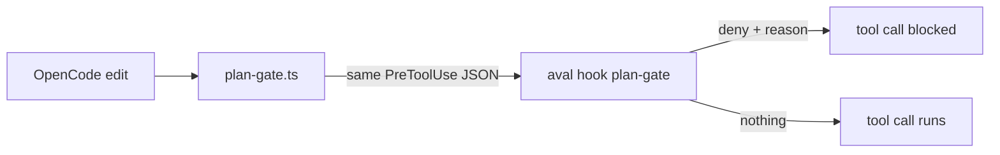

<div align="center">

<picture>
  <source media="(prefers-color-scheme: dark)" srcset="../assets/wordmark-dark.3ba4fd49.svg">
  
</picture>

# v0.3.0-rc.1

**The plan gate guards OpenCode too.**

2026-11-23 &nbsp;·&nbsp; prerelease &nbsp;·&nbsp; **English** &nbsp;·&nbsp; [Español](v0.3.0.es.md)

</div>

> [!NOTE]
> This is a release candidate of v0.3.0, the native harness core. It ships to npm under the `next` tag and is marked as a prerelease on GitHub. The OpenCode plugin is tested against its own probe, not yet inside a long OpenCode session; that is the feedback this candidate is for.

## What this release means for you

aval's rule is that nobody runs a plan they have not seen: while the active plan in `odd/tasks/` has no deck, code edits are denied. Until now only Claude Code enforced it. OpenCode now enforces the same rule, through the same binary, so a plan written in one agent and executed in the other is gated the same way, and one `aval deck build --plan` opens both.

## Highlights

| **One rule, two agents** | **No logic duplicated** | **Fails open** |
| :-- | :-- | :-- |
| OpenCode's edits, writes and patches pass through the plan gate. | The plugin hands the payload to `aval hook plan-gate`; the decision and its reason come from Go. | No binary, a timeout or odd output means the edit goes ahead. |

## The plan gate in OpenCode

| OpenCode tool call while the plan has no deck | Result |
| :-- | :-- |
| `edit`, `write` or `patch` of a source file | denied, with the same reason Claude Code shows |
| an edit under `odd/` or of a `*.deck.json` | allowed |
| `bash`, `read` and every other tool | not gated |
| `AVAL_PLAN_DECK_OFF=1` | allowed, deliberately |
| no `aval` binary, a 2 s timeout or invalid output | allowed |



The plugin is installed with the rest of `config/opencode/plugin` by `aval install`; nothing to configure. Measured on an Apple Silicon Mac, a gated call adds about 10 to 13 ms once the binary is warm.

## Upgrade notes

> [!IMPORTANT]
> After `aval install` or `aval sync`, OpenCode denies edits while the active plan has no deck, as Claude Code already did. Build the deck (`aval deck build <spec> -o <pdf> --plan <plan>`) or set `AVAL_PLAN_DECK_OFF=1` to bypass deliberately.

## Known limits

- A `patch` call that carries only a patch text and no file path is not gated, as in the design gate.
- The timeout and invalid-output paths fail open by design; they are reviewed in code, not tested.

## Verify this release

```sh
gh release download v0.3.0-rc.1 -R alvaroofernaandez/aval
shasum -a 256 -c SHA256SUMS --ignore-missing
gh attestation verify aval_0.3.0-rc.1_<os>_<arch>.tar.gz --repo alvaroofernaandez/aval
npx @alvaroofernaandez/aval@next version
```
