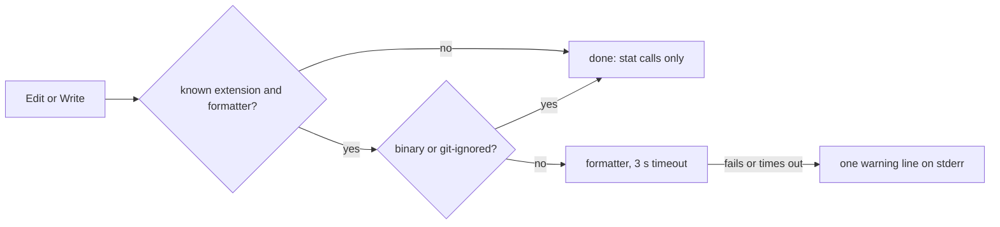
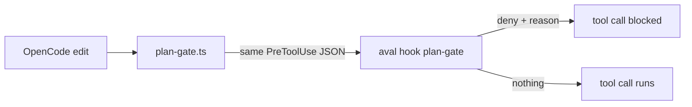

<div align="center">

<picture>
  <source media="(prefers-color-scheme: dark)" srcset="../assets/wordmark-dark.3ba4fd49.svg">
  
</picture>

# v0.3.0-rc.5

**Edits come back formatted, every outside tool is in one table, the plan gate covers OpenCode, decks render offline.**

2026-11-23 &nbsp;·&nbsp; prerelease &nbsp;·&nbsp; **English** &nbsp;·&nbsp; [Español](v0.3.0.es.md)

</div>

> [!NOTE]
> This is a release candidate of v0.3.0, the native harness core. It ships to npm under the `next` tag and is marked as a prerelease on GitHub. The OpenCode plugin is tested against its own probe, not yet inside a long OpenCode session, and the embedded deck fonts were compared by eye on one machine; that is the feedback this candidate is for.

## What this release means for you

When an agent edits a file, aval now formats that one file with the formatter the project already uses (gofmt, Biome, Prettier or Ruff), right after the edit and before the agent reads it again. Nothing to configure, and an edit nobody formats costs a few microseconds.

aval leans on tools it does not ship: git, gh, rtk, code-review-graph, Engram, a browser, tmux and more. Until now nothing said which ones it needed, what broke without each, or which aval release plans to replace it. `aval deps` now prints that inventory, and `aval doctor` checks it: a missing `git` fails the doctor, any other missing tool is a warning that names the feature that turns off.

aval's rule is that nobody runs a plan they have not seen: while the active plan in `odd/tasks/` has no deck, code edits are denied. Until now only Claude Code enforced it. OpenCode now enforces the same rule, through the same binary, so a plan written in one agent and executed in the other is gated the same way, and one `aval deck build --plan` opens both. The decks themselves no longer need the network: the brand fonts travel inside the binary, so a deck built on a plane looks the same as one built at a desk.

## Highlights

| **One rule, two agents** | **No logic duplicated** | **Fails open** |
| :-- | :-- | :-- |
| OpenCode's edits, writes and patches pass through the plan gate. | The plugin hands the payload to `aval hook plan-gate`; the decision and its reason come from Go. | No binary, a timeout or odd output means the edit goes ahead. |
| **Formatted after every edit** | **Only the project's formatter** | **Never in the way** |
| `aval hook fmt` runs after Edit and Write on the one file that changed. | gofmt, or Biome or Prettier from `node_modules/.bin`, or Ruff with a project file. | A failure or a 3 s timeout is one warning line; the edit always stands. |
| **One inventory** | **Doctor knows it** | **A roadmap per tool** |
| `aval deps`: 36 tools by layer, who uses each, what happens without it. | A `deps` row in `aval doctor` and the hub; only `git` blocks. | Each tool names the issue that plans to absorb it, or `none`. |
| **Decks offline** | **Unmodified fonts** | **Faster builds** |
| The rendered HTML holds no `http://` or `https://` URL. | Space Grotesk and IBM Plex Sans, byte for byte from `google/fonts`, licences in every archive. | A 16-slide deck built in about 2.8 s instead of 3.7 s: no font download. |

## Formatting after every edit

| File edited | Formatter | When |
| :-- | :-- | :-- |
| `.go` | `gofmt -w` | `gofmt` on `PATH` |
| `.ts`, `.tsx`, `.js`, `.jsx`, `.json`, `.css` | `biome format --write` | `biome.json` and `node_modules/.bin/biome` |
| same | `prettier --write` | no Biome; a `.prettierrc*` or `prettier.config.*` and `node_modules/.bin/prettier` |
| `.py` | `ruff format` | `ruff` on `PATH` and a `pyproject.toml` or `ruff.toml` |
| anything else, a binary file, a file git ignores, a file outside a repository | none | starts no process |



Measured with Go benchmarks on an Apple Silicon Mac under load: about 4 µs for an edit nobody formats (target under 5 ms) and about 15 ms for a gofmt run (target p95 under 150 ms). Prettier starts Node and may take longer; that was not measured. Claude Code notices the rewrite: in a headless check, the agent's next Edit on the same file went through without re-reading it.

The hook is the first to start a process under a new rule, [ADR 0007](../adr/0007-hooks-may-start-a-resolved-tool.md): a hook may start a tool it has already found, under a timeout, never on its no-op path. Reading config and the network stay forbidden for every hook.

## The plan gate in OpenCode

| OpenCode tool call while the plan has no deck | Result |
| :-- | :-- |
| `edit`, `write` or `patch` of a source file | denied, with the same reason Claude Code shows |
| an edit under `odd/` or of a `*.deck.json` | allowed |
| `bash`, `read` and every other tool | not gated |
| `AVAL_PLAN_DECK_OFF=1` | allowed, deliberately |
| no `aval` binary, a 2 s timeout or invalid output | allowed |



The plugin is installed with the rest of `config/opencode/plugin` by `aval install`; nothing to configure. Measured on an Apple Silicon Mac, a gated call adds about 10 to 13 ms once the binary is warm.

## The dependency inventory

```sh
aval deps                       # the table: status, tool, layer, if missing, substitute, used by
aval deps --layer harness       # harness, agent or env
aval deps --json                # for scripts; exits 1 when a blocking tool is missing
```

| Layer | What it covers | Examples |
| :-- | :-- | :-- |
| `harness` | aval itself, its commands and its hooks | git, go, gh, gitleaks, rtk, code-review-graph, a Chromium browser |
| `agent` | the agent runtimes and what their skills call | claude, opencode, engram, node, docker |
| `env` | the shell and terminal environment `aval install` links | zsh and its plugins, tmux, yazi, Ghostty, fzf, ripgrep |

The inventory is `internal/core/deps/deps.manifest`, embedded in the binary: `aval deps` needs no repository and no network. It runs a short version command only for git, go, gh, node, docker, tmux and zsh, each bounded by 200 ms; the doctor and the hub only look tools up and start no process. macOS apps are checked by path on macOS and reported as skipped elsewhere. Brewfile lines that only the person uses (personal apps) sit in an explicit `[personal]` list, and a test fails when a Brewfile line is neither an entry nor personal. Measured cold on this machine: 0.53 s for the first run, about 0.1 s after.

## Decks need no network

| | Before | Now |
| :-- | :-- | :-- |
| Font source | a `<link>` to fonts.googleapis.com | two `@font-face` rules inlined from the binary |
| Offline | system fonts (Avenir Next, Segoe UI, Helvetica) | the brand fonts |
| Binary size (`-trimpath -s -w`, darwin/arm64) | 12,929,378 bytes | 13,623,298 bytes (+694 KB) |
| 16-slide `aval deck build` | about 3.7 s | about 2.8 s |

The fonts are the variable files `google/fonts` ships today (Space Grotesk 2.000, IBM Plex Sans 3.201), embedded unmodified: no subsetting or conversion, because IBM Plex reserves its name for unmodified files. Their sources, versions and SHA-256 sums are in `internal/deck/assets/fonts/SOURCES.md`, and both SIL Open Font License texts ship in every release archive. Measured on one Apple Silicon Mac under load.

## Upgrade notes

> [!IMPORTANT]
> After `aval sync`, Claude Code runs `aval hook fmt` after every Edit and Write, and the gentle-ai hooks (a review hook on SessionStart and Stop, telemetry on Stop and SubagentStop) are gone from `~/.claude/settings.json`, with no hook in their place: code review is the `aval review assess` command. The Brewfile no longer installs gentle-ai; the tap stays.
>
> `aval doctor` has a new `deps` row and exits 1 when `git` is missing; every other missing tool is a warning.
>
> After `aval install` or `aval sync`, OpenCode denies edits while the active plan has no deck, as Claude Code already did. Build the deck (`aval deck build <spec> -o <pdf> --plan <plan>`) or set `AVAL_PLAN_DECK_OFF=1` to bypass deliberately.

## Fixes

- **release:** an older release published late never moves the npm `latest` or `next` tag. When rc.1 was approved after rc.4, `next` went back to rc.1; a release now moves its tag only when it is the newest of its kind.

## Known limits

- The `native_substitute` of each tool is a proposal for the owner to review in this candidate; no tool reports "outdated".

- The deck fonts were compared with the previous online rendering by eye, on two slides; CI cannot cut the network, so a test that the HTML has no external URL stands in.

- A `patch` call that carries only a patch text and no file path is not gated, as in the design gate.
- The timeout and invalid-output paths fail open by design; they are reviewed in code, not tested.

## For contributors

- Release candidates, patches and, from 1.0 on, minors publish without the owner's approval; only the first stable release of a breaking line (`v0.3.0`, `v1.0.0`, `v2.0.0`) waits for it (`docs/releasing.md`).

- The gentle-ai markers are gone from the instruction files, which keep their text; `skills/_shared/review-ledger-contract*.md` are deleted; `tests/no_gentle_ai_test.go` keeps the name out of `config/`, `internal/`, `cmd/`, `skills/_shared/`, the Brewfile, the README and `.agents/DESIGN.md`, and a test allows hooks to run only `aval`, `code-review-graph` and `rm` (#4).
- `AGENTS.md` carries a dated amendment to the hook rule, pointing to ADR 0007 (#25).

## Verify this release

```sh
gh release download v0.3.0-rc.5 -R alvaroofernaandez/aval
shasum -a 256 -c SHA256SUMS --ignore-missing
gh attestation verify aval_0.3.0-rc.5_<os>_<arch>.tar.gz --repo alvaroofernaandez/aval
npx @alvaroofernaandez/aval@next version
```
